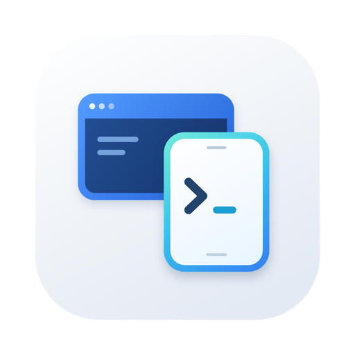
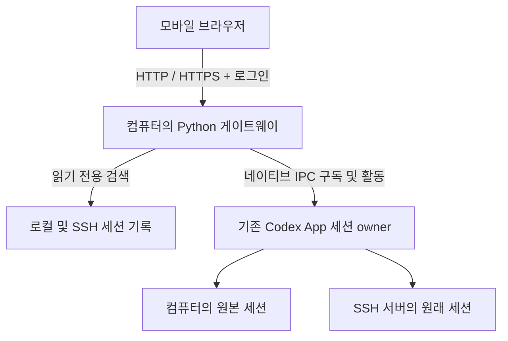

<p align="center">

  
</p>

<p align="center">
  <a href="https://github.com/try2love/codex-mobile-bridge/stargazers"></a>
  <a href="https://github.com/try2love/codex-mobile-bridge/releases/latest"></a>
  <a href="https://github.com/try2love/codex-mobile-bridge/issues"></a>
</p>

<p align="center">
  <a href="https://github.com/try2love/codex-mobile-bridge/releases"></a>
  <a href="https://github.com/try2love/codex-mobile-bridge/releases"></a>
  <a href="https://github.com/try2love/codex-mobile-bridge/releases"></a>
  <a href="https://github.com/try2love/codex-mobile-bridge/releases"></a>
  <a href="https://github.com/try2love/codex-mobile-bridge/releases"></a>
</p>

<p align="center"><sub>다운로드 수는 공개된 정식·미리보기 릴리스의 설치 파일을 플랫폼별로 집계한 값입니다. iOS는 소스 패키지와 IPA를 포함하고 업데이트 메타데이터·체크섬 파일은 제외합니다. 반복 다운로드와 업데이터의 다운로드도 포함하므로 사용자 수나 설치 수를 뜻하지 않습니다. 매일 갱신합니다.</sub></p>

# Codex Mobile Bridge · 다중 클라이언트 원격 워크벤치

> 이 저장소는 [Codex Mobile Bridge](https://github.com/try2love/codex-mobile-bridge)의 **한국어 포크**입니다. 원문의 구성·기능 설명·기여자·라이선스를 유지하면서 UI, 문서, 주석을 한국어로 옮기고 의존성 보안 업데이트를 관리합니다. **이 포크의 설치 파일은 아직 배포하지 않았습니다.** 아래 업스트림 다운로드에는 이 포크의 한국어화와 수정이 포함되지 않습니다.
>
> 업데이트 조회 대상은 `sekai0716/codex-mobile-bridge-kr`입니다. 별도 서명 릴리스가 준비될 때까지 데스크톱 내장 업데이터는 비활성화되어 있습니다. 원본 스크린샷·영상에 포함된 중국어는 그대로이며, 이 포크의 실기기 설치·연결 검증과 구분해 읽어 주세요.

> **v2.2.1:** [업스트림 정식 버전](https://github.com/try2love/codex-mobile-bridge/releases/tag/v2.2.1) · [릴리스 노트](RELEASE_NOTES.md). 최신 Codex App의 네이티브 연결을 사용하려면 업데이트를 권장합니다. Antigravity와 채팅 내 대화형 차트를 추가하고 긴 대화·모델 캐시를 개선했습니다.

**Android 설치 안내:** 새 **Bridge**는 v2.2.0 앱과 별도로 설치되므로 기존 앱에 덮어쓸 수 없습니다. 먼저 새 앱을 설치하고 컴퓨터를 다시 추가해 연결을 확인하세요. 이전 앱에서 필요한 초안을 보관한 뒤 제거해야 하며 연결 정보와 초안은 자동으로 이전되지 않습니다. 별도 앱인 v2.2.1-preview.1 **Bridge Preview** 사용자는 연결·초안을 유지하며 덮어쓰기 업데이트할 수 있습니다.

> **v2.2.0 정식 버전:** [릴리스 페이지](https://github.com/try2love/codex-mobile-bridge/releases/tag/v2.2.0) · [전체 릴리스 노트](RELEASE_NOTES.md) · [모바일 설치 안내](mobile/README.md). ZCode, 컴퓨터별 다중 연결 경로, 네이티브 보조 채팅을 추가하고 유휴 상태의 자원 사용량을 줄였습니다.

[한국어](README.md) · [English](README_EN.md)

**[업스트림 소개 및 사용 시연 ↗](https://try2love.github.io/codex-mobile-bridge/?lang=zh)** · **[업스트림 데스크톱·모바일 앱 다운로드](https://github.com/try2love/codex-mobile-bridge/releases/tag/v2.2.0)**

[](https://try2love.github.io/codex-mobile-bridge/?lang=zh)

모바일 앱이나 브라우저에서 컴퓨터의 **Codex, Claude Code / Cowork, DeepSeek Harness, ZCode** 대화를 이어갑니다. 네 클라이언트는 각자의 채팅 목록, 계정, 작업 공간을 유지합니다. 선택한 클라이언트에서 채팅을 만들고, 응답을 읽고, 파일을 첨부하고, 지원되는 모델·추론 강도를 선택하고, 권한 요청에 응답할 수 있습니다.

작업은 원래 컴퓨터에서, Codex의 SSH 작업은 원래 원격 호스트에서 계속 실행됩니다. Bridge는 기존 데스크톱 세션과 인증·실행 환경을 재사용하므로 휴대폰에서 별도의 에이전트를 실행하지 않습니다. 휴대폰에 같은 모델 서비스의 계정으로 로그인할 필요 없이 게이트웨이 로그인이나 철회 가능한 QR 페어링으로 연결합니다.

## v2.2.0 업데이트

- **ZCode 워크벤치 연결:** 기존 네이티브 채팅을 이어가고 파일 첨부, 질문·승인 응답, 모델·Skill 선택, API·사용 한도 관리를 지원합니다. macOS·Windows·Linux 정식 패키지의 로컬 연결과 이미 구성된 공식 원격 연결을 사용할 수 있습니다.
- **한 컴퓨터의 여러 연결 경로:** LAN·고정 HTTPS·임시 HTTPS 주소를 한 컴퓨터 카드로 묶습니다. 지연 시간을 확인하고 경로를 직접 선택하거나 자동 전환하면서 채팅·초안·읽던 위치를 유지합니다.
- **네이티브 대화 관리:** Codex 보조 채팅을 부모 대화의 하위 탭으로 엽니다. 탭을 닫아도 원래 채팅은 유지됩니다. 지원되는 로컬 대화는 범위를 명시적으로 확인하고 진행 중인 작업을 검사한 뒤 영구 삭제할 수 있습니다.
- **모델과 독립 클라이언트:** 새 채팅을 만들기 전에 모델·추론 강도를 선택합니다. 독립 Codex 설정과 VS Code 환경을 등록할 수 있으며 독립 Claude·DSH 설정은 실험적으로 지원합니다. 작업이 끝나면 게이트웨이가 소유한 CLI 연결을 해제할 수 있습니다.
- **모바일 조작:** 지원되는 Codex 질문을 하나씩 건너뛰어도 다른 답변은 유지합니다. Android에서 서로 다른 이벤트의 알림을 따로 보관하고 컴퓨터별 UU Remote 기능을 설정할 수 있습니다.
- **복구와 자원 사용:** Tailscale 연결 복구, 클라이언트 초기화, 외부 모델의 추론 표시, Unicode 모델 ID 지원을 개선했습니다. 유휴 폴링을 줄이고 긴 내용을 읽던 위치를 유지합니다.

게이트웨이와 모바일 앱을 함께 업데이트하고 기존 앱 식별자·서명·데이터 디렉터리를 유지하세요. iOS는 직접 서명해야 합니다. 네이티브 작업의 지원 여부는 클라이언트 버전과 연결 기능에 따라 달라지며 독립 설정·WSL 계정 관리는 실험적입니다. [전체 릴리스 노트와 지원 범위](RELEASE_NOTES.md)를 참고하세요.

기여해 주신 [@tiancai123123](https://github.com/tiancai123123)([#130](https://github.com/try2love/codex-mobile-bridge/pull/130)), [@laozuzhen](https://github.com/laozuzhen)([#135](https://github.com/try2love/codex-mobile-bridge/pull/135)), [@qybgh](https://github.com/qybgh)([#139](https://github.com/try2love/codex-mobile-bridge/pull/139))에게 감사드립니다.

## v2.1.7 업데이트

- Android 선택적 백그라운드 작업 알림, 연결에 따라 알림 소스를 선택합니다. Android/iOS 통합 테마, iOS 전경 알림 개선([#47](https://github.com/try2love/codex-mobile-bridge/issues/47)、PR [#85](https://github.com/try2love/codex-mobile-bridge/pull/85)/[#95](https://github.com/try2love/codex-mobile-bridge/pull/95)）。
- 대화 메뉴 및 분류를 통합하고, 프로젝트 파일 참조, 기록 사진 미리보기, 코드 강조 표시 및 원격 프로젝트 신뢰 확인(PR)을 추가합니다. [#92](https://github.com/try2love/codex-mobile-bridge/pull/92)、Issue [#99](https://github.com/try2love/codex-mobile-bridge/issues/99)–[#102](https://github.com/try2love/codex-mobile-bridge/issues/102)、[#104](https://github.com/try2love/codex-mobile-bridge/issues/104)）。
- Safari 시작, SSH 오프라인 격리 및 모델 디렉터리, 데스크톱 연결 재구성 및 전송 영수증 복구를 개선합니다. 선택적 타사 재설정 역학을 추가하고 수식 렌더링을 수정합니다.

데스크톱 및 모바일 앱은 **2.1.7** ,Android/iOS 빌드 번호 **40** . iOS는 이번에 프런트 엔드 알림을 개선하고 APNs 백그라운드 푸시를 추가하지 않습니다. WSL 계정 관리는 계속해서 실험적인 기능입니다. 전체 기능, 기여 및 여전히 제한된 범위를 참조하세요. [이중 언어 릴리스 노트](RELEASE_NOTES.md#v217)。

## v2.1.6 업데이트

- **대화 마무리** : 목록을 마우스 오른쪽 버튼으로 클릭하고 휴대폰을 길게 누르면 채팅 제목이 대화 메뉴를 공유합니다. 이름 옆의 연필은 Codex 채팅 이름을 변경하고 세부 정보는 대화 ID 및 작업 디렉터리 복사본을 제공합니다. 핀은 먼저 로컬로 적용된 다음 게이트웨이가 동기화됩니다. 지원되는 대화는 두 번째 확인을 통해 중지되고 보관됩니다. 전송 관리 및 채팅 분기는 각 클라이언트의 기능을 상속합니다. Codex 대화는 기존 네이티브 프로젝트, 파티션으로 이동하거나 밖으로 이동할 수 있습니다. 쓴 후 확인을 위해 다시 읽어보면 작업 디렉터리와 실행 설정은 변경되지 않은 상태로 유지됩니다.
- **복사하여 읽기** : 휴대폰에서 네이티브 클립보드 쓰기 문제를 수정하고, DSH 세션 ID 복사, 마크다운 읽기 및 소스 코드 전환, 독립적인 파일 글꼴 크기를 지원합니다.
- **액세스 및 목록** : API 양식 및 업스트림 모델 획득을 최적화하고, 데스크톱 계정 및 특정 할당량 표시를 유지하고, 수정 목록 업데이트 및 크로스 플랫폼 프로젝트 그룹화를 수행합니다.

데스크톱 및 모바일 앱은 **2.1.6** ,Android/iOS 빌드 번호 **39** . 일부 Codex 앱에 보유된 대화는 여전히 Bridge에서 해제될 수 없습니다. Claude 및 DSH 아카이브에는 호환 가능한 네이티브 지원이 필요하며 Cowork는 아직 지원되지 않습니다. 세부정보 보기[전체 업데이트 지침 및 보관 제한 사항](RELEASE_NOTES.md#v216)，[#77](https://github.com/try2love/codex-mobile-bridge/issues/77) 계속 따라가세요. 고마워하는 [@lanchengjiu](https://github.com/lanchengjiu) PR #73 및 [@mc373906408](https://github.com/mc373906408) PR #82, 원저자가 제출했으며 그대로 유지됩니다.

## v2.1.5 업데이트

- **WSL CLI** : 계정, 기록, 작업 디렉터리, 초안 및 네이티브 제어 기능을 유지하면서 원래 환경에서 Codex / Claude Code에 액세스합니다. 요청 시 검색하고 명시적으로 복원하며 검색 기록으로 인해 중지된 릴리스를 시작하지 마세요.[WSL 액세스](docs/wsl-codex.md)
- **클라이언트 전반에 걸쳐 새 프로젝트 만들기** : 실행 환경 및 디렉터리 선택을 통합하고, 기존 프로젝트, 기타 디렉터리를 선택하거나 새 폴더를 생성합니다. Claude는 ”만들기 및 보내기”를 명시적으로 사용합니다.[프로젝트 채팅](docs/project-chats.md)
- **답장 읽기 및 조작** : 코드 검토 카드, 후속 작업 버튼, Codex / Claude 메시지 및 선택한 참조, 첨부 파일에 추가된 그림, 파일 참조 및 페이지가 매겨진 수정 요약 위치 링크. 후속 작업을 위해서는 초안을 먼저 입력하십시오. 데스크톱 검토 링크는 원래 대상을 유지합니다.[작동 지침](docs/output-interactions.md)
- **메시지 관리** : 보내지 않은 메시지 철회, 현장 편집, 실제 대기열 순서 조정, 확인되지 않은 기록 확인 또는 무시 명확한 전송 거부 및 여러 페이지의 간섭 후 잔여물을 복구하십시오.[메시지 관리](docs/message-management.md)
- **탐색 및 성능** : 브라우저 반환(#67) 및 Windows / UNC 프로젝트 그룹화를 수정했습니다. 선택적 파일 및 차트 리소스는 요청 시 로드되어 캐시, 취약한 네트워크 복구, 네이티브 출력 및 휴대폰 연결 수명 주기를 개선합니다.
- **WSL 계정은 실험적으로 관리됩니다.** : 지원되는 API 구성은 환경에 따라 가져오고 전환 및 복원되며 외부 도구 및 작업 보호는 유지됩니다. 모든 구성이 사용 가능하다고 보장되지 않으며 실제 다중 계정의 전체 프로세스 검증이 아직 완료되지 않았습니다.[실험 노트](docs/wsl-accounts.md)

데스크톱 및 모바일 앱은 **2.1.5** ,Android/iOS 빌드 번호 **38** . 고마워하는 [@we-worker](https://github.com/we-worker) \~의 [PR #64](https://github.com/try2love/codex-mobile-bridge/pull/64)(원본 커밋 8개 유지) [@lanchengjiu](https://github.com/lanchengjiu) \~의 [PR #70](https://github.com/try2love/codex-mobile-bridge/pull/70)(원본 제출 `d62002b` 예약하다).[전체 설명 및 업그레이드 경계](RELEASE_NOTES.md#v215)

## v2.1.4 업데이트

- **공용 네트워크 시작 및 캐싱** : Cloudflare 고정 항목, 첫 번째 리소스 로딩 및 단기 네트워크 오류 복구를 개선합니다. 변경되지 않은 리소스를 반복적으로 열고 재사용합니다.
- **긴대화** : 너무 큰 스냅샷으로 인해 연결이 끊어지는 문제를 해결했습니다. 캐시와 최근 콘텐츠를 먼저 표시한 다음 위로 스크롤할 때 이전 레코드를 읽고 읽기 위치, 초안 및 원본 대화 제어 연결을 유지합니다.
- **웹 원클릭 복사** : 회신, 코드 및 Mermaid 소스 코드는 LAN HTTP와 호환되는 한 번의 클릭으로 복사할 수 있습니다. 브라우저가 거부하는 경우에도 재시도 및 수동 복사가 계속 제공됩니다.
- **선택적 네트워크 복구** : 기본적으로 꺼져 있으며 게이트웨이 또는 휴대폰/웹에서 활성화할 수 있습니다. 동일한 IP 갱신이나 일시적인 네트워크 연결 끊김으로 인한 불필요한 터널 재구성을 방지하려면 네트워크 주소가 변경된 후 사용 가능한 항목을 업데이트하세요.

데스크톱 및 모바일 앱 버전은 다음과 같습니다. **2.1.4** ,Android/iOS 빌드 번호 **37** . 고마워하는 [@qybgh](https://github.com/qybgh) \~의 [PR #63](https://github.com/try2love/codex-mobile-bridge/pull/63) 네트워크 적응 기여, 원본 제출은 그대로 유지됩니다.

<a id="mermaid-preview"></a>

## v2.1.3 업데이트

- **여러 대상 알림** : 여러 개의 독립적인 Webhooks를 추가하여 각각 시작, 중지, 테스트 및 편집할 수 있습니다. 범용 사용자 정의, Feishu, DingTalk, Discord, Telegram 편집 가능한 JSON 템플릿을 제공합니다. Feishu 및 DingTalk는 선택적 서명을 지원합니다. 저장된 주소와 키는 기본적으로 숨겨지며, 저장된 구성만 테스트에 사용됩니다.[구성 지침](docs/webhook-notifications.md)
- **차트 읽기** : Markdown 파일의 Mermaid 코드 블록과 채팅하여 소스 코드를 미리 보거나 복사하고 전체 화면으로 확대할 수 있습니다. iOS는 차트 하위 페이지 탐색 복구를 동기화합니다. 지원하는 앱을 업데이트해야 합니다.
- **약한 네트워크 및 액세스** : 반복적으로 열 때 전송을 줄이기 위해 정적 리소스를 콘텐츠별로 캐시합니다. Windows 패키지는 지원되는 Electron 언어 리소스만 유지합니다. DeepSeek Harness 줄 바꿈 구성 인식을 수정하고, iOS 게이트웨이에 연결할 수 없는 경우 네이티브 재시도 및 반환 항목을 제공합니다.
- **휴대폰 상호작용** : 팝업창이 더 이상 네이티브 ”더 보기” 입구에 의해 차단되지 않고, 포커스 모양이 최적화되고, 보충 답변 입력 상자의 키보드 가시성이 최적화됩니다.

데스크톱 및 모바일 앱 버전이 통합되었습니다. **2.1.3** ,Android/iOS 빌드 번호 **35** . 기여자와 함께 전체 설명 보기 [v2.1.3 업데이트 지침](RELEASE_NOTES.md#v213)。

## v2.1.2 업데이트

- **터미널 직접 입력** : 휴대폰 및 와이드스크린 웹에서는 기본적으로 직접 입력을 사용하고 중국어 입력, 커서 및 포커스 복구를 개선하고 Enter를 추가합니다. 선택적인 ”쓰기 모드 후 보내기”와 단계적 탭 경로 완성을 유지합니다.
- **상호작용과 연결** : OpenCode 터미널 CLI의 터치 스크롤링, 마우스 선택 및 종료 레이아웃을 개선합니다. 네트워크 왕복으로 인한 추가 대기 시간을 줄이고 일시적인 연결 해제 후에도 여전히 유효한 터미널을 자동으로 복원합니다.
- **디스플레이 및 호환성** : 터미널 글꼴 크기는 6\~24px로 독립적으로 조정되며 작은 글꼴 크기, 중국어 혼합 레이아웃 및 배경 테두리가 고정됩니다. Windows는 ConPTY 구성 요소를 완벽하게 전달하여 마우스 이벤트 손실과 설치 프로그램의 구성 요소 누락을 수정합니다.
- **읽기 설정** : 테마와 언어가 설정 상단으로 이동되고, 텍스트 크기가 10\~32px로, 코드 글꼴 크기가 8\~28px로 확장됩니다.

### v2.1.1 업데이트

- **모델이 있는 계정** : 세 클라이언트는 계정 카드와 모델 선택을 통합합니다. 모델 디렉터리 캐시가 우선 순위가 지정되고 컴퓨터, 계정 및 액세스로 격리되며 업데이트 시간이 표시되고 수동 및 12시간 업데이트가 지원됩니다.
- **초안 및 문서** : 채팅과 컴퓨터 전반에 걸쳐 전송되지 않은 초안을 보존합니다. 부드러운 스크롤과 강조 표시로 파일을 찾고 왼쪽 상단에 있는 채팅 목록으로 직접 돌아갈 수 있습니다. 지원 도구 스크린샷 미리보기.
- **일일 경험** : 빠른 슬라이딩 바운스, 목록 및 모델의 반복 로드 수정, iOS 알림 점프 최적화; 게이트웨이 및 휴대폰은 현재 업데이트를 건너뛸 수 있으며 비밀번호 변경 시 유효한 휴대폰 바인딩을 유지하도록 선택할 수 있습니다.

### v2.1.0 업데이트

- **CLI 및 파일 읽기** : 모바일 또는 웹에서 Codex / Claude Code CLI 대화를 읽고 명시적으로 복구합니다. 소스 코드, PDF 및 자체 포함 HTML에 대한 전용 읽기 미리보기.
- **연결 및 목록** : 기존 HTTPS 침투 또는 역방향 프록시에 액세스합니다. Codex 목록은 호스트별로 표시되고 Claude 혼합 목록은 날짜별로 정렬되며 소스 태그는 계속 표시됩니다.
- **크로스 플랫폼 경험** : Windows 연속 터미널 및 Claude 초기화, DSH 호스트 식별, iOS Safari 입력의 뷰포트 및 슬라이딩 레이아웃을 개선합니다. 게이트웨이는 모든 클라이언트가 비활성화된 후에도 계속 관리할 수 있습니다.

### v2.0.3 업데이트

- **Android 업데이트** : 앱 내에서 새 버전을 다운로드하여 설치하고 휴대폰이나 컴퓨터를 통해 다운로드하도록 선택합니다. 다운로드가 완료된 후 계속해서 APK를 설치하거나 내보낼 수 있습니다. 세부정보 보기[휴대폰 설치 및 업그레이드](mobile/README.md#설치-및-업그레이드)。
- **제3자 통지** : 모바일 및 웹 Bark(iPhone), ntfy(Android) 또는 PushPlus(WeChat)를 선택하고 컴퓨터 게이트웨이를 사용하여 설정을 구성, 저장 및 테스트하고 공유할 수 있습니다.
- **검색 및 레이아웃** : 검색창은 ”검색/검색”을 유지하며 필터링 폭은 내용에 따라 할당됩니다. 영어, 가로 화면 및 태블릿 목록이 개선되고 Claude/DSH 풀다운 새로 고침이 지원되며 복구 후 이전 오류 프롬프트가 지워집니다.
- **워크벤치로 연결** : 휴대폰 보안은 유효한 바인딩을 유지하고 로그인 복원을 시도하며 Claude 재연결 및 초기화를 개선합니다. 설정 항목 및 파일 전송 저장 복사본이 더 명확해졌으며, 도구 탭을 닫을 때 스틸 콘텐츠가 포함된 분할 화면이 유지됩니다.

<a id="workspace-reading"></a>

## 파일 읽기 및 미리보기

- **포지셔닝 및 복귀** : 채팅 파일 링크가 원활하게 대상을 찾아 3초 동안 강조 표시합니다. 왼쪽 상단의 Return은 채팅 목록으로 바로 돌아갑니다. 파일 영역의 상위 디렉토리 버튼과 시스템 복귀는 여전히 계층적 탐색을 지원합니다. 전체 화면 시스템으로 돌아가려면 먼저 전체 화면을 종료하세요.
- **소스코드 읽기** : 일반 코드는 구문 강조 표시 및 줄 번호를 표시합니다. 긴 줄을 화면에 맞추려면 ”Wrap Word”를 클릭하거나 ”원래 줄 너비”로 다시 전환하세요. 줄 번호 없이 원본 텍스트를 유지하려면 코드를 복사하세요. 이는 읽기 전용 미리보기이며 파일은 수정되지 않습니다. 알 수 없는 언어와 더 큰 텍스트에는 일반 텍스트를 사용하세요.
- **PDF 읽기** : 휴대폰에서는 두 손가락으로 스와이프하여 스크롤하고 확대/축소할 수 있지만 컴퓨터 브라우저에서는 페이지 넘기기 및 확대/축소 버튼이 그대로 유지됩니다. 텍스트 레이어가 있는 경우 텍스트를 선택할 수 있습니다. 스캔한 문서에는 OCR이 제공되지 않습니다. 다양한 크기의 페이지가 각각 너비에 맞게 조정됩니다. 빠르게 확대/축소할 경우 원본 사진을 유지한 후 새 사진으로 교체하면 깜박임을 줄일 수 있습니다.
- **HTML 읽기** : 미리보기/소스 간을 전환합니다. 자체 포함된 HTML 작업의 인라인 상호 작용 및 애니메이션 외부 리소스, CDN, 백엔드 요청, 팝업 및 양식 제출은 지원되지 않습니다. 미리보기는 게이트웨이 로그인 정보, 상위 페이지 및 모바일 네이티브 인터페이스와 격리되어 있습니다.
- **인어 차트** : 마크다운 파일과 채팅은 동일한 차트, 소스 코드 및 전체 화면 읽기 입구를 사용합니다.[차트 읽기 지침](#mermaid-preview)。
- **컴팩트한 조작과 전체 화면** : 다운로드, 복사 또는 미리보기 작업은 파일 설명 오른쪽에 있습니다. 다운로드 옆에서 전체 화면으로 확장할 수 있습니다. 전체 화면으로 들어가고 나가면 PDF 위치와 HTML 상태가 유지됩니다. 파일 태그를 전환한 후 PDF로 돌아가면 위치가 유지되고 HTML이 다시 로드됩니다.

PDF 온라인 읽기 최대 규모 **20 MiB** , 현재 일반 클릭 다운로드 한도를 초과하지 않습니다. 소스 코드와 HTML은 **512KiB 미만의 UTF-8 텍스트** . 제한을 초과했거나 지원되지 않는 파일은 다운로드하여 열 수 있습니다. 이 개선 사항을 완전히 사용하려면 게이트웨이 및 모바일 앱을 업데이트해야 합니다. 브라우저 사용자는 게이트웨이를 업데이트한 후 새로 고칠 수 있습니다.

## CLI 대화 (v2.1.0 공식 버전)

기존 CLI 대화는 휴대폰과 웹에서 검색하고 읽을 수 있습니다. 원본 CLI 대화에 액세스하거나 복원하려면 ”대화 계속”을 클릭하세요. 원본 터미널을 열어둘 필요가 없습니다. Codex 앱이 채팅에 연결된 경우 게이트웨이는 기존의 확인된 실행 연결을 재사용합니다. 연결을 찾을 수 없으면 명시적 작업 중에 설치된 네이티브 관리 데몬에만 액세스하거나 시작합니다. 연결 후 네이티브/SSH 네이티브 CLI 런타임과 호환되는 모델 및 추론 강도, 스킬, 일반/계획 모드, 권한 전환 및 목표 작업을 지원합니다. 설정의 ”SSH 연결 진단”은 로컬 및 원격 상태를 보고, 요약을 복사하거나 민감도가 낮은 파일을 내보낼 수 있습니다. 이전 버전의 모바일 앱을 내보내려면 먼저 업데이트해야 합니다. 세부정보 보기 [CLI 액세스 지침](docs/codex-cli.md)。

Codex 및 Claude CLI 액세스는 해당 계정 관리에서 구성됩니다. 로컬 CLI 동기화를 활성화해야 하며 데스크톱 및 CLI 확인 결과가 각각 표시됩니다. SSH는 각 서버 구성을 유지합니다. Claude는 기존 기본 또는 SSH 프로젝트에서 CLI 채팅을 생성하여 선택한 구성 및 작업 디렉터리를 유지합니다. 소스 레이블은 항상 표시됩니다. 여러 대화 유형을 필터링할 수 있습니다. Claude 알려진 컨텍스트 용량은 파란색 사용 링을 표시하고 알 수 없는 용량은 중립 링을 표시합니다.

### 플랫폼 및 액세스

데스크톱 설치 프로그램에는 macOS, Windows 및 실험적인 Linux x64/ARM64가 포함됩니다. Codex 및 Claude Code CLI는 기본 및 구성된 SSH 실행기를 지원합니다. Linux의 Claude Code CLI 및 Claude 데스크톱은 독립 채널이며 데스크톱 자동 연결은 macOS/Windows에 적합합니다. 세부정보 보기 [CLI 액세스 지침](docs/codex-cli.md)그리고 [Linux 문서](docs/linux.md)。

## v2 워크벤치

- **다중 애플리케이션 액세스** : 설치된 클라이언트를 자동으로 검색하고 구성이 준비되면 활성화합니다. 시작, 중지, 재연결은 데스크톱, 웹, 휴대폰에서 관리할 수 있습니다. Claude Code / Cowork 그룹은 접을 수 있으며, 애플리케이션 전환은 아이콘과 닫을 수 있는 좌우 슬라이딩을 지원합니다.
- **채팅 이외의 도구** : 파일, Git, 연속 터미널, Codex 네이티브 보조 채팅 및 하위 에이전트 내역이 레이블로 표시됩니다. 와이드스크린, 태블릿 및 접이식 스크린은 조정 가능한 분할 화면을 지원하며 좁은 화면은 단일 열을 유지합니다.
- **문서 및 사진** : 채팅 링크를 통해 폴더를 찾거나 다운로드할 수 있습니다. 일반 다운로드 임계값은 실시간으로 조정될 수 있으며 파일 목록은 대용량 파일/디렉터리의 명시적인 다운로드를 지원합니다. 다운로드 부동 창은 진행률, 속도, 일시 중지 및 재개를 제공합니다. 사진은 두 손가락, 스크롤 휠, 드래그 및 두 번 클릭을 지원합니다.
- **컨텍스트가 있는 계정** : 클라이언트가 업스트림에서 제공한 현재 액세스, 사용 가능한 모델 및 할당량을 봅니다. Codex 및 Claude 컨텍스트 사용법은 권한 옆에 표시됩니다. Codex는 빠른 속도, 기술, 계획/목표, 공식 한도 및 카드 재설정 능력을 유지합니다.
- **여러 컴퓨터 및 알림** ：Android/iOS QR 코드를 스캔하여 컴퓨터를 저장하고, 최근 방문순으로 정렬하고, 온라인 상태를 수동으로 새로 고칩니다. 응용 프로그램 아이콘은 게이트웨이에서 유지 관리하는 읽지 않은 판독값을 표시합니다. 클릭하면 해당 채팅 목록으로 바로 이동합니다. Android는 휴대폰 설정에서 ”백그라운드 알림”을 ​​켤 수 있으며, iOS는 백그라운드 알림을 위해 Bark, ntfy 또는 PushPlus 채널을 사용할 수 있습니다.
- **다양한 네트워크 입구** : LAN, Cloudflare 임시/고정 HTTPS, Tailscale 고정 HTTPS, 자체 서버 + SSH 및 NAS/기존 역생성.

| 고객 | 접근 범위 | 주의가 필요하다 |
| --- | --- | --- |
| Codex | 이 머신은 SSH 대화로 구성되었습니다. 네이티브대화 연산 및 워크벤치 | 설치된 버전에서 제공하는 IPC 및 기능에 따라 다름 |
| Claude Desktop | macOS / Windows, Cowork의 코드 | 일반 채팅은 지원되지 않습니다. 첫 번째 연결 또는 재초기화에는 잠금 해제, 접근성, 개발자 모드 및 디렉터리 신뢰가 필요할 수 있습니다. Linux 자동 액세스는 아직 지원되지 않습니다. |
| DeepSeek Harness | 데스크톱 대화, 로컬 액세스 플러그인, 모델 및 계정 기능 | 작업을 완료한 후 플러그인 업데이트를 다시 시작해야 할 수도 있습니다. 기능은 해당 하네스 버전에 따라 달라집니다. |
| ZCode | 네이티브 채팅, 프로젝트, 첨부 파일, 승인, 모델, API 및 할당량 | macOS / Windows / Linux 로컬 연결 또는 구성된 공식 원격 제어; 호환되는 ZCode 버전에 따라 다름 |

> OpenAI, Anthropic, DeepSeek 또는 ZCode와 공식적으로 제휴하지 않은 커뮤니티 프로젝트입니다. 클라이언트의 내부 인터페이스에 따라 업스트림 업데이트에 적응이 필요할 수 있습니다. 컴퓨터가 최대 절전 모드이거나 오프라인 상태이면 원격 작업이 불가능합니다. 콜드 부팅 중에 Claude가 잠금 해제되지 않을 것이라고 약속할 수 없습니다. 플랫폼 및 기록 측정 범위는 다음을 참조하세요. [기록 확인](VERIFICATION.md) 그리고 [데스크톱 액세스 지침](docs/deepseek-harness.md)。

macOS, Windows 및 실험적인 Ubuntu x64/ARM64를 지원합니다. Linux 설치, VMware 네트워크 및 기능 경계 참조 [Linux 문서](docs/linux.md). 개발 및 대상 수정을 먼저 읽어보십시오. [코드 아키텍처 탐색](docs/architecture/README.md) 그리고 [검증 가이드](tests/README.md)。

## Codex 메시지 편집, 분기 및 복사

- 사용자 메시지 아래에 내용을 복사할 수 있습니다. 가장 최근 메시지에 대해서는 ”편집 및 재전송”을 선택하십시오. 이전 메시지에 대해 ”새 분기 편집 및 생성”을 선택하면 원본 대화가 유지됩니다.
- 완성된 답변 아래에서 ”Branch from here”를 선택하면 새로운 대화가 이번 라운드까지의 기록을 유지하면서 지속적인 입력을 기다립니다. 소스 대화는 채팅 세부정보에 반환될 수 있습니다.
- 답글은 완전한 Markdown 복사를 지원하며 코드 블록과 Mermaid 소스 코드를 별도로 복사할 수 있습니다. 긴 답글은 자동으로 전체 텍스트를 읽습니다. 웹에서 복사를 클릭하면 클립보드에 직접 기록되고 LAN HTTP도 호환 가능한 복사를 시도합니다. 대체 텍스트와 재시도 버튼은 브라우저가 자동 복사를 거부하는 경우에만 표시됩니다.
- 내부 편집 요청 작업이 중지되었으며 답변이 다시 생성됩니다. 편집 및 분기는 기존 파일 수정을 취소하지 않습니다. 이전 및 새 대화는 작업 디렉터리를 공유합니다.
- 분기에서는 실행 시 지정된 라운드와 대상 연속 지연을 모두 지원하기 위해 Codex가 필요합니다. 이전 버전에서는 Codex 앱을 업데이트하라는 메시지가 표시됩니다. 복사 및 최근 메시지 편집은 이 분기 기능에 의해 제한되지 않습니다. 브랜치를 생성해도 모델 요청을 적극적으로 보내지 않습니다.
- 결과가 불확실하다면 먼저 채팅 목록을 확인해보세요. 동일한 요청을 반복적으로 제출하면 다시 실행되지 않습니다. 분기가 생성되었지만 연결이 실패하면 수정 사항은 해당 분기에 대한 편집 초안으로 유지됩니다.

## 다운로드 및 빠른 시작(권장)

일상적인 사용에는 데스크톱 앱을 내려받으면 됩니다. **에이전트에게 배포를 맡기거나 Python·Node.js를 설치하거나 터미널을 열 필요가 없습니다.** 아래는 **업스트림 v2.2.0 정식 버전**의 설치 안내이며 이 한국어 포크의 배포 파일은 아닙니다.

| 운영체제 | 다운로드 | 실행 방법 |
| --- | --- | --- |
| Windows x64(권장 설치 프로그램) | [Setup.exe 다운로드](https://github.com/try2love/codex-mobile-bridge/releases/download/v2.2.0/Codex-Mobile-Bridge-2.2.0-Windows-x64-Setup.exe) | 설치한 뒤 바로가기로 실행합니다. |
| Windows x64(설치 없이 사용) | [전체 ZIP 다운로드](https://github.com/try2love/codex-mobile-bridge/releases/download/v2.2.0/Codex-Mobile-Bridge-2.2.0-Windows-x64.zip) | 전체를 압축 해제한 뒤 `Codex Mobile Bridge.exe`를 실행합니다. exe만 따로 옮기지 마세요. |
| macOS Apple Silicon(M 시리즈) | [arm64 DMG 다운로드](https://github.com/try2love/codex-mobile-bridge/releases/download/v2.2.0/Codex-Mobile-Bridge-2.2.0-macOS-arm64.dmg) | DMG를 열고 앱을 응용 프로그램 폴더로 옮깁니다. |
| macOS Intel | [x64 DMG 다운로드](https://github.com/try2love/codex-mobile-bridge/releases/download/v2.2.0/Codex-Mobile-Bridge-2.2.0-macOS-x64.dmg) | DMG를 열고 앱을 응용 프로그램 폴더로 옮깁니다. |
| Ubuntu x64(실험적 지원) | [.deb 다운로드](https://github.com/try2love/codex-mobile-bridge/releases/download/v2.2.0/Codex-Mobile-Bridge-2.2.0-Linux-amd64.deb) | Ubuntu 22.04용입니다. 설치 후 일반 사용자로 실행합니다. |
| Ubuntu ARM64(실험적 지원) | [.deb 다운로드](https://github.com/try2love/codex-mobile-bridge/releases/download/v2.2.0/Codex-Mobile-Bridge-2.2.0-Linux-arm64.deb) | Ubuntu 22.04 ARM64용입니다. 32비트 ARM은 지원하지 않습니다. |

[전체 릴리스와 업데이트 내역](https://github.com/try2love/codex-mobile-bridge/releases) · [SHA256 체크섬 다운로드](https://github.com/try2love/codex-mobile-bridge/releases/download/v2.2.0/SHA256SUMS.txt). 두 Mac 아키텍처에는 내장 업데이트나 수동 교체에 쓸 ZIP도 제공됩니다. Windows ARM 전용 설치 파일은 없습니다. Mac 패키지는 로컬 무결성 서명을 사용하지만 공증되지 않아 처음 실행할 때 직접 허용해야 할 수 있습니다. Windows 패키지에는 인증서 서명이 없습니다. 아래의 macOS 최초 실행 안내를 참고하세요.

1. 사용할 데스크톱 클라이언트를 설치하고 로그인한 뒤 **Codex Mobile Bridge**를 엽니다. **클라이언트 및 연결**에서 검색 결과를 확인하고 필요한 인증을 마친 다음 사용할 클라이언트를 켭니다.
2. **네트워크 접속**에서 LAN을 사용하거나 HTTPS 연결을 추가합니다. 저장한 뒤 개요 또는 클라이언트 페이지에서 **게이트웨이 시작**을 누릅니다. 기존 설정이 있으면 저장된 포트를 사용합니다.
3. 휴대폰을 해당 주소에 접속할 수 있는 네트워크에 연결합니다. 모바일 앱의 **QR 코드를 스캔해 컴퓨터 연결** 기능으로 개요에 있는 주소의 페어링 코드를 읽습니다. 브라우저에서도 QR 코드를 스캔하거나 주소를 직접 열어 로그인할 수 있습니다.
4. 앱과 대화를 선택해 작업을 이어가거나 워크벤치를 엽니다. 사용하는 동안 컴퓨터, 게이트웨이, 해당 클라이언트를 계속 실행해 두세요.

외부 접속에는 [Tailscale 고정 HTTPS](docs/tailscale.md), 내장 Cloudflare 임시 HTTPS, [고정 Cloudflare Tunnel](docs/fixed-domain.md), [자체 서버와 SSH](docs/server-ssh.md), NAS 역방향 프록시를 선택할 수 있습니다. 필요한 조건은 [연결 안내](#connections)를 참고하세요. 고정 주소가 특정 지역에서의 직접 연결 속도를 보장하지는 않으므로 처음 설정한 뒤 실제 모바일 데이터로 접속을 확인하세요.

Android APK, 서명하지 않은 iOS IPA, Xcode 소스 패키지는 같은 [v2.2.0 릴리스](https://github.com/try2love/codex-mobile-bridge/releases/tag/v2.2.0)에 있습니다. 같은 앱 식별자·서명을 사용하는 Android 버전끼리는 덮어쓰기 설치로 데이터를 유지할 수 있습니다. iOS는 직접 서명해야 하며 App Store·TestFlight 배포판은 없습니다. 소스 실행과 사용자 지정 배포는 [에이전트 배포 실행 안내](#agent-deployment)를 참고하세요.

<a id="macos-first-launch"></a>

### 인앱 업데이트

**beta.5·beta.6은 업데이트 확인 시 HTTP 415 문제가 있어 beta.7 이상을 수동 설치해야 합니다.** 먼저 게이트웨이를 중지하고 앱을 종료한 뒤 기존 데이터 디렉터리는 유지하면서 프로그램만 교체하세요. 수정된 버전부터는 내장 업데이트를 다시 사용할 수 있습니다.

업스트림의 `v0.2.0-beta.5` 이후 데스크톱 앱은 ‘앱 업데이트’에서 새 버전과 안내를 확인한 뒤 ‘업데이트 및 다시 시작’을 선택할 수 있습니다. 다운로드·검증을 마치면 게이트웨이를 잠시 재시작하며 로그인, 네트워크, 알림, 관찰 채팅 설정은 유지합니다. 실패하면 이전 버전으로 복구를 시도합니다. 지원하지 않는 구버전은 최신 버전을 먼저 수동 설치해야 합니다. 임시 HTTPS 주소는 재시작 후 달라질 수 있으므로 새 주소를 여세요. 배포·복구 방식은 [데스크톱 업데이트 문서](docs/desktop-updates.md)를 참고하세요. **이 한국어 포크는 별도의 서명 릴리스가 준비될 때까지 데스크톱 내장 업데이터를 비활성화합니다.**

**Windows beta.7·1.0.0 사용자:** 이전 업데이터는 사용 중인 디렉터리 때문에 `WinError 32`가 발생하고 롤백할 수 있습니다. 먼저 트레이에서 ‘게이트웨이 중지 및 종료’를 선택한 뒤 **2.1.3 Setup.exe**로 같은 위치에 설치하세요. 앱을 제거하거나 데이터를 지울 필요는 없습니다. 1.1.0에서는 이후 업데이트의 디렉터리 점유 문제를 수정했습니다.

Android는 v2.0.3부터 앱 안에서 APK 업데이트를 지원합니다. 휴대폰 또는 PC 다운로드를 선택하며 이전 버전에서 처음 업그레이드할 때는 수동 덮어쓰기 설치가 필요할 수 있습니다. PC를 이용하는 방식에는 게이트웨이가 필요합니다. 다운로드가 실패하면 방식을 다시 고를 수 있고 완료된 패키지는 설치하거나 저장할 수 있습니다. iOS는 계속 직접 서명해 업데이트합니다. [모바일 설치 안내](mobile/README.md#설치-및-업그레이드)를 참고하세요.

### 휴대폰 읽기 및 디스플레이 설정

- 모바일의 ‘화면 설정’에는 웹과 같이 하단 앱 아이콘 표시, 앱 관리, 외부 알림 설정을 나란히 배치합니다. 영어에서는 짧은 버튼 이름을 사용합니다. 파일 전송의 저장 버튼은 전송 크기 설정만 저장합니다.
- 대화 화면의 상단 탐색을 간결하게 정리했습니다. 제목을 누르면 전체 이름, 프로젝트, 실행 기기, 모델을 확인할 수 있습니다.
- 모델·알림·Skill 오른쪽 화살표로 입력창과 전송·중지 바를 접거나 펼칠 수 있습니다. 접어도 초안이 유지되며 전송 성공만으로 자동으로 접히지 않습니다. 실패하면 오류 안내를 펼칩니다.
- **‘··· → 표시 설정’**에서 **추론 요약**과 **실행 과정**을 각각 켜거나 끌 수 있습니다. 실행 과정은 명령, 도구 호출, 파일 변경, 진행 안내를 포함합니다. 두 항목을 꺼도 사용자 메시지, 오류, 확인 대기 카드는 남습니다. 이전 응답에서 단계 표시가 빠지던 문제도 수정했습니다.
- ‘편집한 파일 X개’ 카드는 파일 이름과 추가·삭제 줄 수를 표시합니다. 파일 이름을 누르면 원래 세션의 파일 페이지에서 찾아 강조합니다. 삭제되었거나 프로젝트 밖에 있어 찾을 수 없으면 안내를 표시합니다.
- 밝은 테마·어두운 테마·시스템 설정 따르기, 강조 색상, 본문·코드 글꼴 크기, 읽기 간격을 선택할 수 있습니다. 설정은 즉시 적용해 현재 브라우저에 저장하며 PC 웹에서도 사용할 수 있습니다.

### 다중 계정 및 API 전환

Codex는 Bridge 데스크톱에서 공식 계정·사용자 지정 API를 추가하거나 로컬 설정을 검색해 가져올 수 있습니다. 저장된 연결은 데스크톱과 웹에서 선택합니다. 전환하면 공식 Codex App을 재시작하지만 Bridge와 게이트웨이는 계속 실행됩니다. 현재 연결은 맨 위에 표시하고 공식 계정 옆에는 사용 한도·초기화 카드 수를 표시합니다. API 채팅의 모델 목록은 해당 서비스에서 가져옵니다. [사용·복구 안내](docs/account-switching.md)를 참고하세요.

데스크톱에서 현재 또는 지정한 Codex 데이터 디렉터리를 검색해 기존 공식 자격 증명, API provider, profile을 선택해 가져올 수 있습니다. API 입력창에서는 서비스의 모델 목록을 불러와 기본 모델을 선택하거나 직접 입력할 수 있습니다.

### 공식 계정 사용 한도와 초기화 카드

PC 제어판과 휴대폰의 ‘계정 및 연결’은 현재 클라이언트에 맞는 정보를 표시합니다. 공식 계정 카드에는 사용 비율, 회복까지 남은 시간과 시각, 사용 가능한 초기화 카드, 서비스가 제공하는 크레딧을 표시합니다. API 연결은 접속 상태와 모델 정보를 표시합니다.

Codex 계정 페이지를 열면 자동으로 조회하고 페이지가 보이는 동안 5분마다 또는 수동 새로고침 때 다시 조회합니다. 남은 시간은 로컬에서 갱신합니다. 재조회 중에는 마지막 성공 결과와 ‘조회 중’ 표시를 함께 보여 주고 성공하면 교체합니다. 실패하면 이전 값과 마지막 성공 시각을 유지합니다.

v2.1.0부터 Claude 한도는 ‘잔액 보기’를 눌렀을 때만 조회합니다. 패널 열기, 돌아오기, 주기적 갱신은 저장된 스냅샷만 표시합니다. 실패해도 이전 결과와 성공한 날짜·시각을 유지하며 성공한 적이 없으면 그 사실을 안내합니다. 이 변경은 불필요한 자격 증명 조회를 줄이지만 모든 키체인 인증 창이 사라졌다는 뜻은 아닙니다. DSH의 기존 조회 방식은 유지합니다.

v2.0.0부터 현재 계정이나 저장된 다른 공식 계정의 초기화 카드를 로그인 전환 없이 직접 사용할 수 있습니다. Codex의 ‘에이전트의 초기화 카드 사용 허용’ 설정에 의존하지 않습니다. 확인 화면에서 계정·카드 유효기간을 보여 주고 5초 뒤 사용을 허용합니다. 응답을 받지 못했을 때는 원래 요청을 다시 확인하며 새 사용 ID를 만들지 않습니다.

v2.0.0은 현재 구독 주기의 날짜를 온라인으로 조회해 남은 시간과 날짜를 표시합니다. API가 제한되었거나 날짜를 주지 않으면 ‘구독 유효기간이 아직 확인되지 않음’으로 표시합니다. 조회된 현재 주기를 뜻하며 구독 취소 여부를 나타내지는 않습니다. 로그인 토큰의 만료나 과거 로그인 기록으로 구독 만료를 추정하지 않습니다. 계정 자격 증명은 휴대폰에 전달하지 않습니다.

‘알림 및 Codex 데스크톱 업데이트’에서 사용 한도 부족, 회복, 초기화 카드 만료, 구독 주기, 새 데스크톱 버전 알림을 각각 켤 수 있습니다. 기본은 꺼짐이며 설정된 Bark·ntfy·PushPlus로 보냅니다. PC와 게이트웨이가 계속 실행 중이어야 합니다. [계정 정보와 데스크톱 업데이트](docs/account-insights.md)를 참고하세요.

### 로그인 유효기간 및 기기 관리

- 웹 로그인의 **로그인 유지(7일 동안 다시 로그인하지 않기)**는 기본 선택입니다. 평문 비밀번호 대신 로그인 쿠키를 저장하며 사용할 때마다 갱신합니다. 7일간 갱신되지 않으면 다시 로그인해야 합니다. 선택을 해제하면 일반 유효기간을 적용한 브라우저 세션 쿠키를 사용합니다.
- 같은 IP에서 **비밀번호를 연속 5회 틀리면 자동 차단**합니다. 웹에 남은 횟수를 표시하고 재시작 후에도 실패 횟수·차단 기록을 유지합니다. 올바르게 로그인하면 연속 실패 횟수를 초기화합니다. 차단 해제·횟수 초기화는 PC 앱의 **로그인 및 기기 → IP 자동 차단**에서 수행합니다.
- **알림 → 로그인 보안 알림**은 기본 켜짐입니다. 차단할 때 활성화된 PushPlus·Bark·ntfy 채널로 알리며 따로 끌 수 있습니다. 알림을 꺼도 자동 차단 자체는 계속 적용됩니다.
- 일반 브라우저의 만료 시간은 **로그인 및 기기 → 로그인 유효기간(시간)**에서 설정하고 저장 후 게이트웨이를 재시작해 적용합니다. 계정·로그인 방식을 바꾸면 기존 로그인이 철회됩니다. 비밀번호 변경도 기본적으로 모든 로그인을 철회하지만 ‘연결된 휴대폰도 모두 해제’를 끄면 현재 유효한 신뢰 기기 로그인만 유지할 수 있습니다. 일반 브라우저는 다시 로그인해야 합니다. 신뢰 기기 표시는 기존 모바일 User-Agent 판별을 따르며 위조 불가능한 하드웨어 ID가 아닙니다. 유지 옵션을 사용하려면 먼저 게이트웨이를 중지해야 합니다. 일반적인 게이트웨이 재시작과 앱 업데이트는 유효한 로그인을 유지합니다.
- `0`은 자동 만료를 설정하지 않는다는 뜻입니다. 휴대폰의 장기 페어링은 일반 브라우저의 만료 설정과 별도로 유지하며 로그아웃·기기 철회 등으로 해제합니다. 브라우저는 오래 쓰지 않은 쿠키를 삭제할 수 있고 로그아웃·데이터 삭제·접속 도메인 변경 후에는 다시 인증해야 할 수 있습니다.
- **로그인 기기**에는 IP, 브라우저 식별자, 로그인 시각, 최근 접속 시각(최대 약 1분 지연), 만료 시각을 표시합니다. **로그인 철회**는 해당 로그인만 해제하므로 다시 인증할 수 있습니다. **이 IP 차단**은 해당 IP의 모든 로그인을 철회하고 재로그인도 막습니다.
- IP 허용 목록은 기본 꺼짐이며 켜면 등록된 주소만 허용합니다. 차단 목록이 우선합니다. 한 줄에 하나의 정확한 IPv4·IPv6 주소를 입력하고 저장 즉시 적용합니다. 휴대폰이 차단되어도 PC 앱에서 제한을 해제할 수 있습니다.
- 웹은 휴대폰의 네트워크 카드 MAC을 읽을 수 없으며 iPhone은 주기적으로 바뀌는 비공개 MAC을 사용할 수 있습니다. 이 기록은 고정 하드웨어 ID가 아닌 브라우저 로그인을 나타냅니다. 네트워크를 바꾸면 IP가 달라질 수 있고 공인 IP를 공유하는 기기는 같은 IP 규칙의 영향을 함께 받습니다.
- LAN 직접 연결은 실제 연결의 소스 IP를 사용합니다. 로컬 HTTPS 터널의 전달 주소를 신뢰하며 NAS 같은 외부 역방향 프록시는 **프록시 IP 설정**에 신뢰할 주소를 등록하고 `X-Forwarded-For`를 올바르게 덮어쓰거나 추가해야 합니다. 게이트웨이는 신뢰하는 소스의 전달 헤더만 읽습니다. 원래 클라이언트 주소를 전달하지 않으면 프록시 IP로 표시되고 그 IP를 차단하면 모든 사용자가 영향을 받습니다.

### macOS 최초 실행: ‘손상됨’ 또는 개발자 확인 경고

업스트림 Mac 패키지는 기본 무결성 서명(ad-hoc)을 사용하지만 **Apple Developer ID 서명과 공증은 되어 있지 않아** 처음 실행할 때 macOS가 차단할 수 있습니다. 이전 `v0.2.0-beta.1`에는 패키지 서명 문제도 있으므로 `v1.1.0` 이상을 먼저 받으세요.

1. 릴리스에서 칩에 맞는 DMG·ZIP과 `SHA256SUMS.txt`를 받습니다. 내려받은 파일의 SHA-256을 계산해 체크섬 파일의 같은 이름 항목과 비교하세요. 다르면 다시 내려받고 실행하지 마세요. 다음은 2.1.3 M 시리즈 DMG의 예시이며 다른 파일을 받았다면 이름을 바꿉니다.

   ```sh
   shasum -a 256 "$HOME/Downloads/Codex-Mobile-Bridge-2.1.3-macOS-arm64.dmg"
   ```

2. DMG를 열어 `Codex Mobile Bridge.app`을 응용 프로그램 폴더로 옮기고 디스크 이미지를 꺼냅니다. ZIP이면 압축을 풀어 앱을 옮깁니다. 응용 프로그램 폴더에서 한 번 실행한 뒤 **시스템 설정 → 개인정보 보호 및 보안 → 확인 없이 열기**에서 시스템 안내에 따라 허용합니다.
3. 해당 버튼이 없거나 계속 ‘손상됨’으로 표시되면 출처·해시를 확인한 뒤 터미널에서 이 앱의 다운로드 격리 표시만 제거하고 다시 엽니다.

   ```sh
   xattr -dr com.apple.quarantine "/Applications/Codex Mobile Bridge.app"
   ```

   앱이 다른 디렉터리에 있는 경우 따옴표 안의 경로를 실제 위치로 바꾸세요. 이는 Apple의 신뢰나 공증을 부여하지 않으며 Gatekeeper, SIP 또는 글로벌 보안 검사를 끌 필요도 없습니다.

로컬 무결성 서명은 패키지의 무결성을 확인할 뿐 배포자의 신원이나 Apple의 검증을 보증하지 않습니다. 출처를 신뢰할 수 있는 다운로드에만 수동 허용을 적용하세요. [Apple의 안전한 Mac 앱 실행 안내](https://support.apple.com/102445)를 참고하세요.

## 데스크톱 앱 지침

위의 릴리스 설치 패키지를 사용하십시오. 데스크톱 앱은 게이트웨이를 관리하며 각 클라이언트의 액세스, 작업 실행 및 모델 인증은 해당 원래 데스크톱 클라이언트에서 계속 관리됩니다.

### 데스크톱 앱 사용

빠른 시작은 위의 다운로드 안내를 참고하세요. 개발 빌드는 GitHub Actions의 **Desktop builds**에서 받거나 아래 절차로 직접 빌드할 수 있습니다.

앱을 열면 다음 항목을 설정할 수 있습니다.

- **개요:** 게이트웨이 시작·중지, 접속 주소 확인·복사, QR 로그인 코드 발급.
- **클라이언트 및 연결:** Codex·Claude·DSH 검색, 설정·연결 상태 확인, 시작·중지, 계정·사용 한도·모델 관리. 게이트웨이도 시작·중지할 수 있습니다.
- **네트워크 접속:** LAN 포트, Cloudflare, Tailscale, 서버 SSH, NAS·역방향 프록시, 추가 HTTPS 주소.
- **로그인 및 기기:** 로그인 방식·유효기간, 신뢰 기기, 로그인 철회, IP 접근 규칙.
- **알림:** Bark·ntfy·PushPlus, 모바일 받은 편지함, 관찰할 채팅, 알림 테스트.
- **앱 및 유지 관리:** 자동 시작·데이터 디렉터리, 전송 크기 기준, 게이트웨이 앱 업데이트, 실행 로그, 고급 연결 진단.

이미 명령줄로 배포했다면 ‘앱 및 유지 관리’에서 기존 배포의 `.local` 디렉터리를 선택해 실행 중인 게이트웨이를 찾아 관리할 수 있습니다. 포트·네트워크·실행 파일 경로는 게이트웨이를 중지한 뒤 바꿉니다. 창만 닫으면 게이트웨이가 계속 실행되고 ‘중지’를 누르면 모바일 접속을 중단합니다. 비밀번호 변경은 다음 시작부터 적용됩니다. 새 게이트웨이는 알림 설정의 변경을 자동으로 읽습니다.

Windows 창을 닫으면 시스템 트레이로 되돌아갑니다. 동일한 창을 복원하려면 트레이를 두 번 클릭하거나 앱을 다시 시작하세요. 트레이는 휴대폰 주소를 열거나 복사할 수 있습니다(HTTPS 먼저, 그 다음 LAN). 또는 ”게이트웨이 중지 및 종료” 또는 ”제어판 종료(게이트웨이 유지)”를 선택할 수 있습니다. 기본 데이터는 현재 사용자의 앱 데이터 디렉터리에 저장되며 제거 시 구성 및 자격 증명이 자동으로 삭제되지 않습니다. 수동으로 업데이트하거나 압축이 풀린 버전을 이동하거나 제거하기 전에 게이트웨이를 중지하고 제어판을 종료하여 백그라운드에서 실행되는 동안 프로그램 파일을 점유하지 않도록 하세요. ”앱을 열고 자동으로 시작”은 부팅 시 시작하는 Windows와 동일하지 않습니다.

오른쪽 위에서 **한국어 / English**를 선택합니다. 이 포크는 저장된 선택이 없으면 한국어로 시작하며 명시적으로 고른 영어는 유지합니다. 이전 Windows 버전에 저장한 언어 선택도 계속 사용합니다. 언어를 바꾸면 데스크톱 페이지·연결 설정·상태 안내·Windows 트레이에 바로 반영되며 게이트웨이를 재시작하거나 미저장 설정을 지우지 않습니다. 데스크톱 선택은 앱 사용자 디렉터리의 `language.json`에 저장합니다. 모바일 웹은 같은 사전을 쓰되 언어를 독립적으로 선택·기억합니다. 채팅 본문과 원본 실행 로그는 번역하지 않으며 알 수 없는 시스템 오류의 원본 진단 정보도 유지합니다.

외부 접속은 ‘네트워크 접속 → 연결 추가’에서 추가하고 켭니다. 임시 HTTPS, 기존 터널·역방향 프록시, 자체 서버 SSH, NAS 역방향 프록시를 선택할 수 있습니다. 데스크톱 앱에는 `cloudflared.exe`가 포함되어 임시·고정 Cloudflare Tunnel을 따로 설치할 필요가 없습니다. 기존 `.local`을 재사용하면 `bin/cloudflared.exe`를 찾고 이전 단일 연결 설정도 연결 목록으로 옮깁니다. 연결이 준비되면 실제 HTTPS 주소를 확인하세요. `127.0.0.1`은 휴대폰의 외부 접속 주소가 아닙니다. 기본 비밀번호 보호는 유지됩니다.

저장하지 않은 변경은 사이드바와 해당 설정 페이지 아래 저장 바에 빨간 점으로 표시합니다. 다른 페이지로 이동해도 유지되며 저장에 성공하거나 원래 값으로 되돌리면 사라집니다. 저장에 실패하면 계속 표시합니다.

데스크톱 앱에는 운영체제·아키텍처에 맞는 cloudflared가 포함되어 처음 Cloudflare Tunnel을 쓸 때 추가 설치가 필요하지 않습니다. 사용자 지정 실행 파일이나 소스 실행에서는 ‘앱 및 유지 관리’에서 계속 검색·설치할 수 있습니다. 내장 버전은 앱과 함께 업데이트합니다.

### QR 코드를 스캔해 휴대폰에서 로그인

1. 게이트웨이를 시작하고 홈에서 휴대폰이 접속할 수 있는 주소를 찾습니다.
2. **QR 로그인**을 펼칩니다. LAN·준비된 임시 HTTPS·설정된 고정 HTTPS 주소마다 별도 영역이 있고 여러 개를 동시에 펼칠 수 있습니다. 기본은 접힘이며 PC 전용인 `127.0.0.1`에는 모바일 QR 코드를 만들지 않습니다.
3. 휴대폰 카메라로 읽어 브라우저에서 열면 비밀번호 입력 없이 로그인합니다. 발급 전에 현재 게이트웨이를 가리키는 주소인지 확인하며 연결되지 않거나 다른 서비스이면 발급하지 않습니다.
4. QR 코드는 **5분간 유효하고 한 번만 사용**할 수 있습니다. 접거나 새로고침하면 이전 코드를 철회하고 게이트웨이를 재시작하면 사용 전 코드가 모두 무효화됩니다. 사용·만료 상태를 표시하며 ‘QR 코드 새로고침’으로 다시 발급할 수 있습니다. 일반 브라우저 로그인은 ‘로그인 및 기기’의 유효기간을 따르며 기본은 12시간, `0`은 자동 만료 없음입니다. 게이트웨이 재시작은 유효한 로그인을 유지하고 휴대폰 장기 페어링도 기존 정책을 따릅니다.

QR 코드는 단기 로그인 자격 증명이므로 스크린샷을 공유하지 마세요. 계정 비밀번호를 담거나 일반 접속 주소의 비밀번호 보호를 끄지는 않습니다. 주소를 직접 열면 기존 방식으로 인증합니다. 이미지는 로컬에서 만들며 온라인 QR 생성 서비스로 보내지 않습니다. QR 스캔은 네트워크 연결 자체를 만들지 않으므로 LAN에서는 휴대폰이 PC에 도달할 수 있어야 하고 외부에서는 접속 가능한 HTTPS 주소가 필요합니다. 카메라·실제 모바일 브라우저·모바일 데이터 동작은 사용하는 기기에서 확인해야 합니다.

<a id="connections"></a>

### 고정 도메인 이름, 자체 서버 및 NAS/Docker

**네트워크 접속 → 연결 추가** 추가하고, 입력하고, 저장하세요. 각 구성에는 이름을 지정하고, 활성화하고, 비활성화하거나 삭제할 수 있습니다. LAN 및 임시 Cloudflare, 여러 자체 서버/NAS 포털을 동시에 활성화할 수 있습니다. 게이트웨이에는 하나의 임시 Cloudflare 항목만 필요합니다. 동일한 SSH 대상의 다른 구성은 다른 루프백 포트를 사용해야 합니다. 실행 중인 경우 구성을 변경하기 전에 게이트웨이를 중지하고 저장한 후 다시 시작하십시오. 원래 LAN 포트는 자동으로 교체되지 않습니다.

| 방법 | 적용 가능한 시나리오 | 최초 구성 |
| --- | --- | --- |
| LAN 전용 | 휴대폰과 컴퓨터가 동일한 네트워크에 있습니다. | LAN 스위치 및 포트 예약 |
| 임시 HTTPS | 도메인 이름이 없습니다. Cloudflare를 사용할 의향이 있습니다. | 연결을 추가하고 저장하고 실행합니다. 내장된 프로그램을 자동으로 사용 |
| 기존 침투/역방향 프록시 | 로컬 루프백 게이트웨이에 대한 HTTPS 입구가 자체적으로 구성되었습니다. | 휴대폰 루트 주소 HTTPS만 입력하세요(포트 포함 가능). 보다[구성 가이드](docs/external-tunnel.md) |
| Cloudflare 고정 터널 | 개인 도메인 이름이 있고 서버가 없습니다. | Cloudflare에서 DNS 및 공용 호스트 이름을 구성하고 도메인 이름 및 터널 토큰을 입력합니다. |
| 고정 HTTPS · Tailscale | 고정된 주소를 갖고 싶고 자체 서버를 구축하고 싶지 않음 | 공식 Tailscale를 설치하고 로그인하여 주소를 감지하고 퍼널/서비스 인증을 완료합니다. 참조[지침](docs/tailscale.md) |
| 자체 서버 + SSH | Linux 공용 네트워크 서버가 있습니다. 컴퓨터가 캠퍼스 네트워크에 있거나 NAT 뒤에 있습니다. | HTTPS 및 전달 권한을 준비한 다음 일반 사용자 SSH를 입력합니다. 도메인 이름은 공용 IP에 바인딩되어야 합니다. HTTPS 공용 IP를 사용할 때는 공백으로 두십시오. IP와 일치하는 신뢰할 수 있는 인증서가 있어야 합니다. |
| NAS / 기타 장치 (침투를 위한 고급 옵션 사용 가능) | NAS는 이미 컴퓨터에 액세스할 수 있으며 도메인 이름과 HTTPS 역생성을 갖고 있습니다. | NAS가 연결할 수 있는 컴퓨터의 고정 HTTPS 주소와 HTTP 주소를 입력합니다. Nginx Docker 패키지를 직접 반전하거나 내보냅니다. |

**구성 참조를 앱 내에서 내보내거나 복사할 수 있습니다.** (SSH 연결은 ”수동 구성 참조 내보내기” 및 ”수동 구성 지침 복사”를 표시하고 NAS는 배포 패키지 항목을 유지합니다). 생성된 패키지에는 실제 채워진 주소, 포트, 중국어 단계, 승인 항목, 시작 및 중지 명령이 포함됩니다. 여기에는 로그인 비밀번호, 토큰, Codex 데이터 또는 SSH 개인 키가 포함되어 있지 않습니다. 첫 번째 서버 배포가 완료된 후에는 매일 앱을 열고 게이트웨이를 시작하기만 하면 됩니다. ”앱을 열 때 자동으로 게이트웨이 시작”을 활성화할 수 있습니다.

이 기사에서는 `try2love` 사용자 이름의 예를 들면 다음과 같습니다.`https://codex.try2love.com` 샘플 주소로서 구성 데모에만 사용되며 액세스 가능한 데모 사이트를 나타내지 않습니다. 자신의 구성으로 교체하십시오.

**도메인 이름만 있고 서버는 없나요?** 읽다[고정 도메인 이름에 대한 튜토리얼 완료](docs/fixed-domain.md): 등록 기관에서 NS 수정, Cloudflare 터널 생성, 토큰 채우기, 휴대폰 셀룰러 네트워크 승인에 이르기까지 일반적인 오류 문제 해결도 포함됩니다. 앱의 Cloudflare 연결 카드에서 ”처음 구성”을 확장하여 단계를 볼 수 있습니다.

자체 서버 계획:`휴대폰 → 섬기는 사람 HTTPS → 서버 루프백 포트 → SSH → 컴퓨터 게이트웨이 → 기존 Codex App`. SSH는 게이트웨이가 시작, 중지 또는 연결 해제될 때 자동으로 재시도하며 컴퓨터 LAN 포트 이외의 새 수신 대기 포트를 차지하지 않습니다. 비밀번호, 로컬 개인 키(비밀번호 포함), SSH 에이전트 및 기존 SSH 구성을 지원합니다. 새로운 구성은 앱 커널의 호스트에 지문을 등록하고 지문이 변경되면 연결이 거부됩니다. 이전 시스템 SSH 별칭은 계속해서 호환됩니다. 비밀번호와 토큰은 시스템 자격 증명 저장소에 저장하거나 이 앱의 메모리에서만 사용할 수 있습니다. 일반 구성 또는 배포 패키지에는 기록되지 않습니다. 서버는 원격 전달을 허용하고 루프백 바인딩을 유지해야 합니다. 자동 인증서 체계에서는 DNS가 서버를 가리키도록 요구하며 80/443은 연결 가능하고 유휴 상태입니다. 생성된 Caddy 패키지는 Linux 호스트 네트워크를 사용하며 Mac/Windows Docker Desktop에서 직접 사용할 수 없습니다. 80/443이 이미 역생성으로 점유된 경우, 새로운 캐디를 시작하지 않고도 패키지에 포함된 업스트림 주소를 이용하여 기존 사이트에 접속할 수 있습니다.

**SSH에는 일일 연결에 루트가 필요하지 않습니다.** 일반 사용자를 사용하십시오(예: `try2love`),에 따르면[서버 SSH 단계별 튜토리얼](docs/server-ssh.md)완료됨: ① DNS, HTTPS 및 전달 권한을 수동으로 준비합니다. ② 앱에 구성을 저장하고 SSH 로그인을 확인합니다. ③ 연결을 시작하고 고정된 출입구를 감지한 후 휴대폰 셀룰러 네트워크를 사용하여 수락합니다.

서버 소프트웨어 설치, 방화벽 및 SSH 권한 구성은 사용자 또는 관리자가 수동으로 완료합니다. 앱은 sudo 비밀번호를 허용하지 않으며 원격 설치 명령을 실행하지 않습니다. 웹사이트가 이미 원래 역방향 프록시에 연결되어 있습니다. SSH 로그인 성공은 인증 성공을 의미할 뿐, 전달 권한이나 공용망 진입이 가능하다는 의미는 아닙니다. 수동 구성 참조는 내보내거나 복사할 수 있으며 관리자 명령은 사용자가 실행해야 합니다.

개인 도메인 이름만 있는 경우 다음을 선택하세요. **고정 도메인 이름 · Cloudflare 터널** : 일반적으로 먼저 도메인 이름 DNS를 Cloudflare로 호스팅하고(등록자는 마이그레이션할 필요가 없음) 터널을 생성하고 다음과 같은 공용 호스트 이름을 추가합니다. `codex.try2love.com` → `http://localhost:8787`, 앱이 도메인 이름과 터널 토큰을 저장한 후 시작합니다. 토큰은 기존 터널만 실행하며 자동으로 DNS를 생성하지 않습니다. 공용 네트워크 서버나 컴퓨터 인바운드 포트가 필요하지 않습니다. 독립적인 하위 도메인이 권장되며 사용해서는 안 됩니다. `/codex/` 길. 컴퓨터, Codex 앱 및 게이트웨이는 계속 온라인 상태여야 합니다.

NAS 솔루션: Docker는 HTTP 항목만 배포하며 원래 컴퓨터는 여전히 Codex 앱 및 게이트웨이를 깨워 실행해야 합니다. NAS 백제네레이션에 이미 HTTPS가 있는 경우 일반적으로 컨테이너를 추가하지 않고도 컴퓨터로 직접 전달할 수 있습니다. 네트워크를 넘어 상호 운용성이 없는 경우 단순히 도메인 이름을 입력하는 것만으로는 연결할 수 없습니다. 서버 SSH 솔루션을 선택하거나 사용 가능한 VPN 경로를 먼저 준비해야 합니다. 세부정보 보기 [NAS 배포 지침](deploy/nas/README.md)。

기존 침투/역프록시 솔루션은 공개 HTTPS 주소만 저장하고 침투 소프트웨어와 인증서는 사용자가 관리한다. 업스트림은 로컬 시스템 게이트웨이의 실제 루프백 포트를 가리키고 공용 호스트를 유지해야 합니다. LAN 및 로컬 웹 페이지 액세스를 끌 수 있습니다. 교차 장치 NAS는 여전히 위 표의 고급 방법을 사용합니다. 설치 페이지 보기[예시된 단계](site/setup.html#external)。

시작한 후 클릭 **고정된 출입구 감지** : HTTPS가 다른 서비스가 아닌 현재 게이트웨이 인스턴스를 반환하는지 확인하세요. 감지는 컴퓨터에서 시작되지만 휴대폰에서 Wi-Fi를 끈 다음 셀룰러 네트워크를 사용하여 확인해야 합니다. 활성화된 모든 고정 주소가 홈 페이지에 표시됩니다. 알림 점프 주소를 공백으로 두면 목록에서 처음으로 활성화된 고정 주소가 먼저 사용된 다음 임시 HTTPS 또는 LAN이 사용됩니다. 알림 설정에서 주소를 명시적으로 지정할 수도 있습니다. 도메인 이름과 서버 비용은 선택한 서비스 제공업체에 의해 결정됩니다. 이 프로젝트는 리소스를 구매하거나 자동으로 활성화하지 않습니다.

Cloudflare 터널 및 Tailscale 공용 네트워크 전달/중계는 해외 노드를 통과할 수 있으며 중국 본토의 직접 연결은 느리거나 시간 초과될 수 있습니다. 안정적인 프록시 회선은 경험을 향상시킬 수 있으며 실제 속도는 현재 네트워크에 따라 달라질 수 있습니다. Tailscale 개인 네트워킹은 네트워크 상태에 따라 지점 간 연결을 사용할 수 있습니다.

### 추가 HTTPS 주소의 용도는 무엇입니까?

게이트웨이의 **접속 주소 허용 목록**입니다. 다른 곳에 HTTPS 역방향 프록시나 터널을 이미 설정하고 추가 도메인으로 같은 게이트웨이에 접속할 때 사용합니다. `https://codex.try2love.com`처럼 경로 없이 한 줄에 한 출처를 입력합니다.

주소를 입력하는 것만으로 터널·DNS·인증서를 설정하지는 않습니다. 프록시는 PC 게이트웨이에 도달하고 공개 도메인의 Host 헤더를 유지해야 합니다. 연결 카드의 고정 주소는 자동으로 추가하므로 중복 입력할 필요가 없습니다. LAN이나 임시 Cloudflare만 쓰면 비워 두세요.

### 한국어 및 영어 인터페이스

PC 앱 상단과 모바일 웹의 **더보기 → 표시 설정**에 **한국어 / English** 선택기가 있습니다. 화면마다 선택을 기억하고 저장된 선택이 없으면 한국어로 시작합니다. 명시적으로 선택한 영어는 유지하며 언어 전환으로 게이트웨이를 재시작하지 않습니다. 미저장 설정, 메시지 초안, 확인 대기 폼의 입력도 유지합니다. UI 문구만 번역하며 채팅 본문, 모델·Skill 설명, 명령, 원본 로그는 바꾸지 않습니다. 배포 ZIP에는 한국어·영어 안내를 넣고 ‘배포 에이전트용으로 복사’는 현재 UI 언어로 생성합니다.

### 타사 알림 구성: Bark, ntfy 및 PushPlus

v2.1.3은 다중 구성을 지원합니다. **Webhook** 수신 대상: 각 로봇은 개별적으로 이름 지정, 시작, 중지, 편집, 테스트 및 삭제가 가능하며 HTTPS 주소, 요청 헤더 및 JSON 템플릿을 사용자 정의할 수 있습니다. 이전 단일 웹훅 구성은 유지되며 기존 미리 알림 전략, 중복 제거 및 재시도를 계속 재사용하여 전달됩니다. 보다 [웹훅 구성 지침](docs/webhook-notifications.md)。

게이트웨이에 직접 접속 후, 휴대폰의 ’모양 및 디스플레이’, 웹 설정 또는 채팅 목록 하단에서 진입하세요. **제3자 통지** ,선택하다 **Bark(iPhone), ntfy(Android) 또는 PushPlus(WeChat)** 을 클릭한 다음 해당 구성 페이지로 들어갑니다. 영어 입구 표시 **Push alerts** . 공유 릴레이는 이 구성 항목을 열지 않습니다.

휴대폰, 웹 및 컴퓨터는 동일한 게이트웨이 구성을 사용합니다. 채널 페이지를 시작하고 중지할 수 있으며, 주소와 테마를 수정하고, 키를 입력하거나 지울 수 있으며, 저장 후 클릭할 수 있습니다. **저장된 구성 테스트** ; 일반 설정에서는 채팅 제목, 보안 이벤트 및 게이트웨이 시작/항목 변경 알림을 표시할지 여부와 같은 알림 점프 주소를 조정할 수 있습니다. 저장된 키는 휴대폰 페이지에 반환되지 않으니 비워두세요. 서비스 주소 변경 시 다시 입력해주세요. 테스트는 알림을 수신하는 실제 장치에 따라 달라집니다.

다음은 컴퓨터 측의 Bark 및 ntfy 구성에 대해 설명합니다. 휴대폰과 웹에서도 동일한 서비스 정보를 입력할 수 있습니다. 위챗 채널에서 만나요 [PushPlus 설명](#pushplus-알림-및-채팅-이름-변경)。

1. **아이폰 추천 Bark** : Bark를 설치하고 알림을 허용합니다. 컴퓨터 앱의 ”메시지 알림 → Bark 푸시”에 서비스 주소와 장치 키를 입력하세요. 예를 들어 휴대폰 디스플레이 `https://api.day.app/당신의 열쇠`, 서비스 주소를 입력하세요 `https://api.day.app`, Device Key 키만 입력하세요. 자체 구축 서비스도 지원됩니다. 휴대폰은 해당 서버에 등록되어 있어야 합니다. 키가 저장되면 마스크가 기본적으로 표시되며 눈 아이콘을 클릭하여 볼 수 있습니다. 서버 변경 시 다시 입력해야 합니다. 보다 [Bark 공식 설명](https://bark.day.app/#/tutorial)。
2. **Android는 ntfy를 사용합니다.** : ntfy를 설치하고 시스템 알림, 잠금 화면 표시 및 백그라운드 실행을 허용합니다. 첫 번째 테스트에 사용 가능 `https://ntfy.sh`: ”무작위 주제 생성”을 클릭하고 동일한 서비스에 가입하고 휴대폰 ntfy에서 주제 이름을 완성한 다음 공개 익명 주제의 토큰을 비워 둡니다. 테마는 자동으로 생성되며 별도의 등록이 필요하지 않습니다. 익명 주제에는 액세스 제어가 없으며 이름을 아는 사람이 읽고 쓸 수 있습니다. 임의의 긴 이름을 사용하고 채팅 제목을 닫아 두세요. 정식으로 사용하려면 접근 통제로 보호되는 주체를 선택하고 서비스 요구 사항에 따라 Token을 입력하면 됩니다.
3. 필요한 채널을 활성화하고 구성을 저장한 다음 각각 ”Bark 테스트 알림 보내기” 또는 ”ntfy 테스트 알림 보내기”를 클릭합니다. 실제 휴대폰으로 접수된 영수증이 합격기준으로 사용됩니다. 동일한 대화 알림을 수신하기 위해 두 채널을 개별적으로 또는 동시에 활성화할 수 있습니다. 이 단계에서는 게이트웨이를 시작할 필요가 없습니다. 서버가 요청을 수락한다고 해서 휴대폰이 요청을 받았다는 의미는 아닙니다.
4. 웹페이지에서 게이트웨이를 시작하세요. **설정 → 전체 대화 알림** 요청 처리 알림과 실행 완료 알림을 각각 선택합니다. 새 구성은 기본적으로 요청 처리 알림을 켜고 실행 완료 알림을 끕니다. 먼저 하나 이상의 푸시 채널을 구성하고 열어야 합니다.
5. 새로운 명령, 파일, 권한 요청 또는 질문은 알림을 트리거합니다. 알림을 클릭하여 채팅으로 돌아가고 웹 로그인 및 확인 카드를 계속 사용하세요.
6. 모든 채팅 **상기시키다** , 두 가지 유형의 알림을 모두 선택할 수 있습니다. **전역 설정에 따라 켜고 끄세요.** , 서로 독립적; 업그레이드할 때 채팅을 따르도록 명시적인 옵션을 유지하세요. 완료 알림은 첫 번째 실시간 연결부터 경계를 설정하며, 실패, 수동 중지 및 시작 이전에 종료된 이력은 트리거되지 않습니다.
7. 컴퓨터 앱 **”메시지 알림 → 팔로우된 채팅”** 대화 이름, 장치, 디렉터리 및 대화 ID를 표시합니다. 완료 알림으로 직접 전환하거나 **”모니터링 삭제”** , 작업이 즉시 저장됩니다. 대화를 삭제하지 않고 대화 알림을 중지하려면 모니터링을 삭제하세요. 전역 기본값 및 단일 대화 재정의는 웹 설정 또는 채팅 알림에서 관리됩니다. 저장된 모니터링은 게이트웨이가 중지되거나 알림 채널이 닫힌 경우에도 관리할 수 있습니다. 원격 대화는 가장 최근에 획득한 이름을 표시하며 아직 획득되지 않은 경우 장치와 대화 ID를 유지합니다.

컴퓨터, 게이트웨이, 원본 Codex 앱 및 관련 SSH 연결을 계속 사용할 수 있는 경우 모바일 웹페이지를 닫은 후에도 팔로우된 채팅은 계속 모니터링됩니다. 각 채널, 수신 대상, 채팅 및 이벤트는 전송 상태를 별도로 기록하며 게이트웨이는 다시 연결하거나 다시 시작한 후 중복을 제거합니다. 한 채널의 장애는 다른 채널에 영향을 미치지 않습니다. 수신 대상을 변경하거나 새 채널을 추가해도 완료된 내역은 재발행되지 않습니다. 첫 번째 실시간 연결이 설정될 때 여전히 실행 중인 작업과 후속 새 완료 이벤트가 알림을 트리거할 수 있습니다. 이전 ntfy 구성 및 전달된 기록은 유지됩니다. 전송에 실패하면 뒤로 물러나 다시 시도하고, 다시 시도하기 전에 요청이 아직 보류 중인지 다시 확인합니다. 대화 옵션이 계속 켜져 있으면 완료 알림이 다시 시도되고, 꺼진 후에는 다시 시도가 취소됩니다. 첫 번째 실시간 연결이 이루어지기 전에 완료된 이력은 재발행되지 않습니다. 네트워크 중단 시 정확한 1회 전송이 보장되지 않습니다.

알림 점프 주소를 공백으로 두면 구성된 고정 HTTPS 항목이 먼저 사용된 다음 임시 HTTPS 또는 LAN 주소가 선택됩니다. 수동으로 입력한 알림 주소가 항상 우선적으로 적용됩니다. 임시 도메인 이름 변경은 ntfy 구독을 변경하지 않지만 이전 알림의 이전 링크는 무효화될 수 있습니다. Android 백그라운드 수신은 시스템 배터리 및 네트워크 설정의 영향을 받습니다. 보다 [ntfy 모바일 지침](https://docs.ntfy.sh/subscribe/phone/)。

### 게이트웨이 시작 및 진입 알림

새로운 구성에서는 기본적으로 주소 알림이 켜지고 업그레이드에서는 저장된 끄기 선택이 유지됩니다. PC 앱에서 **메시지 알림 → 게이트웨이 시작 및 진입 알림** ”게이트웨이가 시작되고 입구가 바뀔 때마다 주소 보내기”를 설정하고 게이트웨이 이름을 입력할 수 있습니다. 먼저 하나 이상의 PushPlus, Bark 또는 ntfy 채널을 활성화하고 구성을 저장한 다음 게이트웨이를 시작한 다음 ”현재 입학 테스트 알림 보내기”를 클릭하고 전화기에서 수신을 확인하십시오.

게이트웨이가 시작될 때마다 주소가 변경되지 않더라도 활성화된 액세스 주소가 요약되어 전송됩니다. LAN, NAS/기존 역방향 프록시 고정 도메인 이름, 자체 서버(SSH 전달이 설정된 후) 및 임시 HTTPS(터널이 준비된 후)를 포함합니다. 추후 준비되는 출입구 및 주소 변경 사항은 재발급 및 업데이트될 예정입니다. 다운 NIC, 다운 수신 및 루프백 주소는 알림에 포함되지 않습니다. LAN 링크는 동일한 네트워크에 있어야 하며 고정 도메인 이름이 먼저 배포되어야 합니다.

이 스위치는 채팅 알림과 별개입니다. 새 구성에서는 기본적으로 활성화되며 업그레이드 시 원래 선택 사항을 유지합니다. 알림은 현재 입구를 사용하고 채팅 알림의 고정 점프 주소를 무시하며 비밀번호나 로그인 토큰을 포함하지 않습니다. 각 채널을 개별적으로 다시 시도하고 게이트웨이를 중지하거나 스위치를 꺼서 새 전송을 중지하세요. v1.3.2 또는 후속 버전으로 업그레이드한 후 먼저 구성하고 테스트한 다음 알림을 통해 후속 재시작을 위한 새 입구를 얻으십시오. 이전 버전에는 아직 이 기능이 없습니다.

### 소스 코드에서 실행 및 패키징

개발 환경에는 Node.js와 Python 3.10 이상이 필요합니다. Electron·electron-builder·PyInstaller는 빌드할 때 사용합니다. Windows·macOS 패키지는 해당 운영체제에서 빌드하고 Python·Node.js·설치 패키지의 CPU 아키텍처를 맞춰야 합니다.

macOS는 게이트웨이 런타임을 빌드한 뒤 `npm run build:mac -- --arm64`(M 시리즈) 또는 `npm run build:mac -- --x64`(Intel)를 실행하면 `dist/desktop/`에 해당 아키텍처의 DMG·ZIP을 만듭니다. DMG는 앱을 응용 프로그램 폴더로 옮겨 설치할 때, ZIP은 내장 업데이트에 사용합니다. 아키텍처를 바꿀 때는 해당 아키텍처의 Python으로 `scripts/build-desktop.py`부터 다시 실행해야 합니다. CI는 Apple Silicon·Intel Mac에서 각각 전체 패키지를 빌드·검사합니다.

```bash
git switch main
npm ci
npm run desktop
```

빌드 단계(현재 프로젝트의 Python 가상 환경에서 실행됨):

```bash
python -m pip install -r requirements-desktop.txt
python scripts/build-desktop.py
npm run pack:desktop
```

Windows는 `npm run build:windows`로 `dist/desktop/`에 설치 파일·ZIP을 만듭니다. `npm run test:windows-app`은 패키징된 창, 내장 런타임, 트레이 복원, 시작·중지를 실제로 확인합니다. 임시 포트·합성 데이터를 쓰며 모델 요청이나 실제 알림은 보내지 않습니다. 화면을 표시할 수 있는 Windows 세션과 Node.js 24가 필요합니다. 개발 테스트에서는 `CMB_DATA_DIR`로 별도 데이터 디렉터리를, `CMB_PYTHON`으로 Python을 지정할 수 있습니다. 배포 앱은 내장 런타임을 씁니다. 자동 검사는 `python -B -m unittest discover -s tests -v`와 `npm run test:desktop`으로 실행합니다. 아이콘 원본은 `assets/icon.png`이며 `npm run icons:desktop`으로 데스크톱 PNG·ICO, 모바일 웹·소개 페이지 아이콘을 갱신합니다. macOS 시스템 아이콘은 패키징할 때 데스크톱 PNG에서 생성합니다.

앱 설정 인터페이스는 기본 프로세스 통신을 통해 게이트웨이를 관리합니다. 게이트웨이 시작, 중지, 업데이트 및 액세스 범위 구성은 LAN 또는 터널에 공개되지 않습니다. 기본적으로 꺼져 있는 네트워크 복구 스위치를 사용하면 인증된 직접 연결 클라이언트가 CSRF를 수정하고 확인할 수 있습니다. 게이트웨이에 직접 연결된 웹 페이지 로그인 사용자는 Bark, ntfy, PushPlus 및 일반 알림 구성을 수정할 수 있으며 호스트, 원본, 로그인 및 CSRF 확인을 계속 사용할 수 있습니다. 공유 릴레이는 이러한 구성 항목을 열지 않습니다. 구성, 알림 키, 자격 증명 및 배달 기록은 게이트웨이 데이터 디렉터리에 있습니다. 세 개의 푸시 채널은 기본적으로 닫혀 있습니다. 포장 및 제출은 포함되지 않습니다. `.local`、`.tmp` 또는 개인 구성.

## Codex 대화 기능

| 기능 | 설명하다 |
| --- | --- |
| 새 채팅 | 현재 클라이언트에서 생성되었습니다. Codex는 로컬/SSH 프로젝트를 선택하거나 프로젝트를 선택하지 않을 수 있으며 생성 자체는 모델을 호출하지 않습니다. |
| 앱 채팅 동기화 | 기존 채팅, 기록, 실시간 응답 및 도구 출력 읽기 |
| 마크다운 및 수식 | 제목, 목록, 인용문, 표, 코드 블록 및 LaTeX 방정식; 리소스와 글꼴은 로컬로 제공되며 CDN이 필요하지 않습니다. |
| 프로그레시브 로딩 | 가장 최근의 20개 항목이 먼저 표시되고 배경의 100개 항목에 해당 번호가 추가됩니다. 상단 근처까지 위로 스크롤하면 자동으로 100개 이상의 항목을 읽을 수 있으며 필요에 따라 도구 텍스트가 확장됩니다. |
| 동일한 대화 실행 | 새 메시지 보내기, 현재 작업 보완, 대기열, 보낼 메시지 철회, 작업 중지 |
| 첨부파일 업로드 | 다중 선택 파일 또는 사진을 메시지와 함께 원본 대화로 보내 대기열 및 보충 작업을 지원합니다. |
| 휴대폰 응답 | 명령, 파일, 임시 권한 요청 및 질문 카드를 지원합니다. 복잡한 요청은 처리를 위해 데스크톱으로 돌아가라는 메시지가 표시됩니다. |
| SSH 대화 | 호스트에 연결된 데스크톱 앱의 채팅을 표시하고 해당 호스트의 대화에게 계속해서 작업을 넘겨줍니다. |
| 채팅 목록 | 최근 상호 작용 또는 프로젝트 보기, 호스트 태그, 실행 중 및 완료된 미확인 플래그 |
| 모델 설정 | 현재 채팅 모델 및 추론 강도를 변경하고 사용자 정의 모델 ID를 지원합니다. 네이티브 모델 디렉터리 및 작업 공간 조건을 충족하는 액세스는 고속 모드를 켜고 끌 수 있습니다. |
| 계획 및 목표 모델 | 웹 페이지에서 계획 또는 네이티브 목표를 시작하십시오. 계획이 완료된 후 직접 실행하거나 계속 수정할 수 있습니다. |
| Skill | 대화가 있는 호스트 및 작업 디렉터리에 따라 설치된 스킬을 읽고 메시지와 함께 네이티브 스킬 참조를 검색하여 보냅니다. |
| 로그인 방법 | 독립적인 계정 비밀번호; 비밀번호 없이 구성 가능 |
| 연결 방법 | LAN, 임시 Cloudflare 및 여러 고정 HTTPS 항목은 병렬일 수 있습니다. 구성을 추가하고, 이름을 지정하고, 시작하고, 중지하고, 삭제할 수 있습니다. |
| 이중 언어 인터페이스 | 컴퓨터 앱 및 모바일 웹페이지 지원 중국어 간체/영어 전환 |
| 응답 압축 | 외부 네트워크를 통해 빅채팅으로 전송되는 데이터의 양을 줄이기 위해 gzip을 지원합니다. |
| 문서 및 사진 | 프로젝트 파일 미리보기, 디렉토리 위치 지정, 이미지 확대/축소 및 다운로드를 일시 중지할 수 있습니다. 공통 다운로드 임계값을 실시간으로 구성할 수 있습니다. |

기본적으로 데스크톱 대화의 모델, 공급자 및 권한 정책이 상속됩니다. 모델을 수동으로 전환하면 모델 및 추론 강도가 업데이트됩니다. 속도 설정은 Fast 스위치가 활성화된 경우에만 업데이트됩니다. 모델 사용 가능 여부는 현재 제공업체에 따라 다릅니다.

### 긴 채팅 읽기

채팅을 열면 가장 최근 메시지 20개가 먼저 표시되고, 그 다음에는 가장 최근 메시지 100개가 백그라운드에 추가됩니다. 로딩된 콘텐츠 상단에서 10개 정도 항목까지 스크롤을 하시면 이전 100개 항목이 자동으로 읽혀집니다. ”이전 콘텐츠 보기”를 클릭할 수도 있습니다. 로딩에 실패하면 상단에서 다시 시도할 수 있으며, 기록 채우기 시 현재 읽고 있는 위치가 유지됩니다.

도구 호출 및 결과는 활동 기록으로 통합되며 텍스트는 확장 시에만 읽혀집니다. 매우 긴 답변과 로그는 세그먼트별로 읽혀집니다. 계속 읽으려면 ”텍스트 계속 로드”를 클릭하세요. 한 페이지는 항목 수와 크기에 따라 제한되므로 내용이 너무 길면 여러 번 채워질 수 있습니다. 생성되는 응답은 원본 메시지를 업데이트합니다. 오래된 콘텐츠를 읽을 때 ”새 콘텐츠 사용 가능” 또는 ”확인 요청 보류 중” 항목이 표시됩니다.

실시간 동기화는 전체 채팅을 다시 전송하지 않고도 증분 긴 폴링을 통해 변경 사항을 전달합니다. 데스크톱이 다른 기록 스냅샷을 다시 제공하거나 게이트웨이가 다시 시작되면 만료된 커서가 최근 콘텐츠의 재동기화를 트리거합니다. 컴퓨터 측은 여전히 ​​전체 대화 컨텍스트를 유지합니다.

## 실행 요구 사항

- macOS, Windows 10/11 또는 실험용 Ubuntu; 원하는 데스크톱 클라이언트를 설치하고 구성을 완료합니다. Claude 자동 액세스는 macOS/Windows만 지원합니다.
- 게시된 데스크톱 앱을 사용할 때 Python 또는 Node.js를 설치할 필요가 없으며 게이트웨이 런타임이 이미 내장되어 있습니다.
- 소스·명령줄 실행 환경은 Python 3.10 이상을 사용합니다. 기본 게이트웨이는 Python 표준 라이브러리만 사용하므로 별도 `pip install`이나 프런트엔드 빌드가 필요하지 않습니다. Windows에서는 네이티브 CPython을 쓰며 WSL은 필요하지 않습니다. 데스크톱 개발·패키징에는 Node.js와 빌드 의존성이 추가로 필요합니다.
- 컴퓨터는 깨어 있고 인터넷에 연결되어 있으며 게이트웨이 프로세스는 계속 실행 중입니다.
- SSH를 사용하여 채팅하는 경우: 호스트가 앱에 구성되어 있고 컴퓨터의 해당 SSH 별칭이 비대화식으로 연결될 수 있으며 원격 끝에 Python 3이 있습니다. Windows를 사용하려면 PATH에서 OpenSSH를 사용할 수 있어야 합니다. `ssh.exe`. models/Skill 디렉터리에는 원격으로 사용할 수 있는 Codex 런타임도 필요합니다.
- 외부 네트워크 터널: 내장 데스크톱 빌드 `cloudflared`, 소스 코드는 자체적으로 설치할 수 있습니다. 바이너리는 잠금 버전과 빌드 시 SHA-256에 따라 획득되며 창고에 제출되지 않습니다. 소스 코드가 새로운 SSH 구성 또는 시스템 자격 증명 저장소를 사용하는 경우 이를 설치해야 합니다. `requirements-desktop.txt` 해당 종속성.

## 명령줄 시작: LAN(고급)

데스크톱 앱을 다운로드한 사용자는 이 섹션의 명령을 실행할 필요가 없습니다. 다음은 소스에서 게이트웨이를 실행하려는 사용자를 위한 것입니다.

### Windows

PowerShell에서 실행:

```powershell
git clone https://github.com/sekai0716/codex-mobile-bridge-kr.git
cd codex-mobile-bridge-kr
py -3 -B .\run.py --lan
```

두 번 클릭해도 됩니다. `start.cmd`. Python 실행 프로그램이 없는 경우 `py -3` 다음으로 교체 `python`;스크립트를 두 번 클릭하면 자동으로 이 두 항목을 시도합니다. 시작 창을 열어두고 전화기가 동일한 LAN에 연결된 후 단말기에 표시된 IP 주소에 접속하십시오.

중지하려면 다음을 누르세요. `Ctrl+C`, 또는 다른 터미널에서 실행 `py -3 -B .\stop.py`, 두 번 클릭할 수도 있습니다. `stop.cmd`. 게이트웨이는 중지 요청을 받은 후 연결과 터널을 정리하고 이전 PID에 따라 다른 프로세스를 강제로 종료하지 않습니다. 맞춤 사용 `--config` 경우 중지 명령은 동일한 구성 경로를 전달해야 합니다.

기본 읽기 `%USERPROFILE%\.codex`(또는 `CODEX_HOME`), 네이티브 명명된 파이프 사용 `\\.\pipe\codex-ipc`. 게이트웨이 및 앱은 동일한 Windows 사용자를 사용하여 실행되어야 합니다. 사용자 정의 데이터 디렉토리는 다음을 통해 액세스할 수 있습니다. `--codex-home` 지정됨; 명명된 파이프 이름은 디렉터리에 따라 변경되지 않습니다.

models/Skill 디렉토리는 다음을 찾습니다. `%LOCALAPPDATA%\OpenAI\Codex\bin` 런타임, 일반 설치 경로, 현재 사용자의 MSIX 패키지 및 PATH `codex.exe`. 설치를 사용자 정의하거나 동시에 여러 버전을 설치할 때 앱에 해당하는 프로그램을 명시적으로 지정할 수 있습니다.

```powershell
py -3 -B .\run.py --lan --codex-bin 'C:\path\to\codex.exe'
```

`--ipc-path` 기본 명명된 파이프 주소는 재정의될 수 있습니다. 이는 TCP 포털이 아니므로 다른 컴퓨터에 연결하는 데 사용할 수 없습니다.

Windows 방화벽에서 메시지가 표시되면 필요한 경우에만 개인 네트워크 액세스를 허용하십시오. 자격 증명 및 전송 기록은 UTF-8로 저장됩니다. `.local/`;Windows 파일 액세스 권한은 디렉터리 ACL을 상속합니다. 자신의 사용자 디렉터리를 사용하거나 프로젝트 디렉터리 액세스 권한을 제한하십시오. POSIX `chmod` Windows ACL을 대체하지 않습니다.

### macOS

```sh
git clone https://github.com/sekai0716/codex-mobile-bridge-kr.git
cd codex-mobile-bridge-kr
python3 -B "$PWD/run.py" --lan
```

`start-gateway.command`를 두 번 클릭해 실행할 수도 있습니다.

1. 컴퓨터에서 Codex 앱을 엽니다.
2. 게이트웨이를 시작하고 터미널에서 LAN 주소를 찾습니다. 예: `http://192.168.1.10:8787`。
3. 휴대폰을 동일한 LAN에 연결하고 브라우저로 주소를 엽니다.
4. 기본 계정은 `admin`이며 최초 생성 비밀번호는 프로젝트의 `.local/첫 로그인.txt`에 저장됩니다.
5. 채팅을 선택하고 **연결됨**을 확인한 뒤 메시지를 보냅니다.

채팅을 열면 저장된 기록이 먼저 표시되고 백그라운드에서 데스크톱이 연결됩니다. ”데스크톱에 연결”은 읽기 기록에 영향을 미치지 않습니다. 이 목록은 소스가 비어 있는 레거시 앱 및 레거시 데스크톱 레코드의 소스 태그와 호환되며 하위 에이전트는 계속 제외됩니다.

데스크톱 채팅에 내역 기록만 표시되는 경우 먼저 컴퓨터 앱에서 채팅을 연 다음 모바일 페이지에서 ”다시 연결”을 클릭하세요. 게이트웨이는 원래 데스크톱 소유자를 대체하기 위해 다른 실행 인스턴스를 생성하지 않습니다. v2.1.0의 CLI 채팅은 ”대화 계속”을 클릭하여 명시적으로 액세스하거나 복원할 수 있습니다. 원래 터미널을 열어 둘 필요는 없습니다. 수동 읽기에서는 런타임이 시작되지 않습니다. ”데스크톱 읽기 시간 초과”가 표시된다는 것은 실시간 상태가 아직 획득되지 않았음을 의미하며 이는 메시지가 전송되었음을 의미하지 않습니다. 전송 작업의 결과를 알 수 없는 경우에만 ”작업이 제출되었을 수 있습니다.”라는 메시지가 표시됩니다. 이 경우 중복 발송을 방지하기 위해 먼저 채팅 내용을 확인해 주시기 바랍니다.

`--lan`을 생략하면 로컬의 `127.0.0.1`에서만 수신합니다. 앞에서 실행 중이면 `Ctrl+C`로 중지하거나 `python3 -B stop.py`를 실행하거나 `stop-gateway.command`를 두 번 클릭합니다. 이전 버전에서 처음 업그레이드할 때는 기존 서비스 창에서 `Ctrl+C`로 중지한 뒤 새 중지 제어 기능을 사용하세요.

게이트웨이는 시작 서비스를 설치하지 않습니다. 동일한 데이터 디렉터리를 사용하여 다시 시작하면 여전히 유효한 로그인과 신뢰할 수 있는 전화 바인딩이 유지됩니다.

## 외부 네트워크 액세스: 임시 HTTPS 터널

공인 IP가 없거나, 도메인 이름이 없거나, 휴대폰이 캠퍼스/회사 VPN에 접속할 수 없는 상황에 적합합니다. 컴퓨터는 터널 서비스에 대한 아웃바운드 연결을 적극적으로 설정하고 휴대폰은 생성된 HTTPS 주소에 액세스합니다.

### cloudflared 설치

**데스크톱 앱(권장)** : 프로그램이 이미 내장되어 있으므로 추가 다운로드가 필요하지 않습니다.

1. ”네트워크 액세스”에서 ”임시 HTTPS · Cloudflare”를 추가 및 활성화하고 구성을 저장합니다.
2. 개요로 돌아가서 게이트웨이를 시작하고 임시 HTTPS가 준비될 때까지 기다립니다.
3. 휴대폰을 이용하여 주소를 열거나 QR코드를 스캔하여 로그인하세요. 장기간 변하지 않는 주소가 필요한 경우[Cloudflare 고정 도메인 이름 튜토리얼](docs/fixed-domain.md)。

구성 요소가 누락되어 사용자 정의 프로그램이나 소스 코드를 실행해야 하는 경우에만 ”응용 프로그램 및 유지 관리 → Cloudflare 구성 요소 → 고급: 사용자 정의 프로그램 및 버그 수정”을 확장합니다. 프로그램 경로, 감지 및 복구 설치가 여기에 보관됩니다. 다운로드하면 Cloudflare 공식 릴리스의 SHA-256을 확인합니다. 게이트웨이 데이터 디렉터리에 설치되며 관리자 권한이 필요하지 않습니다. 경로를 변경하신 후 저장해주세요. 네트워크 또는 확인 실패는 기존 프로그램을 덮어쓰지 않습니다. 터널에 장애가 발생하면 ”작업 로그”를 볼 수 있으며 LAN은 여전히 ​​독립적으로 사용할 수 있습니다.

**소스 코드/명령줄 배포**：

홈브루 사용:

```sh
brew install cloudflared
```

다음에서도 이용 가능 [Cloudflare 공식 다운로드 페이지](https://developers.cloudflare.com/cloudflare-one/networks/connectors/cloudflare-tunnel/downloads/) 해당 macOS 또는 Windows 프로그램을 가져옵니다.

Windows는 `cloudflared.exe` 입다 `.local\bin\cloudflared.exe` 또는 PATH를 입력하고 두 번 클릭합니다. `start-tunnel.cmd`;전체 경로를 지정할 수도 있습니다:

```powershell
py -3 -B .\run.py --lan --tunnel --cloudflared 'C:\tools\cloudflared.exe'
```

macOS 시작 명령은 다음과 같습니다.

### 시작

먼저 이미 동일한 포트를 사용하고 있는 게이트웨이를 중지한 후 다음을 실행합니다.

```sh
python3 -B "$PWD/run.py" --lan --tunnel --cloudflared "$(command -v cloudflared)"
```

터미널에 임의의 `https://…trycloudflare.com` 주소를 표시하고 `.local/외부 접속 주소.txt`에도 기록합니다. 휴대폰에서는 같은 게이트웨이 계정·비밀번호로 로그인하며 Cloudflare 로그인이 필요하지 않습니다.

`start-external-gateway.command`를 사용하려면 실행 가능한 `cloudflared`를 `.local/bin/cloudflared`에 둡니다. Homebrew로 설치했다면 다음처럼 연결할 수도 있습니다.

```sh
mkdir -p .local/bin
ln -s "$(command -v cloudflared)" .local/bin/cloudflared
```

위의 링크 명령은 대상이 아직 존재하지 않는 경우 작동합니다.

임시 터널의 사용 경계:

- 재부팅 후 주소가 변경됩니다. 게이트웨이를 중지하면 터널도 중지됩니다.
- 트래픽은 Cloudflare를 통과합니다. 지속적인 가용성이 보장되지 않는 임시 항목입니다.
- 빠른 터널은 SSE를 지원하지 않습니다. 이 프로젝트의 웹 페이지는 LAN과 외부 네트워크 모두에서 로그인 확인과 함께 증분 롱 폴링을 사용합니다.
- 현재 터널은 HTTP/2를 사용하며 네트워크는 Cloudflare에 대한 TCP 7844 아웃바운드 연결을 허용해야 합니다.
- 프록시에서 열 수 없지만 직접 연결을 통해 액세스할 수 있는 경우 클라이언트 프록시 규칙을 확인하세요.

## HTTPS 입구 소유

자신의 터널이나 역방향 프록시를 가리킵니다. `http://127.0.0.1:8787`, 외부를 유지 `Host`, 그런 다음 시작합니다.

```sh
python3 -B "$PWD/run.py" --origin https://codex.try2love.com
```

사용 가능 `--lan` 함께 사용됩니다. 여러 항목이 반복적으로 전달되도록 허용 `--origin`, 또는 쓰기 `.local/config.json` \~의 `origins` 정렬. 값은 경로와 후행이 없는 전체 HTTPS 소스여야 합니다. `/`。

역방향 프록시 읽기 시간 제한은 300초 이상인 것이 좋습니다. 웹 페이지는 최대 대기 시간이 12초인 증분 장기 폴링을 사용합니다. 이전 SSE 인터페이스는 유지되며 이 인터페이스에 액세스할 때 SSE 버퍼링을 꺼야 합니다. HTTPS 입구 로그인 쿠키 밴드 `Secure` 재산.

## NAS/Docker 공용 네트워크 액세스

홈 NAS, 도메인 이름 및 HTTPS 역방향 프록시가 이미 있는 경우 Cloudflare가 필요 없이 역방향 업스트림을 컴퓨터의 LAN 게이트웨이 주소로 직접 가리킬 수 있습니다. 또한 사용 가능 [Docker Compose 항목 및 전체 구성 튜토리얼](deploy/nas/README.md)。

링크는 다음과 같습니다: **휴대폰 → HTTPS NAS 입구 → 컴퓨터 게이트웨이 → Codex 앱** . Docker 컨테이너는 프록시 항목을 담당합니다. Codex 앱 및 게이트웨이는 원래 Mac/Windows 컴퓨터에서 계속 실행됩니다. NAS에 프로젝트를 설치하고 다른 컴퓨터의 앱을 원격으로 인수할 수는 없습니다. NAS는 컴퓨터 IP에 액세스할 수 있어야 합니다. 컴퓨터가 캠퍼스 네트워크에 있고 NAS가 집에 있는 경우에도 둘 사이의 네트워크 연결을 먼저 설정해야 합니다.

컴퓨터에서 LAN 액세스를 활성화하고 고정된 HTTPS 도메인 이름을 허용된 소스에 추가합니다. NAS는 외부 호스트를 유지하고 캐시를 끄며 읽기 시간 제한을 300초로 설정합니다. 휴대폰의 원래 게이트웨이계정 비밀번호를 사용하세요. 휴대폰에 알림되는 점프 주소에 고정 도메인 이름을 입력할 수도 있습니다.

## 휴대전화에서의 조작

### 새 채팅

목록 위를 클릭하세요. **”+ 신규”** , 컴퓨터 앱에 저장된 항목을 선택하고(라벨에는 로컬 컴퓨터 또는 SSH 호스트가 표시됨) 채팅 이름을 입력한 다음 클릭합니다. **”만들고 열기”** . 컴퓨터 앱에서 새 채팅이 열립니다. 전화기에 ”연결됨”이 표시되면 작업을 입력하고 모델과 기술을 선택할 수 있습니다.

선택한 호스트 및 프로젝트 디렉터리의 Codex 기본 구성이 생성 시 사용되며, 이전 채팅에서 일시적으로 변경된 모델 설정은 복사되지 않습니다. 게이트웨이가 잠시 공식 출시되었습니다. `app-server` 모델 작업을 제출하지 않고 빈 채팅을 만들고 유지합니다. 프로세스를 종료한 후 원래 앱이 데스크톱 딥 링크를 통해 이어받도록 합니다. 후속 실행, 승인 및 메시지 동기화는 원래 앱 IPC를 계속 사용합니다. 생성 프로세스 중에 데스크톱의 현재 페이지가 전환됩니다.

시간 초과 후에는 목록 확인이 먼저 새로 고쳐지고 동일한 생성 요청을 반복적으로 제출하면 다시 생성되지 않습니다. ”생성되었지만 컴퓨터에서 열어야 합니다”라는 메시지가 표시되면 앱에서 해당 채팅을 열고 휴대폰에서 ”다시 연결”을 클릭하세요. 현재는 기존 프로젝트의 직접 디렉터리만 지원되며 새 프로젝트, 프로젝트 없는 채팅 또는 Git 작업 트리 자동 생성은 포함되지 않습니다. 새로운 입구는 여전히 앱 내부 프로토콜과 런타임 버전에 따라 달라집니다. 플랫폼의 실제 측정 범위는 다음을 참조하세요.[기록 확인](VERIFICATION.md)。

### SSH로 나열

”디스플레이 모드” 옵션 **최근 상호작용** 또는 **프로젝트별** . 프로젝트 그룹은 확장/축소할 수 있으며 브라우저는 선택 사항을 기억합니다. 호스트 이름은 프로젝트 이름과 함께 표시됩니다.

SSH 목록은 앱에서 저장한 연결 및 프로젝트 구성을 재사용합니다. 휴대폰은 SSH 개인 키를 저장할 필요가 없으며 SSH 클라이언트를 설치할 필요도 없습니다. 컴퓨터는 서버 연결을 담당합니다. 서버에 일시적으로 연결할 수 없는 경우 해당 오류가 목록에 표시되고 로컬 대화를 계속 사용할 수 있습니다.

### 모델과 기술

입력 상자 위의 모델 버튼을 클릭하고 모델과 추론 강도를 선택합니다. 현재 작업이 실행되는 동안 다음 라운드부터 새로운 설정이 사용됩니다. 맞춤 모델 ID는 현재 제공업체에서 지원해야 합니다.

공식 ChatGPT 계정을 사용하거나 모델 디렉터리에 대한 명시적 Codex 네이티브 집계 액세스를 사용하고 현재 채팅 모델과 작업 영역에서 허용하는 경우 패널에 다음이 표시됩니다. **빠른 모드** 스위치. 라우팅 모델은 전체 ID를 유지하며 속도 기능은 모델이 실제로 반환한 네이티브 메타데이터를 기반으로 하며 유사한 이름을 가진 기본 모델에서는 추론되지 않습니다. 확인 또는 취소 후 클릭 **이 채팅에 적용** , 다음 라운드부터 유효합니다. 취소하면 분명히 표준 속도로 다시 전환됩니다. 새로 고친 후에도 계속 볼 수 있는 실제 데스크톱 설정을 동기화하도록 전환합니다. 스위치를 조작하지 않고 모델 또는 추론 강도만 조정하면 원래의 속도 기어가 유지됩니다.

Fast는 특히 다음과 같이 할당량 소비를 증가시킵니다.[공식 속도 설명](https://learn.chatgpt.com/docs/agent-configuration/speed)승리할 것이다. 일반 API 모델 목록은 추론 강도 옵션이 있는 모델만 제공합니다. 빠른 스위치에는 네이티브 모델 속도 기능, 현재 채팅 액세스 및 작업 공간 정책 일치도 필요합니다. SSH 채팅은 원격 계정 및 작업 공간에서 판단됩니다. 설정은 현재 채팅에만 적용됩니다.

더 긴 모델 이름은 도구 모음에서 생략되고 추론 강도는 그대로 유지됩니다. 버튼을 클릭하면 설정 패널에서 전체 모델 ID를 볼 수 있고 마우스를 올려 컴퓨터에서 볼 수 있습니다.

딸깍 하는 소리 **Skill** , 현재 대화에 사용할 수 있는 설치된 스킬을 최대 8개까지 검색하고 선택합니다. 선택한 항목은 네이티브 스킬 입력을 통해 다음 메시지와 함께 대화로 전송됩니다. 전송이 성공하면 선택이 지워집니다. SSH 대화는 원격 기술 디렉터리를 읽습니다.

### 계획 및 목표 모델

하단 센드바 가운데 선택 **작업 모드** 을 클릭한 다음 작업을 입력하고 다음을 보냅니다.

- **일반 모드** : 작업을 직접 처리합니다.
- **계획 모드** : 먼저 논의하고 계획을 세워보세요. 계획이 완료되면 웹페이지에서 전문을 펼쳐서 클릭하시면 됩니다. **현재 기획 결과에 따라 계획을 실행** , 또는 수정 설명을 입력하고 **수정된 의견에 따라 계속 기획** . 수정의견이 있는 경우 계획을 지속할 것을 강조하고, 의견이 무시되지 않도록 직접 실행을 비활성화합니다. 실행 계획은 다시 일반 모드로 전환되고 계속해서 계획 모드를 계획하고 유지합니다.
- **타겟 모드** : 달성하고자 하는 목표를 입력합니다. 기본 앱 채팅은 네이티브 목표 인터페이스를 통해 목표를 설정한 다음 원래 데스크톱 소유자가 이를 실행합니다. 호환 가능한 네이티브/SSH CLI 채팅은 동일한 네이티브 데몬을 통해 목표를 설정하고 실행합니다. 웹페이지에는 대상 콘텐츠, 상태 및 토큰 사용량이 표시됩니다. 작업 결과가 확인되지 않으면 요청 ID가 유지되며 자동으로 재전송되지 않습니다.

타겟바 오른쪽에 **×** 이 막대는 숨겨질 수 있으며 대상은 계속 실행됩니다. 숨긴 후 보내기 버튼 옆을 클릭하세요 **목표 진행** 디스플레이 복원; 좁은 화면에서는 대상 아이콘으로 표시됩니다. 현재 브라우저 탭을 새로 고친 후에도 동일한 대상은 숨겨진 상태로 유지되며 기본적으로 새 대상이 표시됩니다.

모드 선택은 현재 채팅을 따르며 수동 선택을 유지합니다. 보충 실행 작업은 작업 모드를 따릅니다. 일반 메시지와 예약 메시지는 대기열에 포함될 수 있으며, 대상은 현재 작업이 끝난 직후 최대 4000 단어로 전송되어야 합니다. 완료되지 않은 목표나 확인되지 않은 목표 요청이 있는 경우 다시 열 수 없습니다.

모드 작업에서는 채팅의 기본 호스트, 모델, 공급자 및 권한 설정을 사용합니다. 대상 제출이 성공한 후 후속 메시지는 일반 입력을 재개합니다. 이미 생성된 대상은 취소되지 않습니다. 채팅 호환 대상 표시줄은 일시 중지, 재개, 수정 및 닫기 기능을 제공합니다. 이러한 작업은 SSH에서 앱 소유자가 수행한 채팅에는 아직 지원되지 않습니다. 콘텐츠를 수정하기 전에 일시 중지해야 합니다. 수정하면 원래 대상이 대체되고 사용 통계가 재설정됩니다. 저장 후에는 일시 중지를 유지하고 원래 토큰 예산을 유지하세요. 계속하려면 재개를 클릭하세요. 목표를 일시 중지하고 닫아도 현재 응답이 중단되지 않습니다. 즉각적인 중단이 필요한 경우 중지를 사용하십시오. 예산 조정에는 여전히 원래 Codex 작업이 사용됩니다. 관련 기능은 실제 실행 종료의 런타임 지원에 의존합니다. 실제 측정 범위는 다음을 참조하십시오.[기록 확인](VERIFICATION.md)。

### 파일 및 이미지 첨부

보내는 방법 왼쪽의 클릭 **종이 클립** , 한 번에 여러 파일이나 사진을 선택합니다. 메시지당 최대 10개의 첨부 파일, 각각 1바이트\~20MiB, 총 100MiB를 초과할 수 없습니다. 업로드가 완료된 후 별도로 제거하거나, 실패한 경우 재시도하거나, 메시지와 함께 직접 전송하고, 대기하고, 현재 작업으로 보완할 수 있습니다. 일반 메시지의 경우 첨부파일만 보낼 수 있습니다. 제출이 실패하면 초안과 업로드된 첨부 파일이 유지되며 다시 시도할 때 원래 제출 ID가 사용됩니다.

첨부 파일은 현재 채팅과 호스트를 따르며 채팅을 전환할 때 해당 초안은 유지됩니다. PNG, JPEG, GIF 및 WebP는 네이티브 이미지 입력을 사용합니다. 다른 파일은 원본 파일 경로를 제공하며 읽을 수 있는지 여부는 모델, 도구 및 대화 권한에 따라 다릅니다. 원격 채팅은 호스트가 구성한 SSH 연결을 통해 파일을 업로드합니다. 업로드 자체로는 모델 작업이 시작되지 않습니다.

### 대화 실행 플래그

채팅 목록은 기본적으로 표시됩니다. **녹색 점(실행 중)**、**파란색 점(정상적으로 완료됨, 조회되지 않음)** , 실패하거나 주황색으로 중지됩니다. 완료 표시를 지우기 위해 채팅에 들어가면 실행중인 녹색 점이 남아 있습니다. 실행 중인 대화는 일시적으로 연결이 끊어졌을 때 회색 점을 표시하고 다시 연결한 후 업데이트되는 것으로 알려져 있습니다.

**설정 → 채팅 목록** 로고를 끌 수 있습니다. 디스플레이 기본 설정 및 조회 상태는 현재 브라우저에 저장됩니다. 처음 사용할 때 완료된 모든 기록을 읽지 않은 것으로 표시하지 마세요. 웹 페이지가 표시되면 로드된 목록의 상태가 약 5초마다 새로 고쳐집니다. 웹 페이지를 닫아도 작업이 취소되지 않으며 백그라운드 모바일 푸시 알림은 여전히 ​​별도의 채팅 알림 구성으로 관리됩니다.

### 보내고 응답하기

- **새 메시지 보내기** : 다음 작업 라운드를 시작합니다.
- **완료되면 보내기** : 대기열에 있는 메시지를 보내기 전에 현재 작업이 끝날 때까지 기다립니다. 보내기 전에 철회될 수 있습니다.
- **현재 작업 보충** : 현재 실행 중인 작업에 입력을 추가합니다.
- **멈추다** : 현재 작업을 중지하도록 요청합니다.
- **응답 카드** : 요청 내용을 검토한 후 작업 승인, 거부 또는 질문에 답변합니다.

지원하다 `Ctrl/Cmd + Enter` 보내다. 휴대폰에서는 홈 화면에 웹페이지를 추가할 수 있습니다. 채팅의 오프라인 캐싱을 위한 서비스 워커는 없습니다.

## 로그인 비밀번호와 비밀번호 없이 실행

계정 로그인과 Codex 모델 인증은 서로 독립적입니다. 휴대폰에 API 모델 키를 넣을 필요가 없습니다.

### 비밀번호 변경

게이트웨이를 중지한 후 실행:

```sh
python3 -B run.py --set-password
python3 -B "$PWD/run.py" --lan
```

비밀번호는 12자 이상이어야 합니다. 계정 이름을 수정할 수 있습니다. `.local/config.json` \~에 `auth.username`。

### 비밀번호 없이 실행하기

```sh
python3 -B "$PWD/run.py" --lan --no-auth
```

설정의 `auth.mode`를 `none`으로 지정할 수도 있습니다. 비밀번호 없는 페이지에서도 연결 버튼을 눌러 세션과 CSRF 토큰을 만들어야 합니다. **비밀번호를 끄면 게이트웨이에 접속하는 누구나 채팅을 읽고 해당 Codex 대화를 제어할 수 있으므로** 접근을 통제하는 네트워크에서만 사용합니다.

비밀번호는 독립된 임의 salt와 PBKDF2-HMAC-SHA256으로 저장합니다. 일반 브라우저 로그인은 기본 12시간이며 데스크톱 앱에서 0~87600시간의 정수로 설정합니다. `0`은 서버가 자동 만료를 설정하지 않는다는 뜻입니다. 일반 세션의 만료는 로그인 때 정하며 접속해도 늘어나지 않습니다. ‘로그인 유지’는 별도로 7일간 미사용 시 만료되는 갱신 방식을 쓰고 휴대폰 장기 페어링은 기존 정책을 유지합니다. HTTP·API·SSE·긴 폴링에는 로그인·Host·Origin 검사를, 쓰기에는 CSRF 검사도 적용합니다. 게이트웨이는 다중 사용자 역할을 분리하지 않는 개인용 프로그램이므로 계정을 공유하지 않습니다.

## 구현원리



- **발견과 역사** : Codex의 SQLite 및 대화 레코드를 읽기 전용 쿼리합니다. SSH 호스트는 기존 별칭을 통해 읽기 전용 스크립트를 실행합니다.
- **실시간 상태** : macOS Unix 소켓 또는 Windows 명명된 파이프를 통해 앱에 연결하고 스냅샷 및 증분 업데이트를 구독합니다. SSH 대화는 운반 `hostId` 구독 스냅샷은 소유자를 식별합니다.
- **실행 및 승인** : 메시지, 모델 설정, 중지 및 승인 응답은 모두 대화 ID, 작업 디렉터리, 공급자 및 권한 컨텍스트를 유지하면서 원래 소유자에게 라우팅됩니다.
- **모델/기술 디렉토리** : 단기간 사용 `app-server` 메타데이터 보조 프로세스, 호출 초기화만,`model/list` 그리고 `skills/list`;대화를 복원하거나 작업을 수행하지 않습니다.

이는 데스크톱 앱 프로그램을 수정하거나 원본 채팅 데이터베이스를 작성하지 않고도 달성됩니다. 채팅 작업에서는 Codex 네이티브 인증을 사용합니다. ”계정 및 액세스”를 명시적으로 사용하는 경우 자격 증명은 컴퓨터에 로컬로만 저장 및 전환되며 휴대폰으로 전송되지 않습니다.

자세한 프로토콜 및 모듈 설명은 다음을 참조하세요. [구현 지침](ARCHITECTURE.md), 검증 범위를 확인하세요 [기록 확인](VERIFICATION.md)。

## 데이터 저장

실행 데이터는 기본적으로 프로젝트의 `.local/`에 저장합니다.

| 문서 | 사용 |
| --- | --- |
| `config.json` | 게이트웨이계정, 비밀번호 다이제스트 및 허용된 항목 |
| `첫 로그인.txt` | 게이트웨이 비밀번호가 처음 생성되었습니다. 비밀번호 변경 후 삭제하세요 |
| `submissions.json` | 로컬 채팅을 위해 중복 제거 기록, 텍스트 및 대기열 보내기 |
| `hosts/<호스트 해시>/submissions.json` | SSH를 통해 호스트 격리를 위한 레코드 보내기 |
| `uploads/`、`hosts/<호스트 해시>/uploads/` | 대화에 의해 격리된 로컬 첨부 파일 및 원격 첨부 파일의 기본 복사본 |
| `gateway.pid` | 이 게이트웨이 프로세스 기록 |
| `gateway-control.json`、`gateway.stop` | 종료 시 이 인스턴스의 로컬 제어 토큰 및 중지 요청이 정리됩니다. |
| `auth-sessions.json` | 개인 로그인 기록(토큰은 해시만 저장함), IP 액세스 규칙 공유하지 마세요. 일반적인 업데이트를 위해 보관하세요. |
| `.pairing-*` | 로컬 데스크톱 제어를 위한 단기 QR 코드 스캔 요청/응답; 정상적으로 종료할 때 정리되고 다른 장치에 복사되지 않습니다. |
| `외부 접속 주소.txt`、`tunnel.log` | 임시 터널 주소 및 로그 |

서비스 프런트엔드 로그가 시작 터미널에 출력됩니다.`.local/`、`.tmp/`, 환경 파일 및 로컬 개발 기록이 추가되었습니다. `.gitignore`, 이슈나 공개 저장소에 업로드하지 마세요.

업로드된 파일은 게이트웨이 데이터 디렉터리에 보관됩니다. 원격 복사본이 이 호스트에 있습니다. `$CODEX_HOME/mobile-bridge/uploads/`(기본 `~/.codex/mobile-bridge/uploads/`). 임시 첨부 파일을 제거해도 업로드된 파일이 즉시 삭제되지는 않습니다. 게이트웨이는 7일이 넘었고 전송된 기록에서 참조되지 않는 로컬 업로드를 정리하고 전송, 대기 중 및 알 수 없는 결과 메시지에서 참조되는 첨부 파일을 유지합니다. 원격 복사본은 자동으로 정리되지 않습니다. 수동으로 삭제하면 해당 파일에 의존하는 기록 또는 보류 중인 메시지에서 더 이상 첨부 파일을 읽을 수 없습니다.

전송된 확인 응답이 손실되면 페이지에 ”전송 결과 확인 보류 중”이 표시되고 게이트웨이는 자동으로 재전송되지 않습니다. 전송 기록을 삭제하면 중복 제거 정보와 대기열이 손실됩니다.

## 알려진 제한사항

- macOS 및 Windows의 실제 검증 범위는 다음과 같습니다. [기록 확인](VERIFICATION.md); Linux 네이티브 설치 및 게이트웨이 확인은 CI로 처리되며 실제 데스크톱 IPC, Wayland/FUSE 및 다양한 배포판은 여전히 ​​실제 머신에서 확인해야 합니다.
- 내부 IPC는 공용 API에 대해 안정적이지 않습니다. Codex는 앱 업데이트 후 호환되지 않을 수 있습니다.
- 아직 로드되지 않은 데스크톱 채팅은 저장 기록을 볼 수 있으며 보내기 전에 앱에서 한 번 열어야 할 수도 있습니다. CLI 채팅은 ”Continue 대화”를 사용하여 명시적으로 복원됩니다.
- 데스크톱의 자체 서버 포털은 비밀번호, 개인 키 및 호스트 지문 상호 작용을 지원합니다. Codex 원격 채팅은 기존의 비대화형 SSH 구성을 계속 재사용하며 MFA 또는 스프링보드 배포 지원을 추가하지 않습니다.
- 클라우드 채팅 및 SSH 파일 다운로드에 아직 액세스하지 않았습니다.
- 로컬 파일은 Codex 시각화의 파일과 채팅에서 참조하는 작업 디렉터리에만 액세스할 수 있도록 허용합니다. 디렉토리 외부의 첨부 파일에는 설명만 표시됩니다.
- 복잡한 MCP 양식, 인증 문제 및 일부 특수 요청에는 데스크톱 처리가 필요합니다.
- 저장된 기록의 형식에는 컨텍스트 삽입 텍스트가 포함될 수 있으며 모바일 레이아웃이 데스크톱 레이아웃과 정확히 동일하다고 보장되지는 않습니다.
- 이 디자인은 API, 사용자 정의 공급자 및 공식 로그인 구성을 재사용합니다. 실제 테스트에서는 사용자 정의 공급자를 다루며 모든 로그인 방법과 서비스 공급자를 모두 다루지는 않습니다.

<a id="agent-deployment"></a>

## 에이전트 배포를 위한 실행 지침

데스크톱 앱을 일상적으로 사용하는 데 에이전트는 필요하지 않습니다. 소스 배포, 별도 네트워크 연결 또는 문제 해결이 필요하면 아래 문단을 컴퓨터의 에이전트에 복사해 전달할 수 있습니다.

```text
https://github.com/sekai0716/codex-mobile-bridge-kr 배포와 실행을 도와주세요. 먼저 현재 컴퓨터가 Windows인지 macOS인지 확인하고 저장소 README의 ‘에이전트 배포를 위한 실행 지침’을 읽어주세요. 배포된 데스크톱 앱이나 기존 설치를 우선 사용하고, 제 요구에 맞게 설정·시작·검증을 완료해주세요. 기존 Codex App 세션과 모델 인증을 재사용하고, 기본적으로 계정·비밀번호 로그인과 LAN 접속을 활성화하며 기존 LAN 포트를 유지해주세요. 외부 접속이 필요하면 기존 NAS/HTTPS 역방향 프록시를 우선 재사용해주세요. 소유한 서버와 도메인이 있다면 SSH 역방향 연결 및 고정 HTTPS 설정 예시를 준비하되, 서버 관리자 권한이 필요한 작업은 제가 직접 수행합니다. 기존 접속 경로가 없을 때 임시 HTTPS 터널을 설정해주세요. 채팅 읽기, 실시간 동기화, 사용할 수 있는 조작 경로를 검증하고 서비스를 계속 실행해주세요. 마지막으로 클릭할 수 있는 모바일 접속 주소, 로그인 정보 확인 방법, 앱 시작·중지 방법 또는 명령, 검증 결과, 제가 완료해야 하는 단계를 알려주세요.
```

이 절은 사용자를 대신해 프로젝트를 배포하는 에이전트를 위한 지침입니다. 완료 목표는 **사용자가 모바일 접속 주소와 로그인 방법을 받아 기존 Codex App의 동일한 세션을 열고, 원래 컴퓨터 또는 SSH 서버에서 메시지를 실행하며, 결과와 확인 대기 요청을 받을 수 있는 상태**입니다. 사용자가 일부 기능만 요청하면 그 범위에 맞춰 배포합니다. 기존 선택과 승인은 재사용할 수 있습니다.

### 1. 대상 환경과 접속 방법 확인

이 README, [구현 지침](ARCHITECTURE.md), [검증 기록](VERIFICATION.md)을 먼저 읽고 사용자의 현재 환경을 확인합니다. 저장소의 검증 기록은 알려진 호환성의 근거이며, 실제 배포는 아래 절차에 따라 별도로 검증해야 합니다.

| 항목 | 에이전트가 수행할 작업 |
| --- | --- |
| 배포 호스트 | Codex App이 실행되는 컴퓨터에 게이트웨이를 배포합니다. SSH 서버의 기존 Codex 실행 환경은 유지합니다. |
| 설치 디렉터리 | 사용자가 지정한 디렉터리를 사용합니다. 기존 저장소가 있으면 버전과 로컬 변경을 먼저 확인하고 `.local/`의 계정, 중복 방지 및 대기열 기록을 보존합니다. |
| 시스템과 런타임 | macOS/Windows, 앱 실행 상태, 앱에 포함된 Codex 런타임 버전을 확인합니다. 소스 실행에만 Python 3.10+를 확인하며 설치 패키지 사용자에게 Python을 추가 설치하지 않습니다. 버전이 다르다는 이유만으로 호환된다고 주장하지 않습니다. |
| 데이터 디렉터리 | 실제 `--codex-home`, `CODEX_HOME` 또는 기본값 `~/.codex`에 따라 위치를 확인합니다. 세션 데이터베이스와 macOS의 `ipc/ipc.sock` 또는 Windows의 `\\.\pipe\codex-ipc`를 확인하고 기존 인증 설정을 유지합니다. |
| 포트와 프로세스 | 사용할 포트와 프로젝트의 `gateway.pid`를 확인합니다. 사용할 수 있는 기존 서비스를 우선 재사용하고, 중지하거나 재시작하기 전에 프로세스 소유 관계를 확인합니다. |
| 로그인 | 기본적으로 계정·비밀번호 로그인을 사용합니다. 사용자가 명시적으로 비밀번호 없이 접속하기로 선택했을 때만 `--no-auth`를 사용합니다. 모델 API 키를 요구하지 않습니다. |
| LAN | 사용자가 같은 네트워크에서 접속하면 `--lan`으로 실행하고 휴대폰에서 접속할 수 있는 실제 LAN IP를 전달합니다. |
| 외부 접속 | 기존 NAS/HTTPS 역방향 프록시를 우선 재사용하고 필요에 따라 `deploy/nas/` 설정을 사용합니다. 기존 접속 경로가 없을 때 임시 터널을 고려합니다. 새 설치와 외부 노출은 기존 승인 범위를 따릅니다. |
| SSH | 앱에 저장된 호스트·프로젝트와 기존 SSH 별칭의 비대화형 연결 가능 여부를 확인합니다. 로컬 모델 목록, Skill 경로 또는 로그인 상태를 원격 환경에 그대로 적용하지 않습니다. |

외부 접속이 필요한지 불분명하면 배포 방식을 바꾸는 그 질문만 확인하고, 답에 의존하지 않는 로컬 점검은 계속합니다. 시스템 권한, 소프트웨어 설치, 전용 테스트 채팅도 현재 대화의 승인 범위에 따라 처리하며 이미 받은 승인을 다시 요구하지 않습니다.

게이트웨이를 ‘연결됨’으로 표시하기 위해 Codex 원본 데이터베이스를 수정하거나, provider를 교체하거나, 원격 모델 서비스를 재시작하거나, 새 CLI 세션을 앱 세션처럼 사용하지 마세요. 구현 수정이 필요하면 먼저 버전 또는 프로토콜 차이를 찾고 원래 세션을 보존합니다.

### 2. 서비스 준비와 시작

1. 배포된 데스크톱 앱을 우선 사용하고 빠른 시작 안내에 따라 설정·실행합니다. 저장소 준비와 루트 디렉터리의 자동 테스트 실행은 소스 배포에만 필요합니다. 테스트에 실제 모델 계정은 필요하지 않습니다. 도구 환경이 임시 TCP, Unix socket 또는 Windows 명명된 파이프를 제한하면 해당 환경의 권한 절차를 따르고 그 사실을 기록합니다.
2. 터널을 선택했을 때만 `cloudflared`를 준비합니다. 기존 실행 파일을 재사용하고 경로를 확인합니다. 없으면 사용자 승인에 따라 공식 설치 경로를 사용합니다.
3. 앱에서는 ‘네트워크 접속’에서 필요한 연결을 추가하고 활성화합니다. LAN, 임시 터널, 고정 접속 경로를 함께 유지할 수 있습니다. 명령줄에서는 LAN에 `--lan`, 임시 외부 접속에 `--tunnel --cloudflared <실제 경로>`, 기존 자체 접속 경로에 `--origin <실제 HTTPS origin>`을 조합합니다.
4. 기존 데이터 디렉터리와 포트를 유지합니다. 소스 실행 시 `run.py`의 절대 경로를 사용해 `stop.py`가 프로세스를 검증할 수 있게 합니다. 기본 설정은 프로젝트의 `.local/`을 사용합니다. 포트 변경을 요청받으면 검증 명령과 전달할 주소도 함께 바꿉니다.
5. 사용자가 계속 사용할 수 있도록 프로세스를 유지하고 시작 방법, PID, 로그, 중지 방법을 기록합니다.

아래 터미널 실행 방법은 소스 배포용입니다. 앱 사용자는 화면에서 시작·중지할 수 있습니다.

**포그라운드 실행:** 사용자가 열어둘 수 있는 터미널에서 앞의 시작 명령을 실행합니다. 터미널을 유지해야 한다는 점과 `Ctrl+C`로 중지하는 방법을 안내합니다.

**Windows 포그라운드 실행:** `start.cmd` 또는 PowerShell의 `py -3 -B .\run.py`를 사용하고 선택한 방식의 매개변수를 추가합니다. 아래 shell heredoc 예시는 macOS용이며 PowerShell에 그대로 붙여 넣지 않습니다.

**백그라운드 실행(macOS):** 에이전트 환경이 하위 프로세스 유지를 허용하고 기존 인스턴스가 대상 포트를 사용하지 않는다면 저장소 루트에서 아래 Python 3.10+ 예시를 사용할 수 있습니다. 먼저 선택한 방식에 맞게 `serve_args`를 수정합니다. 기본 예시는 LAN과 계정·비밀번호 로그인만 활성화합니다.

```sh
python3 -B - <<'PY'
import os
import subprocess
import sys
from pathlib import Path

root = Path.cwd().resolve()
assert (root / "run.py").is_file(), "저장소 루트 디렉터리에서 실행하세요."
serve_args = ["--lan"]
# 임시 외부 접속: ["--lan", "--tunnel", "--cloudflared", "확인한 절대 경로"]로 변경
# 자체 접속 경로: ["--origin", "사용자의 실제 HTTPS origin"]으로 변경
os.umask(0o077)
data_dir = root / ".local"
data_dir.mkdir(mode=0o700, exist_ok=True)
with (data_dir / "gateway.log").open("ab") as log:
    process = subprocess.Popen(
        [sys.executable, "-B", str(root / "run.py"), *serve_args],
        cwd=str(root),
        stdin=subprocess.DEVNULL,
        stdout=log,
        stderr=subprocess.STDOUT,
        start_new_session=True,
    )
print("시작 요청을 제출했습니다. PID:", process.pid)
print("로그:", data_dir / "gateway.log")
PY
```

PID는 하위 프로세스가 생성되었다는 뜻일 뿐입니다. **시작 도구 호출이 반환된 뒤 독립된 검사로 프로세스 실행 상태, HTTP 준비 상태, 앱 세션 연결 가능 여부를 확인합니다.** 도구 환경이 백그라운드 프로세스를 종료할 수도 있습니다. 계속 유지할 수 없다면 사용자 터미널 등 허용된 실행 방법을 사용하고 남은 작업을 설명합니다. 이 예시는 자동 시작을 설정하거나 컴퓨터 절전 중의 연결 유지를 보장하지 않습니다.

기본 포트는 먼저 아래처럼 로그인 정보 없이 검사할 수 있습니다. 다른 포트를 사용하면 `8787`을 바꿉니다.

```sh
python3 -B - <<'PY'
import json
import urllib.error
import urllib.request

opener = urllib.request.build_opener(urllib.request.ProxyHandler({}))
base = "http://127.0.0.1:8787"
with opener.open(base + "/api/auth", timeout=5) as response:
    print("인증 상태:", json.load(response))
try:
    opener.open(base + "/api/sessions", timeout=5)
except urllib.error.HTTPError as error:
    assert error.code == 401, "채팅 API가 예상과 다른 상태를 반환했습니다."
    print("로그인 없이 채팅 읽기: 401, 예상과 일치")
else:
    raise RuntimeError("로그인 없이 채팅을 읽을 수 있습니다. 인증 설정을 먼저 확인하세요.")
PY
```

임시 터널 연결에는 시간이 걸릴 수 있습니다. 이번에 시작한 프로세스, 최신 시작 로그, 현재 `.local/외부 접속 주소.txt`를 함께 확인하고 실제 HTTPS 주소에도 요청합니다. 터널이 실패해도 게이트웨이는 로컬 서비스를 제공할 수 있으므로 두 결과를 각각 기록합니다.

### 3. 사용자 요구에 따라 실제 연결 검증

브라우저에 로그인해 사용자에게 필요한 기능을 검증합니다. 승인된 전용 테스트 채팅을 재사용하며, 새 채팅 생성이나 실제 모델 테스트는 기존 승인 범위에 포함되는지 먼저 확인합니다. 사용 중인 업무 채팅에 테스트 메시지를 넣거나 테스트를 위해 권한 정책을 바꾸지 않습니다.

| 검증 항목 | 판단 근거 |
| --- | --- |
| 로그인과 접근 보호 | 올바른 정보로 로그인할 수 있고, 로그인하지 않은 채팅 읽기는 거부됩니다. 기본 비밀번호 모드에서 잘못된 비밀번호는 거부됩니다. |
| 원래 앱 세션 읽기 | 알려진 채팅을 선택해 제목, 호스트, 작업 디렉터리, 기록을 확인합니다. ‘연결됨’ 상태이며 이후 업데이트를 받을 수 있어야 합니다. |
| 동일한 세션에서 메시지 보내기 | 승인된 테스트 채팅에 짧은 표식을 보내 원래 앱의 동일한 세션이 입력을 받고 어시스턴트 응답을 생성하는지 확인합니다. 사용자 메시지의 표식을 어시스턴트 응답으로 간주하지 않습니다. |
| 휴대폰에서 응답 | 승인된 테스트에서 질문 카드에 답하고, 실제 수동 승인이 있으면 해당 요청을 검증합니다. 자동 승인으로 수동 카드가 나타나지 않으면 수동 승인은 실측하지 않았다고 기록합니다. |
| 모델과 Skill | 승인된 테스트 채팅에서 모델·추론 강도를 바꿔 적용 여부를 확인한 뒤 복원합니다. 설치되어 있고 테스트에 적합한 Skill을 선택해 앱이 네이티브 Skill 입력을 받는지 확인하며 provider는 유지합니다. |
| SSH | 원격 호스트, cwd, 실시간 내용을 확인합니다. 모델과 Skill은 해당 호스트에서 가져와야 합니다. SSH 메시지 전송과 수동 승인은 각각 실측 여부를 기록합니다. |
| 목록 | ‘최근 상호작용’ 정렬이 정확하고 ‘프로젝트별’ 항목을 펼치거나 접을 수 있어야 합니다. 이름이 같아도 호스트가 다른 프로젝트를 구분할 수 있어야 합니다. |
| 외부 접속 | 실제 HTTPS 주소에서 로그인하고 세션을 읽습니다. 임시 터널에서 장기 폴링 업데이트를 확인합니다. 로컬 loopback 검사만으로 외부 접속이 검증된 것은 아닙니다. |
| 지속 실행 | 시작 도구 호출이 끝난 뒤에도 접속할 수 있고, 작업 전달 시점에 서비스가 실행 중이어야 합니다. 기록한 방법으로 중지·재시작할 수 있어야 합니다. |

실제 휴대폰을 조작할 수 없다면 데스크톱 브라우저의 모바일 크기와 공개 URL을 먼저 검증하고 사용자에게 휴대폰 확인을 요청할 수 있습니다. 결과에는 두 범위를 분명히 구분합니다. 셀룰러 연결은 실제 이동통신망으로 확인해야 하며 컴퓨터에서 공개 주소에 접속한 것으로 대신할 수 없습니다.

각 결과에는 ‘현재 환경 실측 통과 / 자동 테스트 범위 / 사용자 확인 대기 / 미검증 / 해당 없음’처럼 명확한 상태를 사용합니다. 저장소 테스트 통과, 페이지 열기, 모델 응답 성공은 각각 해당 단계만 증명합니다.

### 4. 문제 발생 시 해당 단계 확인

| 현상 | 다음 단계 |
| --- | --- |
| 포트 사용 중 또는 프로세스 종료 | 해당 포트의 서비스, PID, 이번 로그를 확인합니다. 기존 게이트웨이를 재사용하거나 승인 범위에 따라 프로젝트의 이전 인스턴스를 중지하며, 알 수 없는 프로세스는 종료하지 않습니다. |
| 채팅 데이터베이스 또는 IPC를 찾지 못함 | 실제 Codex 데이터 디렉터리, 앱 실행 상태, 파일 접근 권한을 확인합니다. |
| 기록만 보이고 전송할 수 없음 | 앱 연결과 프로토콜 버전을 확인합니다. 아직 열지 않은 채팅은 데스크톱에서 한 번 열어야 할 수 있습니다. SSH의 일반 owner 조회 실패가 채팅 미실행을 뜻하지는 않으므로 프로젝트의 구독 탐색 경로를 확인합니다. |
| SSH 목록이 비거나 호스트에 연결하지 못함 | 앱의 호스트·프로젝트 매핑, 기존 SSH 인증, 원격 Python과 데이터 디렉터리를 확인합니다. 로컬 DB에 없는 원격 기록은 SSH로 읽어야 합니다. |
| 모델 또는 Skill 목록 읽기 실패 | 해당 호스트의 Codex 런타임 경로, 세션 cwd, 목록 오류를 확인합니다. 문제를 우회하려고 원래 세션의 provider를 교체하지 않습니다. |
| 로컬에서는 접속되지만 LAN에서는 실패 | `--lan`, 실제 IP, 같은 네트워크의 접근 조건, 시스템 방화벽을 확인합니다. 주소가 바뀌면 필요에 따라 게이트웨이를 재시작합니다. |
| HTTPS만 실패하고 로컬은 정상 | 현재 터널 프로세스, 최신 주소, TCP 7844 아웃바운드 연결 조건, 프록시 경로를 확인합니다. 직접 접속 검사만으로 모든 사용자 네트워크의 연결을 보장할 수 없습니다. |
| QR 로그인 시 `CERTIFICATE_VERIFY_FAILED` | 신뢰할 수 있는 루트 인증서가 포함된 beta.4 이상으로 업데이트합니다. 계속 실패하면 시스템 시간, HTTPS 프록시, 자체 도메인의 인증서 체인을 확인하며 인증서 검증을 끄지 않습니다. ntfy가 새 TLS 구현을 사용하려면 게이트웨이를 재시작해야 합니다. |
| 전송 결과가 확인 대기 중 | 원래 앱 세션과 메시지 상태를 먼저 확인합니다. 원래 제출 ID를 유지하고 무조건 재전송하지 않습니다. |

검증된 부분은 유지하고 근거가 있는 문제를 해결합니다. 사용자 작업이 필요하면 구체적인 행동과 이유를 안내합니다. 완료하지 않은 단계를 성공으로 기록하거나, 인증을 끄거나, Host/Origin 검증을 완화하거나, 원본 데이터베이스를 수정해 성공한 것처럼 만들지 않습니다.

### 5. 사용자에게 전달할 최종 결과

최종 답변은 사용자가 휴대폰으로 바로 접속하고 직접 중지·재시작할 수 있도록 작성합니다. **현재 환경의 실제 값**으로 다음 내용을 채웁니다.

- **상태와 접속 주소**: 배포 완료 또는 부분 완료 여부, 클릭할 수 있는 LAN/HTTPS 주소와 각각의 검증 상태를 제공합니다. `127.0.0.1`은 로컬 확인용이며 휴대폰 접속 주소가 아닙니다.
- **로그인 방법**: 실제 계정과 초기 게이트웨이 비밀번호 확인 방법을 안내합니다. 필요하면 적절한 비공개 경로로 비밀번호를 전달하거나 로컬 로그인 정보 파일의 링크를 제공합니다. 이미 비밀번호를 바꾸고 초기 파일을 삭제했다면 기존 비밀번호 유지와 재설정 방법을 설명합니다. 공개 issue, README, 로그에 비밀번호를 기록하지 않습니다.
- **실행과 관리**: 배포 디렉터리, 버전/commit, 포그라운드·백그라운드 방식, PID, 정확한 중지·재시작 명령을 제공합니다. 백그라운드 방식은 로그 경로를, 별도 설정은 실제 경로를 안내합니다.
- **검증 결과**: 로컬 채팅, 전송, 응답, 모델, Skill, SSH, 외부 접속의 해당 결과를 나열하고 실제 테스트·자동 테스트·확인 대기를 구분합니다.
- **사용 조건과 후속 작업**: 컴퓨터, 앱, 게이트웨이, 필요한 SSH 연결을 계속 유지해야 합니다. 임시 도메인은 재시작하면 바뀝니다. 사용자에게 남은 구체적인 작업만 나열합니다.

아래 템플릿에서 해당하지 않는 항목은 삭제할 수 있습니다. 대괄호는 실측값 또는 명확한 미완료 상태로 바꾸며 예시 주소를 그대로 사용하지 않습니다.

```text
배포 상태: [완료 / 부분 완료와 이유]

모바일 접속:
- LAN: [실제로 클릭할 수 있는 URL] ([검증 상태])
- 외부 접속: [실제로 클릭할 수 있는 HTTPS URL / 비활성화] ([검증 상태])

로그인:
- 계정: [실제 계정]
- 비밀번호: [비공개 전달한 게이트웨이 비밀번호 / 로그인 정보 파일 링크 / 기존 비밀번호 유지]
- 비밀번호 변경: [실제 배포 디렉터리에서 실행할 명령]

실행 관리:
- 디렉터리와 버전: [절대 경로], [commit]
- 현재 프로세스: [포그라운드 터미널 또는 백그라운드 방식], PID [실제 값]
- 중지: [이번 실행 방식에 맞는 명령]
- 재시작: [실제 포트, 터널 프로그램 경로 또는 origin을 포함한 전체 명령]
- 로그: [실제 파일 경로 / 포그라운드 터미널]

검증:
- 원래 앱 세션 읽기와 전송: [상태]
- 휴대폰 질문 응답과 수동 승인: [각 상태]
- 모델과 Skill: [상태]
- SSH 세션: [호스트와 검증한 범위 / 해당 없음]
- 목록과 외부 접속: [상태]

사용 중에는 컴퓨터, Codex App, 게이트웨이, 필요한 SSH 연결을 유지하세요.
[임시 터널 사용 시: 재시작 후 실제 ‘외부 접속 주소.txt’에서 새 주소를 확인하세요.]
남은 사용자 작업: [구체적인 단계 / 없음. 실제 휴대폰 미검증 여부도 명시]
```


## 개발 및 테스트

제품 소개 페이지의 소스는 `site/`에 있습니다. 업스트림은 `site/` 변경을 `main`에 푸시하면 **Product website** 워크플로로 GitHub Pages에 게시하며 별도 빌드가 필요하지 않습니다. 이 포크는 GitHub Pages 자동 게시를 비활성화했으므로 저장소 변경만으로 별도 사이트를 공개하지 않습니다.

```sh
python3 -B -m unittest discover -s tests -v
```

테스트는 프로젝트의 `.tmp/`, 합성 데이터, 임시 TCP·Unix 소켓을 사용하며 실제 계정, Codex App 실행, 모델 요청이 필요하지 않습니다. 저장소 루트에서 실행하세요.

프런트엔드는 HTML·CSS·JavaScript를 그대로 사용하며 빌드 단계가 없습니다. 수정 후 페이지를 새로고침하고 백엔드 변경 후에는 게이트웨이를 재시작하세요.

## 문제 피드백

제출을 환영합니다 [Issue](https://github.com/try2love/codex-mobile-bridge/issues) 또는 풀 요청. 시스템, 앱/런타임 버전, 연결 방법 및 둔감한 오류 메시지를 첨부하세요. API 키, 게이트웨이 비밀번호, 전체 채팅 기록 또는 개인 프로필을 제출하지 마세요.

## 감사의 말

[LINUX DO](https://linux.do/) 커뮤니티와 회원 여러분의 지원에 감사드립니다.

[@heiqiu47](https://github.com/heiqiu47)은 [PR #167](https://github.com/try2love/codex-mobile-bridge/pull/167)·[PR #169](https://github.com/try2love/codex-mobile-bridge/pull/169)에서 채팅 내 대화형 차트와 Codex 프로토콜 호환성에, [@windowmmk](https://github.com/windowmmk)는 [PR #171](https://github.com/try2love/codex-mobile-bridge/pull/171)에서 큰 로그의 네이티브 포트 검색 수정에 기여했습니다.

[@windowmmk](https://github.com/windowmmk)는 [PR #150](https://github.com/try2love/codex-mobile-bridge/pull/150)에서 채택된 Antigravity 연결의 기반을 제공하고 [PR #170](https://github.com/try2love/codex-mobile-bridge/pull/170)에서 네이티브 대기 요청 처리, 모델 사용 한도, 기록 이미지 개선에 기여했습니다. [@heiqiu47](https://github.com/heiqiu47)은 [PR #146](https://github.com/try2love/codex-mobile-bridge/pull/146)·[PR #157](https://github.com/try2love/codex-mobile-bridge/pull/157)에서 사용자 지정 HTTPS 포트와 macOS 메뉴 막대 아이콘을 제공했습니다. 원저자의 커밋은 모두 유지했으며 선택적 반영·수정·통합 조정은 별도 커밋으로 기록했습니다.

[@heiqiu47](https://github.com/heiqiu47)의 PR [#85](https://github.com/try2love/codex-mobile-bridge/pull/85)·[#86](https://github.com/try2love/codex-mobile-bridge/pull/86)·[#92](https://github.com/try2love/codex-mobile-bridge/pull/92)·[#95](https://github.com/try2love/codex-mobile-bridge/pull/95), [@mc373906408(waken)](https://github.com/mc373906408)의 [#88](https://github.com/try2love/codex-mobile-bridge/pull/88), [@littltstream](https://github.com/littltstream)의 [#96](https://github.com/try2love/codex-mobile-bridge/pull/96)에 감사드립니다. 원저자의 커밋은 모두 유지했으며 기여 내용은 [v2.1.7 릴리스 노트](RELEASE_NOTES.md#v217)에 있습니다.

[@we-worker](https://github.com/we-worker)는 [PR #64](https://github.com/try2love/codex-mobile-bridge/pull/64)에서 Windows WSL Codex 연결, Magpie 호환성, 프로젝트 디렉터리 기능에 기여했습니다. v2.1.5는 원본 커밋 여덟 개를 모두 유지하며 공통 UI·연결별 새 프로젝트 생성의 통합 조정은 별도로 기록했습니다.

[@qybgh(Luoran Yau)](https://github.com/qybgh)는 [PR #8](https://github.com/try2love/codex-mobile-bridge/pull/8)에서 모바일 Plan·Goal 모드, 첨부 미리보기, UI 개선에 기여했습니다. v1.3.1은 이를 바탕으로 Goal 제어, 알림, 조작 방식을 개선했습니다.

[@heiqiu47](https://github.com/heiqiu47)은 [PR #24](https://github.com/try2love/codex-mobile-bridge/pull/24)에서 v2.0.2의 파일 호환성, 휴대폰 파일 열기, 시스템 표시줄, 로그인 자동 실행 개선에 기여했습니다.

[@SevenPwZ(des1re)](https://github.com/SevenPwZ)는 [PR #32](https://github.com/try2love/codex-mobile-bridge/pull/32)에서 Android 내장 업데이트에 기여했습니다. v2.0.3은 이를 바탕으로 PC 다운로드 지원, 다운로드 방식 선택, 설치 복구를 개선했습니다.

[@wangzheuser](https://github.com/wangzheuser)가 제출한 [PR #51](https://github.com/try2love/codex-mobile-bridge/pull/51)은 줄바꿈된 DSH 연결 설정을 인식하지 못하던 문제를 수정했습니다. 원래 커밋 작성자 [@w154594742](https://github.com/w154594742)의 서명을 유지했습니다.

[@RigerWu](https://github.com/RigerWu)는 [PR #52](https://github.com/try2love/codex-mobile-bridge/pull/52)에서 iOS 게이트웨이에 연결할 수 없을 때 네이티브 재시도와 컴퓨터 목록으로 돌아가기를 제공했습니다.

[@heiqiu47](https://github.com/heiqiu47)은 [PR #40](https://github.com/try2love/codex-mobile-bridge/pull/40)에서 계정·모델 UI와 조회 개선을 제안했으며 v2.1.3에는 조회 수명 주기를 정리한 부분만 반영했습니다.

[@jasongzy](https://github.com/jasongzy)는 [Issue #60](https://github.com/try2love/codex-mobile-bridge/issues/60)에서 범용 Webhook 알림의 필요성을 제안했습니다.

[@tiancai123123](https://github.com/tiancai123123)은 [Issue #54](https://github.com/try2love/codex-mobile-bridge/issues/54)에서 느린 네트워크의 정적 리소스 반복 다운로드 문제를 찾아 재현했고 [PR #56](https://github.com/try2love/codex-mobile-bridge/pull/56)에서 콘텐츠 해시, 브라우저 캐시, 조건부 요청의 구현·테스트에 기여했습니다. 원본 커밋을 유지하면서 기존 캐시 무효화·리소스 버전 처리와 통합했습니다.

[@tiancai123123](https://github.com/tiancai123123)은 [PR #130](https://github.com/try2love/codex-mobile-bridge/pull/130)에서 외부 Codex 서비스의 추론 본문·증분 표시 문제([Issue #110](https://github.com/try2love/codex-mobile-bridge/issues/110))를 수정하고 Windows·Android 검증을 제공했습니다. 원저자의 커밋은 모두 유지했습니다.

## 라이선스 및 참조

프로젝트 전체에는 [GNU AGPLv3(버전 3만 해당, `AGPL-3.0-only`)](LICENSE)를 적용합니다. 이전 MIT 코드의 라이선스·저작권 고지는 [NOTICE](NOTICE)에 유지하며 타사 구성 요소는 각자의 라이선스를 따릅니다. 이미 MIT로 배포한 이전 버전에는 이 변경이 소급되지 않습니다. 수정 버전을 네트워크로 사용자에게 제공할 때는 AGPL 제13조에 따라 그 사용자에게 해당 소스를 제공해야 합니다. Codex App은 별도 소프트웨어로 이 프로젝트에 포함해 배포하지 않습니다. 데스크톱 패키지는 cloudflared와 해당 라이선스를 함께 제공하며 바이너리를 소스 저장소에 커밋하지 않습니다. cloudflared에는 자체 라이선스가 적용됩니다.

- [OpenAI Codex 앱 서버 설명서](https://learn.chatgpt.com/docs/app-server)
- [Cloudflare 빠른 터널 문서](https://developers.cloudflare.com/cloudflare-one/networks/connectors/cloudflare-tunnel/do-more-with-tunnels/trycloudflare/)
- [cloudflared 공식 소스 코드](https://github.com/cloudflare/cloudflared)


### 네트워크 카드에 따라 액세스 주소를 선택하십시오.

데스크톱 앱 → **네트워크 접속** , ”LAN 액세스 범위”에서 선택 **자동 인트라넷 주소** 또는 **선택된 네트워크 카드만** . 자동 모드는 비가상 네트워크 카드에만 개인 인트라넷 주소를 게시합니다. Parallels, WSL, Docker 및 VPN 가상 네트워크 카드는 알림에 표시되지 않습니다. 네트워크 카드를 선택하여 범위를 맞춤 설정하고 불필요한 가상 네트워크 카드를 취소하세요. 먼저 게이트웨이를 중지하고 액세스 범위를 저장하십시오. 선택하지 않은 네트워크 카드는 포트를 수신하지 않으며 오류가 발생할 때 모든 네트워크 카드를 열지 않습니다.

**네트워크 변경 사항의 자동 복구는 기본적으로 꺼져 있습니다.** 로그인 후 데스크톱의 ”네트워크 액세스” 또는 웹/모바일 앱의 ”애플리케이션 관리 → 게이트웨이 연결”에서 활성화 또는 비활성화할 수 있습니다. 게이트웨이를 다시 시작하지 않고도 즉시 적용됩니다. 활성화된 후 주소 변경은 시스템 네트워크 이벤트 및 저주파 백업 확인을 통해 추적됩니다. 동일한 네트워크 카드가 새 DHCP 주소를 얻고 연결이 끊어진 후 복원되면 성공적으로 모니터링된 항목이 업데이트되고 기존 알림 설정이 사용됩니다. 임대가 갱신되면 입구는 조정되지 않지만 주소는 변경되지 않습니다. 닫은 후에도 현재 항목이 유지되고 주소 변경이 감지되지 않습니다.

Quick Tunnel은 기본 종료가 변경된 후 원래 연결이 자체적으로 복구될 때까지 기다리고, 지속적인 상태 확인을 통해 복구되지 않았음을 확인한 후에만 재구축을 시도하며 재구축 빈도를 제한합니다. LAN 주소를 한 번만 변경해도 일반 공용 네트워크 도메인 이름은 대체되지 않습니다. 기존 고정 도메인 이름인 Tailscale 및 SSH 전달은 각각의 복구 방법을 따릅니다. 이 기능은 휴대폰에 저장된 기존 IP를 수정하지 않습니다. 기존 입구에 더 이상 접근할 수 없는 경우 기존 백업 주소, 검색 기능, 알림의 새 주소를 통해 입력하거나 QR 코드를 다시 스캔해야 합니다. 휴대폰에 연결된 원래 비밀번호는 변경되지 않습니다.

”로컬 웹 페이지 접근 허용”은 개별적으로 제어됩니다. `127.0.0.1 / localhost`. 닫히면 로컬 포털을 숨기고 웹/API 액세스를 거부하지만 데스크톱 상태 확인 및 HTTPS 터널링에 대해서만 내부 루프백 연결을 유지합니다. LAN 메인 스위치를 꺼도 구성된 외부 네트워크 입구는 꺼지지 않습니다.

데스크톱 사이드바 하단에는 프로젝트 GitHub 홈페이지, 이슈 및 홍보 입구가 제공되며, 여기에서 소스 코드, 피드백 이슈 및 기여 코드를 직접 볼 수 있습니다.

### PushPlus 알림 및 채팅 이름 변경

PushPlus는 WeChat을 통해 알림을 받습니다. **접속 전 실명인증 결제가 필요하며, 최소 3.9위안 이상** . 인증 후 추가 멤버십 구매 없이 기본 할당량을 사용하실 수 있습니다. 3.9위안은 무제한 푸시 패키지가 아닌 실명인증 수수료입니다. 수수료는 PushPlus에 의해 부과됩니다.[공식 실명인증 페이지](https://www.pushplus.plus/center/real-auth?source=push)승리할 것이다; 과정을 보아라[공식 실명인증 안내](https://www.pushplus.plus/doc/function/verify.html)。

1. 존재하다 [PushPlus 공식 홈페이지](https://www.pushplus.plus/)위챗으로 로그인 후 해당 서비스 계정에 따라 ”개인센터 → 개인정보 → 실명인증”에서 인증을 완료하세요.
2. 존재하다[개인정보](https://www.pushplus.plus/uc-profile.html)사용자 토큰을 복사합니다. 기본 채널이 수정된 경우 ”기능 설정 → 기본 푸시 구성”에서 WeChat 채널 사용을 확인하세요.
3. 아래 지침에 따라 토큰을 저장하고, 테스트 알림을 보내고, 웹 설정에서 전체 대화 알림을 선택하거나 채팅 알림에서 개별적으로 조정하세요. 인터페이스에 의한 요청 수락이 최종 전달을 의미하는 것은 아닙니다. 실제로 테스트 알림을 받았는지 WeChat에서 확인하세요.

\*\*할당량 제한:\*\* WeChat 채널의 일반 실명 사용자의 경우 하루 200건, 분당 5회 요청; 회원의 경우 1일 2,000회, 10초당 5회. 둘 다 동일한 콘텐츠를 시간당 최대 3개로 제한합니다. 실패한 요청도 할당량에 포함되며, 한도를 초과하면 푸시가 일시 중지될 수 있습니다. 이 계정을 공유하는 여러 채팅 및 기타 애플리케이션은 할당량을 공동으로 소비합니다. 세부정보 보기[공식 할당량 설명](https://www.pushplus.plus/doc/guide/use.html)그리고[푸시 한도](https://www.pushplus.plus/doc/help/limit.html)。

- 웹 페이지에서 게이트웨이에 직접 연결하는 경우 **설정** 또는 채팅 목록 하단의 클릭 **제3자 통지 → PushPlus** , 기입하다 [PushPlus 공식 홈페이지](https://www.pushplus.plus/) 토큰을 얻었습니다. 활성화를 선택하고 저장한 다음 클릭하세요. **저장된 구성 테스트** . 데스크톱 런처의 ”모바일 알림”에서도 구성하고 테스트할 수도 있습니다.
- PushPlus 구성은 전체 게이트웨이에서 공유됩니다. 토큰을 변경하면 팔로우된 모든 채팅의 PushPlus 수신 대상이 변경됩니다. 게이트웨이에 직접 연결된 모든 로그인된 장치는 이를 수정할 수 있습니다. 비밀번호 없는 액세스가 활성화되면 게이트웨이에 직접 연결할 수 있는 장치에도 이 권한이 있습니다. 공유 릴레이는 타사 알림 채널 구성을 제공하지 않습니다.
- **설정 → 전체 대화 알림** 모든 채팅의 요청 처리 및 완료 알림을 제어합니다. 각 채팅 **상기시키다** 독립적으로 커버할 수 있습니다. 게이트웨이가 계속 실행되면 웹 페이지가 닫혀도 알림이 계속 전송됩니다. PushPlus는 Bark 및 ntfy와 동시에 사용할 수 있습니다.
- 게이트웨이에 직접 연결됨 **제3자 통지** 모바일 웹 페이지 또는 앱에서 각각 Bark, ntfy 및 PushPlus의 활성화 상태, 서비스 주소 및 키를 구성하고 저장된 단일 채널을 테스트할 수 있습니다. 일반 알림 설정은 보안 알림, 입장 알림, 게이트웨이 이름, 채팅 제목 및 점프 주소를 중앙에서 관리합니다. 키를 읽을 때 저장 여부만 표시됩니다. 공백으로 두고 원래 값을 저장합니다. Bark/ntfy 서비스 주소를 변경하면 원래 키가 지워집니다.
- **설정 → 홈페이지 빠른입력** 타사 알림 및 계정 관리 입구를 별도로 숨길 수 있습니다. 기능은 설정에서 계속 켤 수 있으며 디스플레이 기본 설정은 현재 브라우저에만 저장됩니다. 알림 정책은 게이트웨이에 저장되며 각 장치에서 공유됩니다.
- 토큰은 로컬 알림 구성 파일에 저장됩니다. 컴퓨터 앱은 기본적으로 마스크를 표시하고 보기를 지원하며 웹 페이지는 저장된 토큰을 반환하지 않습니다. 원래 토큰을 유지하려면 비워 두세요. 채널을 닫은 후 Clear를 확인할 수 있습니다.
- 채팅 상단의 제목을 클릭하고 채팅 세부정보에서 선택하세요. **채팅 이름 수정** , 새 이름을 입력하고 저장합니다(최대 120자). 이름은 채팅이 있는 호스트의 Codex에 기록됩니다. 이 기기와 SSH 간의 채팅이 지원되며 웹 페이지 목록과 제목이 동시에 업데이트됩니다.
