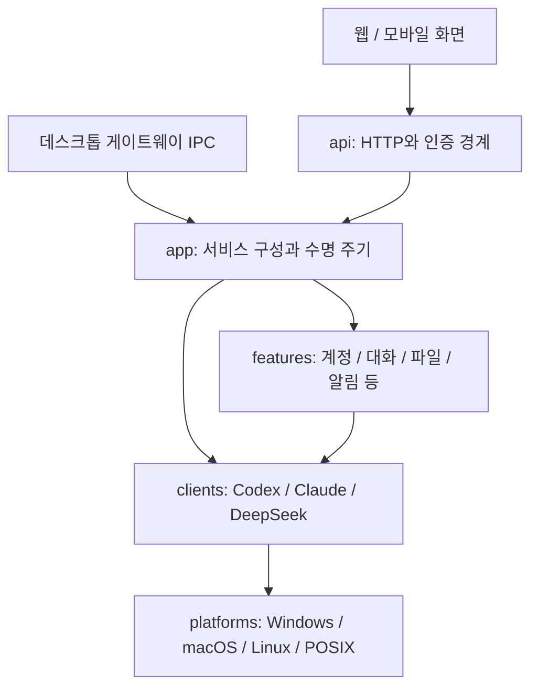

# 개발 아키텍처와 변경 위치 안내

이 페이지에서 수정할 코드를 찾는다. 실행 방식과 프로토콜은 루트의 [ARCHITECTURE.md](../../ARCHITECTURE.md), 플랫폼별 변경 범위는 [platforms/README.md](../../bridge/platforms/README.md)를 참고한다. 이 프로젝트는 **기능, 클라이언트, 운영체제**별로 구성하며 공통 기능의 규칙은 한 곳에서 관리한다.

## 무엇을 바꿀지 먼저 결정하세요

| 필요 | 먼저 보기 | 함께 변경할 부분을 확인할 때 |
| --- | --- | --- |
| Windows 클라이언트 설치 경로, 프로세스, 시작·종료 | `bridge/platforms/windows/` | `bridge/clients/discovery.py`、`desktop_app.py`、`lifecycle.py` |
| Codex 페이지의 APP·CLI·WSL 연결과 Magpie | `bridge/features/endpoints/`、`bridge/clients/manager.py`、`bridge/platforms/windows/wsl.py` | `web/features/clients/client-navigation.js`、[사용 안내](../wsl-codex.md)、[검증 기록](windows-wsl-validation.md) |
| macOS 화면 보호기, 손쉬운 사용, Claude 네이티브 보조 프로그램 | `bridge/platforms/macos/claude.py`、`claude-helper.swift` | `bridge/clients/claude/setup.py` |
| Ubuntu 설치 검색, 데스크톱 실행, IPC | `bridge/platforms/linux/`、`platforms/posix/` | [Linux 안내](../linux.md) |
| 로컬 Linux Codex의 권한 기능과 보조 채팅 권한 확인 | `bridge/features/sessions/linux_permissions.py`、`linux_side_chat.py` | `bridge/clients/codex/catalog.py`、`web/features/chat/permissions.js` |
| 특정 클라이언트의 메시지, 권한, 모델, 계정 | `bridge/clients/codex/`、`claude/`、`deepseek/` | `bridge/clients/manager.py`, 해당 웹 기능 모듈 |
| 로그인, 페어링, 신뢰하는 휴대폰 | `bridge/features/auth/` | `bridge/api/httpd.py`, `mobile/`의 네이티브 영구 저장 |
| Codex 계정 전환, API, 사용 한도, 모델 목록 | `bridge/features/accounts/` | `bridge/clients/desktop_app.py`, `web/features/accounts/` |
| 로컬 CLI 연결의 저장·선택·확인 | `bridge/features/accounts/cli_access.py`、`cli_sync.py` | `bridge/clients/claude/cli_session.py`, `web/features/accounts/cli-access.js` |
| CLI 네이티브 연결과 SSH 검색 | `bridge/clients/codex/app_server.py`、`cli_session.py`、`remote.py` | `features/sessions/store.py`、`app/service.py`; [연결 경계](../codex-cli.md) |
| 대화 기록, 승인, Plan·Goal, 보조 채팅 | `bridge/features/sessions/` | `bridge/app/service.py`, `web/features/chat/` |
| 연결별 새 프로젝트 생성, 디렉터리 탐색·등록 | `bridge/features/sessions/create.py`、`projects.py`、`bridge/clients/manager.py` | `web/shared/project-picker.js`、[새 프로젝트 채팅](../project-chats.md) |
| 새 채팅의 모델·추론 강도와 같은 계정의 캐시 | `bridge/features/sessions/creation_models.py`、`bridge/features/accounts/models.py` | `web/shared/creation-model-picker.js`; 네이티브 첫 입력의 설정은 각 클라이언트 어댑터에서 처리 |
| 공통 대화 메뉴, 네이티브 이름 변경·프로젝트, Bridge 표시 분류 | `web/features/chat/session-menu.js`、`bridge/features/sessions/organization.py`、`display_metadata.py` | `app/service.py`、`features/endpoints/wsl.py`; `sessions/store.py`는 네이티브 프로젝트 소속을 조회 |
| 파일, 이미지, 업로드·다운로드, Git | `bridge/features/workspace/` | `web/features/workspace/`、`web/shared/image-viewer.js` |
| 소스 강조 표시, PDF·HTML 미리보기·전체 화면, 디렉터리로 돌아가기 | `web/features/workspace/` | `bridge/api/html_preview.py`、`httpd.py`, 모바일 네이티브 탐색; [모듈 규칙](../../web/README.md#파일-읽기-모듈) |
| 채팅·Markdown 파일의 Mermaid 다이어그램, 소스, 전체 화면 | `web/shared/mermaid-*.js`、`markdown.js` | `bridge/api/mermaid_render.py`, 중계와 iOS 하위 페이지 탐색; [모듈 규칙](../../web/README.md#mermaid-preview) |
| Codex 채팅 내 visualize 대화형 차트 | `web/shared/visualize*`、`bridge/features/workspace/visualize.py` | `bridge/api/visualize.py`、`app/service.py`, 중계와 Android·iOS 미리보기 탐색 |
| Claude 사용 한도의 수동 조회와 성공한 조회의 스냅샷 | `bridge/clients/claude/accounts.py` | `web/features/accounts/client-accounts.js`; [결정과 경계](../../.agents/notes/implemented/bug-fix/2026-10-12-keychain-access-and-manual-quota.md) |
| 터미널 세션과 명령 | `bridge/features/terminals/manager.py` | `bridge/platforms/windows/terminal.py`、`posix/terminal.py` |
| 알림, 백그라운드 확인, 이벤트 커서 | `bridge/features/notifications/` | `desktop/features/notifications/`, `mobile/android/`、`mobile/ios/` |
| LAN, 도메인, SSH, Tailscale, 중계 연결 | `bridge/features/network/` | `desktop/features/connections/`, 독립 서비스 `relay/` |
| 게이트웨이 또는 Codex 업데이트 | `bridge/features/updates/` | `desktop/features/updates/`, 서명·빌드 스크립트 |
| 공통 채팅 기능과 앱 전환 | `web/features/chat/`、`web/features/clients/` | `web/shell/` |
| 좁은 화면, 가로 화면, 넓은 화면의 분할 배치 | `web/layouts/` | 워크벤치 자체의 탭·초안 상태는 `web/features/workspace/`에서 관리 |
| 브라우저와 모바일 앱의 차이 | `web/hosts/` | `mobile/shared/web/`의 공통 주입 스크립트 |
| Android 네이티브 메뉴, 뒤로 가기, 다운로드, 알림 | `mobile/android/` | 선택적 푸시 셸 `mobile/android-push/` |
| iOS 네이티브 메뉴, 탐색, 다운로드, 알림 | `mobile/ios/` | Xcode의 Sources·Resources와 `WebScripts.swift` |
| 데스크톱 게이트웨이 페이지와 모듈 배치 | `desktop/shell/`、`desktop/features/` | `desktop/index.html`、`main.cjs`、`preload.cjs` |

## 목차 및 책임

```text
run.py / desktop.py / stop.py     유지되는 외부 명령 진입점
bridge/
  app/                           시작·중지, 주 서비스, 기능 구성
  api/                           HTTP 라우팅, 요청 검증, 고정 정적 리소스 라우팅
  features/                      공통 기능의 규칙
    auth/ accounts/ sessions/ workspace/ terminals/
    notifications/ network/ updates/
  clients/                       클라이언트 프로토콜과 데이터 형식
    codex/ claude/ deepseek/
    manager.py                   다중 클라이언트 설정, 읽기 요청 병합, 쓰기 작업 기록
    discovery.py                 설치·로그인·기능·실행 상태 취합
    desktop_app.py / lifecycle.py 소유 관계 검증과 안전한 시작·중지 조정
  platforms/                     운영체제와 직접 상호 작용
    windows/ macos/ linux/ posix/
  resources.py                   소스·패키징된 런타임의 리소스 위치 확인
web/                             웹과 모바일이 공유하는 채팅 화면
  shell/ features/ shared/        공통 기능과 페이지 구성
  hosts/                         browser / iOS / Android 호스트 환경별 처리
  layouts/                       좁은·중간·넓은 화면과 컨테이너 분할 배치
desktop/                         데스크톱 게이트웨이 셸과 기능 페이지
mobile/
  ios/ android/                  플랫폼별 네이티브 셸, QR 스캔, 알림, 다운로드
  shared/web/                    두 앱에 함께 포함하는 공통 주입 스크립트
  android-push/                  Android 선택적 푸시 빌드 설정
relay/                           독립 중계 서비스와 관리 페이지
scripts/                         테스트, 빌드, 검증, 통제된 스모크 테스트 진입점
tests/                           Python·Node 회귀 검사; browser/는 별도 브라우저 픽스처
```

`features/`는 허용할 기능과 규칙을, `clients/`는 각 클라이언트와 상태·명령을 주고받는 방식을, `platforms/`는 운영체제에서 검색·실행·종료·통신하는 방식을 담당한다. 플랫폼 모듈에서 `clients`, `features`, `app`을 역으로 가져와서는 안 된다. 플랫폼 디렉터리의 `AGENTS.md`에는 해당 운영체제에서 작업하는 Codex가 따라야 할 제약이 있다.

아래 그림은 코드를 읽을 때 따라갈 호출 흐름이다. 모듈 사이에 이미 있는 협업 의존성은 생략했다.



## 요청에 따라 읽기

**Codex 대화 전송:** `web/shell/app.js`가 요청을 구성하고, `api/httpd.py`가 로그인과 CSRF를 검증한다. `app/service.py`는 대화와 원본 데스크톱 owner를 확인하고, `clients/codex/ipc.py`는 허용된 프로토콜 메시지를 보낸다. `clients/codex/transport.py`는 로컬 소켓이나 Windows 명명된 파이프를 선택한다. 메시지·승인 정규화는 `features/sessions/model.py`, 기록은 `store.py`, 타임라인은 `timeline.py`에서 처리한다.

**Claude·DSH 대화 작업:** 공통 페이지 모듈 `web/features/clients/desktop-sessions.js`가 HTTP를 호출한다. `clients/manager.py`는 클라이언트 활성화 상태, 동시 읽기 전용 요청 병합, 쓰기 기록을 처리한 뒤 해당 `adapter.py`를 호출한다. Claude의 mailbox와 `connector.js`, DSH의 `host.mjs`가 실제 연결 프로토콜의 경계다. 모델이나 권한의 차이는 해당 클라이언트 어댑터에서 처리한다.

**새 에이전트를 추가할 때의 공통 경계:** 메시지 표시, 작업 상태, 첨부 미리보기, 파일 위치 확인은 `web/features/chat/`, `web/shared/`, `bridge/features/`의 기존 기능을 먼저 재사용한다. ZCode Mac Test 연결도 같은 경계를 따른다. 모델, Skill, 알림, 계정 작업은 [공통 기능 기록](../../.agents/notes/implemented/feature/2026-10-31-zcode-shared-capabilities.md)을 참고한다. 어댑터는 네이티브 데이터를 변환하고 검증된 기능을 보고하며 네이티브 작업을 실행한다. 공통 구성 요소는 기능 정보와 정규화된 데이터에 따라 동작하며 에이전트 이름별로 처리 흐름을 복제하지 않는다. 기존 공통 작업 상태 진입점은 `renderChatProgress`이며 규칙은 [공통 네이티브 작업 상태 표시](../../.agents/notes/implemented/feature/2026-10-29-shared-chat-progress.md)를 따른다. 아직 검증하지 않은 네이티브 기능은 제한된 상태로 남겨야 하며 공통 계층에서 추측해 구현해서는 안 된다.

메시지 대기열, 구버전 미확인 기록의 복구, 연결별 지원 범위는 [메시지 관리](../message-management.md)를 참고한다.

기록의 첫 화면과 실시간 제어를 분리하는 방식, 연결별 페이징 기능, 로컬 검증 범위는 [기록과 제어 분리](history-control-separation.md)를 참고한다.

**검색과 시작·중지:** `clients/discovery.py`는 선택한 운영체제의 `discovery.py`를 호출하고 계정·연결·기능 정보를 보완한다. `desktop_app.py`와 `lifecycle.py`가 작업 및 프로세스의 소유 관계를 관리하고, 플랫폼의 `desktop.py`는 네이티브 조회·실행·종료만 수행한다. 화면 갱신에서는 프로세스 목록을 한 번 읽어 공유할 수 있다. 종료, 복구, 계정 전환 전에는 다시 검증해야 한다.

**클라이언트 시작·중지 UI:** `web/features/clients/client-lifecycle.js`가 웹·모바일·데스크톱 게이트웨이의 종료 선택지를 통일하고 클라이언트 페이지는 진행 상황과 결과를 표시한다. `clients/manager.py`는 연결 해제, 정상 종료, 사용자가 명시적으로 확인한 Windows 강제 종료를 구분한다. 정상 종료가 실패했다고 자동으로 강제 종료해서는 안 된다. 네이티브 구현에서도 대상 식별 정보와 현재 데스크톱 세션을 검증한다.

**Windows 네이티브 진입점:** `platforms/windows/discovery_ext.py`는 등록된 설치 정보를 읽고 `session.py`는 데스크톱과 상호 작용할 수 있는 상태인지 확인한다. `claude.py`는 네이티브 보조 프로그램의 응답과 profile 검색을, `claude-helper.cs`는 지정한 창의 조작을 담당한다. `codex_quit.py`·`codex-quit-helper.cs`와 `dsh_quit.py`는 정상 종료를, `force_exit.py`는 명시적 강제 종료의 프로세스 검증을 담당한다. 연결 재시도, 취소, 작업 규칙은 클라이언트 계층에 두며 네이티브 보조 프로그램으로 옮겨서는 안 된다.

**SSH 작업 공간:** `app/service.py`는 `clients/codex/remote.py`를 통해 실제 Python 소스를 선택한 원격 호스트에 보낸다. 원격 호스트에는 이 프로젝트 패키지가 설치되어 있지 않으므로 `source_text()`가 읽는 모듈은 독립적으로 실행할 수 있어야 한다. Windows 게이트웨이에서 Linux 호스트에 연결할 때 로컬 운영체제를 기준으로 원격 터미널 구현을 선택해서는 안 된다.

## 단일 시스템에서의 타겟 개발

Windows 전용 수정을 예로 들면, 먼저 `bridge/platforms/windows/AGENTS.md`를 읽고 명명된 파이프, 프로세스 검색, 창 보조 프로그램 중 변경할 위치를 찾는다. 인터페이스와 반환 의미가 그대로라면 해당 디렉터리와 관련 테스트만 수정한다. 로컬 테스트를 통과시키려고 다른 운영체제 구현을 Windows 분기로 바꾸거나 공통 계정·작업 흐름에 플랫폼 우회를 추가해서는 안 된다.

공통 인터페이스를 바꾸면 공통 호출자와 다른 두 운영체제의 구현·계약 테스트도 함께 갱신한다. 운영체제가 같아도 배포 채널, 설치 디렉터리, 아키텍처, 클라이언트 버전은 다를 수 있다. MSIX, AppImage, 심볼릭 링크 등의 기존 검색·검증 로직을 유지한다. Linux에서는 현재 Claude를 검색할 수 있지만 자동 연결은 지원하지 않는다. 디렉터리가 존재한다는 이유로 세 운영체제의 기능이 모두 같다고 판단해서는 안 된다.

여러 컴퓨터에서 작업할 때는 검증한 동일 커밋을 기준으로 `fix/windows-client-discovery`, `fix/linux-terminal` 같은 단기 브랜치를 만든다. 각 커밋은 명확한 변경 하나만 담고 테스트한 운영체제, 클라이언트 버전, 한계를 기록한다. 다시 병합할 때 공통 계층의 변경을 하나씩 검토한다. 공통 기능을 세 개의 장기 브랜치에서 따로 유지하지 않는다.

## 기능을 추가하거나 조정할 때

1. 위 표에서 기능 디렉터리를 찾는다. 기존 요청과 상태 흐름을 먼저 읽고 구성 요소를 재사용한다.
2. 클라이언트 프로토콜의 차이는 해당 클라이언트 디렉터리에서, 운영체제 호출의 차이는 플랫폼 디렉터리에서 처리한다. HTTP 진입점은 검증과 분배만 담당한다.
3. 결과를 알 수 없는 쓰기의 자동 재전송 금지, 작업 보호, 인증·CSRF, 원본 세션의 provider/cwd/owner 등 기존 규칙을 유지한다.
4. 관련 테스트와 기능 설명을 갱신한다. 공개 요청 형식을 바꿀 때는 데스크톱, 웹, Android·iOS, 중계 서비스에서 이 형식을 사용하는 부분을 확인한다.
5. 변경 범위에 맞는 테스트를 실행한 뒤 [검증 안내](../../tests/README.md)에 따라 필요한 공통 회귀 검사를 수행한다. 정적 검사, 모의 테스트, 실제 플랫폼 테스트, 패키징 테스트의 결과를 구분해 보고한다.

## 리소스 및 호환성

- 외부 진입점 `run.py`, `desktop.py`, HTTP URL, 설정·데이터 형식은 유지한다. 내부 Python import는 새 디렉터리로 바뀌었으며 이전 모듈의 별칭 계층은 없다. 프로젝트 밖에서 만든 스크립트가 이전 내부 모듈을 직접 가져오면 [경로 대응표](path-map.json)에 따라 수정한다.
- `web/assets.json`은 단일 파일 또는 선언 순서대로 합칠 CSS 소스 파일을 매핑한다. `bridge/api/assets.py`의 고정 허용 목록이 공개 URL을 결정한다. 매핑을 추가했다고 임의의 파일이 공개되는 것은 아니다. 중계 서비스도 같은 매핑을 사용한다.
- `scripts/gateway-resources.json`은 게이트웨이와 함께 배포할 SSH 소스, 연결 스크립트, 라이선스를 나열한다. 이 파일을 옮기면 목록도 갱신한다. CA 인증서는 계속 TLS 모듈 옆에 배포한다.
- 데스크톱 페이지가 일부 웹 공통 파일을 직접 참조하므로 `desktop/index.html`과 `package.json`의 리소스 목록을 함께 갱신한다. 디스크 경로를 바꾸는 것과 브라우저 공개 URL을 바꾸는 것을 혼동해서는 안 된다.
- 클라이언트 관리 페이지, 상단 전환 메뉴, 하단 탐색은 연결 인스턴스 ID에 따라 재사용한다. 해당 설정에서 만든 프로젝트와 채팅은 그 인스턴스에 속한다. [공통 클라이언트 셸](../../.agents/notes/implemented/architecture/2026-11-02-shared-client-shell.md)을 참고한다.
- 독립 Desktop 설정의 디렉터리 식별·등록·충돌 규칙은 `features/clients/instances.py`, 네이티브 경로와 지연 로딩 실행 환경은 `clients/profiles.py`·`clients/instances.py`에서 관리한다. HTTP는 `family + entry`로 같은 계정·첨부·작업 공간 환경을 선택한다. 웹 초안과 알림 이동에서는 전체 인스턴스 ID를 유지한다. ZCode는 기본 설정만 사용하며 추가 등록 정보가 손상되어도 기본 연결에는 영향을 주지 않는다. 지원 범위와 검증 한계는 [독립 클라이언트 인스턴스](../../.agents/notes/implemented/architecture/2026-11-05-independent-client-instances.md)를 참고한다.
- 로컬 CLI 연결은 게이트웨이에서 관리한다. 기본 Codex CLI와 Desktop은 원본 `CODEX_HOME`을 공유한다. 독립 Codex 클라이언트는 같은 Bridge, 계정 관리, 채팅 구성 요소를 사용하되 연결 ID로 설정 디렉터리·계정·원격 탐색을 분리한다([독립 클라이언트 관리](../../.agents/notes/implemented/feature/2026-11-02-independent-codex-management.md) 참고). 계정 전환 시 계정 저장소와 네이티브 설정을 확인한다. Claude Code API 자격 증명은 게이트웨이의 비공개 디렉터리에 저장하며 선택할 때 원본 Claude 설정 디렉터리의 인증 환경 항목을 갱신한다. 그 디렉터리의 대화 기록과 다른 설정은 유지한다.
- 리소스 경로 회귀 검사는 로컬 `bridge` 패키지가 없는 격리된 Python에서 SSH 소스 정의를 실행한다. 이 검사만으로 실제 SSH, 패키징된 프로그램, 네이티브 보조 프로그램까지 검증했다고 볼 수는 없다.

## 이번 라운드에서 유지되는 경계

`scripts/check-boundaries.py`와 `tests/test_module_boundaries.py`가 의존성 방향을 검사한다. 플랫폼의 역방향 의존성을 금지하며 기능·클라이언트 계층에서 앱·HTTP 의존성을 추가하거나 provider 사이에 상호 참조를 추가해서는 안 된다. 기존 22개 의존성은 `dependency-exceptions.json`에 파일·심볼·이유와 함께 기록되어 있다. 새 위반이나 더 이상 필요하지 않은 예외가 있으면 검사가 실패한다. 이 검사는 의존성이 더 늘어나는 것을 막는 장치이며 기존 결합이 모두 해소되었다는 뜻은 아니다. 개발 절차는 [CONTRIBUTING.md](../../CONTRIBUTING.md)를 참고한다.

이번 구조 정리에서는 운영체제별 구현을 독립적으로 관리할 수 있게 분리하고 기능·클라이언트 모듈의 위치를 재배치했다. `app/service.py`, `api/httpd.py`, 일부 페이지 구성 파일은 여전히 크다. 기존 기능 진입점을 유지해 회귀 위험을 제한했으며 이후에는 실제 기능 요구에 따라 조금씩 분리한다. 줄 수만을 기준으로 파일을 나누지 않는다.

일회성 명령의 `CommandJob`은 SSH로 보내는 소스를 독립 실행 가능하게 유지하기 위해 터미널 모듈 안에 운영체제 분기를 남겨 두었다. 데스크톱 Electron 주 프로세스에도 창·시스템 메뉴의 기존 분기가 있다. 디렉터리를 분리했다고 모든 `sys.platform`·`process.platform` 판단이 사라진 것은 아니다. 모바일은 공통 주입 스크립트를 합치고 네이티브 리소스 로딩의 책임을 분리했으며, 네이티브 컨트롤러의 기존 탐색·보안 콜백은 유지해 디렉터리 정리를 이유로 동작 변경을 확대하지 않았다.

초기 정리의 보관 자료, 비교 결과, 미검증 범위는 [디렉터리 재구성 검증 기록](refactor-verification.md), 이후 iOS·Android와 화면 크기별 레이아웃의 분리는 [UI 계층화 검증 기록](surface-verification.md), Windows 브랜치 병합은 [통합 검증 기록](windows-integration.md)을 참고한다.

이후 Windows·Linux 실기기 검증 브랜치의 출처, 수정 범위, 로컬 회귀 결과는 [플랫폼 검증 브랜치 통합 기록](platform-validation-integration.md)을 참고한다.

## 4개 액세스 인터페이스의 수정 경계

‘iOS·Android·브라우저’와 ‘좁은·중간·넓은 화면’은 서로 독립적인 기준이다. 네 벌의 채팅 기능을 따로 관리하지 않는다. 모바일 브라우저도 브라우저 호스트이며 태블릿·폴더블 기기의 앱은 넓은 화면 배치를 사용할 수 있다. 화면 크기가 바뀌어도 현재 대화, 초안, 탭, 읽던 위치, 사용자의 분할 화면 선택을 유지한다.

- iOS 전용 동작은 `mobile/ios/AGENTS.md`부터 확인한다. Android도 해당 디렉터리에서 시작한다.
- 두 앱이 함께 사용하는 네이티브 메뉴 공간 확보나 클립보드 스크립트는 `mobile/shared/AGENTS.md`부터 확인한다. 소스는 한 곳에 두고 두 앱의 빌드 목록에서 참조한다.
- 좁은·넓은 화면 배치는 `web/layouts/README.md`부터 확인한다. 호스트나 기기 모델로 사용 가능한 공간을 판단해서는 안 된다.
- 브라우저·앱의 기능 진입점 차이는 `web/hosts/README.md`부터 확인한다. 호스트를 나타내는 정보가 네이티브 권한을 부여하지는 않는다.

CSS는 순서가 정해진 소스 목록을 메모리에서 합쳐 제공한다. 기존 공개 스타일 URL과 캐스케이드 순서를 유지하며 번들 파일을 만들거나 조각별 HTTP 요청을 추가하지 않는다. 소스 파일의 수정 시간·크기가 바뀌면 캐시를 무효화하므로 소스를 수정하고 새로고침해 검증할 수 있다. 공통 네이티브 스크립트의 출처 대응표는 `mobile/source-map.json`을 참고한다.
