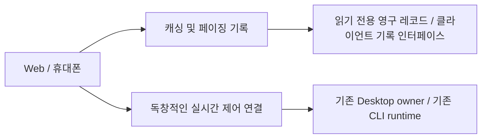

# 이력 표시 및 실시간 제어 분할（2026-10-23）

상태: 현지 지점 `perf/history-control-decoupling`，네이티브 페이징 읽기 전용 프로토타입 기반 `0a27fdf`。
소스 코드 구현 단계는 배포되지 않습니다. 후속 조치 Test 건설 및 설치 승인에 대해서는 기사 끝 부분을 참조하십시오. 모든 변경 사항은 여전히 ​​로컬이며 푸시되지 않았습니다.。

## 행동과 권한의 경계

세션에 들어가면 캐시와 최근 기록이 먼저 표시됩니다. 사용자가 페이지를 넘길 때 이전 콘텐츠를 읽습니다. 역사는 다음과 같이 읽을 수 없습니다.
Desktop 전체 스냅샷이 도착할 경우가 있습니다. 원래의 owner 여전히 실시간 패치 전송, 중지, 승인을 담당합니다.。
기록에는 제어 권한이 없으며 만료된 요청 및 기록이 있습니다. turn 상태는 현재 작업의 기초로 사용할 수 없습니다.。

- `LiveSession.history_state` 기록 저장，`state` 원본 라이브 스냅샷을 유지하고 revision 패치 베이스。
- 백그라운드 읽기 캐시 및 연결 owner 분리; 빠른 기록이 먼저, 느린 기록이 가장 많아야 합니다. owner 지연된 시작 100 ms。
- 첫 번째 디스플레이는 현재 창의 메시지 텍스트만 변환합니다. 페이지를 앞으로 넘기면 창이 확장됩니다. 도구 호출 및 결과는 페이지 전체에서 관련성을 유지합니다.，
  이전 통화를 계속해도 후속 실시간 업데이트가 자동으로 전체 기록으로 확장되지 않습니다.。
- 캐시는 보류 중인 요청을 처리하지 않습니다. 제어 요청은 여전히 ​​실시간으로 확인됩니다. runtime，읽기 전용 요청 병합 또는 재시도 대기열에 들어가지 마세요.。
- 연결이 끊어진 후에는 파일과 사진의 표시 및 인증에 현재와 동일한 역사적 증거가 사용됩니다. 인증, 페어링 및 경로 경계는 변경되지 않습니다.。
- Claude/DSH 이전 페이지는 메시지와 파일 참조만 병합하고 현재 상태, 권한, 승인, 모델 또는 초안을 덮어쓰지 않습니다.。
  세션, 계정 또는 액세스를 전환한 후에는 늦은 페이징 응답이 무효화됩니다.。

## 각 액세스의 기록 소스

| 연결 | 이번 회독 방법 | 보유 제한 |
| --- | --- | --- |
| Codex Desktop | 호환 가능 `thread_history_1.sqlite` 읽기 전용 인덱스, 항목 창별 쿼리; 그렇지 않으면 현재를 읽으십시오 rollout 꼬리의 완성도 turn | 내부 색인 구조 및 진행 상황이 현재 파일과 일치하지 않거나 도구 결과에 해당 호출이 없습니다. 이건 원본이 아니야 Desktop IPC 쪽수 매기기 RPC |
| Codex CLI | 동일한 영구 기록 읽기 및 표시 창을 재사용합니다. 원본 daemon 여전히 실시간 관제를 담당 | 히스토리 캐시 위조 불가 CLI 연결됨; 제어 측은 여전히 ​​더 큰 상태를 달성할 수 있습니다. |
| Claude Code Desktop | 능력지원시 원본을 사용하세요 `getTranscriptTail/getTranscriptPage` | 오래된 연결 스크립트 또는 Cowork 완전한 것을 사용하십시오 transcript；새로운 기능을 사용하려면 연결 스크립트를 업데이트해야 합니다. |
| Claude Code CLI | 이 기계와 SSH 의 JSONL 역페이징; 세션, 파일 버전 및 레코드 경계에 바인딩된 커서 | 단일 페이지 스캔 제한 4 MiB；파일 변경으로 인해 이전 커서가 무효화되고 최근 페이지를 명시적으로 다시 읽습니다. |
| DSH | 네이티브 레코드 페이징, 수정됨 `throughSeq`、사용 `beforeSeq` 이전 페이지 읽기 | 잘린 페이지는 마지막 기록에서 시작할 수 없습니다. turn 현재 상태 추론 |

CLI 의 기록, 메타 정보 및 제어 상태가 정확히 동일하지 않습니다.。Claude CLI 콜드 리딩 및 로그 변경 후에도 메타 정보를 계속 검사해야 합니다.，
예약하다 cwd、권한, 모델 및 상황별 의미；SSH 목록을 백그라운드로 새로 고쳐도 로그는 계속 검색됩니다. 모든 콜드 경로가 선언되는 것은 아닙니다.
고정 비용. 여러 페이지에 흩어져 있는 작업 도구 기록에는 이전 페이지의 작업 컨텍스트가 부족할 수 있습니다. 원본 메시지는 계속해서 앞으로 스크롤될 수 있습니다.。

## A/B 실제 테스트만 읽기

이 기계에 존재하는 것 Desktop、원래 세션 및 계정으로 측정되었습니다. 전체 세션 ID、원래 타이밍과 해시는 기본적으로만 유지됩니다.
`.tmp/history-control-decoupling-20261023/`；채팅 내용이나 계정 자료를 제출하지 마세요.。

다음 표는 공중망, 이동통신망, 휴대폰 렌더링 시간을 제외한 최종 보완 테스트 샘플이다.；B 이 작업 라운드 동안 세션이 계속해서 증가합니다.。

| 색인 | A | B |
| --- | ---: | ---: |
| 최근 역사 읽기 | 6.8 ms | 450.7 ms |
| 첫 번째 화면 메시지 수 | 20 | 20 |
| 스크롤 없이 볼 수 있는 부분 위 JSON | 10,011 B | 10,247 B |
| 앞으로 읽으려면 시간이 걸립니다 | 7.3 ms | 1,443.7 ms |
| 이번 이전 페이지의 메시지 수 | 100 | 65 |
| 이전 페이지 JSON | 45,489 B | 31,499 B |
| 원래 페이지 넘김 커서는 유지됩니다. | 예 | 예 |
| 역사는 통제의 상태가 된다 / 다시 승인을 받아 | 아니요 | 아니요 |

A 기본 영구 인덱스 사용。B 인덱싱 진행상황은 현재와 동일합니다. rollout 일관성이 없으며 사전에 현재 파일의 끝으로 되돌아갑니다.，
오래된 인덱스 표시 방지。B 꼬리가 완성됐네요 turn 독서는 계속 이어질 것입니다 turn 크기 변화。

또 다른 원본 owner 읽기 전용 구독 측정：A 초기 프레임 1,520,151 B、～에 대한 25 ms；B 초기 프레임
94,648,887 B、～에 대한 2.31 s。접힌 본문 텍스트가 약 변환된 후 큰 스냅샷이 도착합니다. 0.7 / 1.6 ms。
**이번 라운드에서는 대규모 스냅샷에 대한 역사적 첫 번째 화면의 의존도가 줄어들었지만 완전히 제거되지는 않았습니다. Desktop → 게이트웨이의 첫 번째 전체 전송。**

## 경량 채널에 대한 독립적인 결과

기존 owner 의 `thread-follower-read-model-settings` 기록을 구독하지 않고도 읽을 수 있습니다.：A/B 평균
404 B，약 소요됩니다. 1.7 / 0.6 ms。모델 설정 메타 정보를 독립적으로 읽을 수 있다는 점만 확인하고 완전한 실행 상태로 간주할 수는 없습니다.、
승인 또는 연결 끊김 복구 채널. 그것으로 선언되지 않았습니다“실시간 제어가 연결됩니다”。

`scripts/prototypes/native_history.py settings --thread <id> --ipc <기존 IPC 길>
--output <프로젝트 .tmp 결과 경로는 다음과 같습니다.>` 개별적으로 다시 테스트할 수 있습니다. follow、기본 읽기 프로세스를 시작하지 않고 설정 내용을 출력하지 않습니다.。
첫 번째 기본 스냅샷은 여전히 ​​패치와 일치합니다. revision，스냅샷을 삭제하고 위치 패치를 직접 적용할 수는 없습니다.。

## 수용 범위

- Python 완전한 소스 코드 회귀 실행 2186 아이템, 실패 없음，44 플랫폼별 아이템/기본 환경을 건너뛰었습니다. 추가 프로토타입 테스트 11 항목이 통과되었습니다. 캐시 덮어쓰기/실시간 상태 격리, 페이지 간 도구 호출, 이전 인덱스 롤백, 파일 액세스, 원본 CLI 제어、
  시뮬레이션 Windows/Linux 로컬 프로젝트가 없는 브랜치 및 패키지 SSH worker。
- Node 전액 반환 892 항목이 통과됨、1 항목을 건너뛰었습니다. 덮어썼다 Claude/DSH 기본 페이징, 현재 상태 보호, 기록 메시지 및 파일 병합, 지연 응답 및 캐싱。
- 현실 Chromium 에서 1366 px 및 390 px 다음 실행 11 항목 내역 상호작용 주장: 첫 번째 화면, 페이지 넘김, 스크롤 위치、
  초안, 이전 페이지 파일 참조 및 읽기 전용 요청이 모두 통과됩니다.。
- 네이티브 진짜 A/B owner、계정、cwd/provider/source 메타정보, 공식 App 문서, 공식 및 Test 설정、
  인증된 신원과 기존 모바일 세션은 사전 및 사후 해시 또는 집계를 통해 확인됩니다. 메시지가 전송되지 않거나 모델이 호출되지 않습니다.。
- 소스 코드 구현 단계가 아닙니다. Windows/Linux 실제 머신에 새 패키지를 배포하는 것은 아직 완료되지 않았습니다. Android/iOS 네이티브 App 실제 기계 수용; 이것들은 있을 수 없다
  소스코드를 공유하거나 Chromium 대안을 통한 좁은 화면。Claude Desktop Linux 원래 기능 경계는 변경되지 않고 그대로 유지됩니다.。

관련 출입구：`tests/test_history_control_separation.py`、`tests/test_claude_cli_history.py`、
`tests/test_desktop_paged_turn_state.py`、`tests/desktop-sessions-ui.test.cjs` 및
`tests/browser/desktop-history.browser.js`。이전 라운드 읽기 전용 API 능력의 증거는 다음을 참조하십시오.
[네이티브 페이징 프로토타입](native-history-prototype.md)。

## Test 설치 승인（2026-10-24）

세 가지 플랫폼 Test 제품을 사용하여 제출 `b299ac4`，버전번호는 아직 `2.1.4-preview.1`。
후속 제출에서는 테스트 픽스처의 리소스 릴리스 순서와 파일 시스템 클럭 타이밍만 수정하고 패키지 제품 코드는 변경하지 않습니다.。

| 플랫폼 | 빌드 및 설치 | 시작 및 읽기 전용 회귀 |
| --- | --- | --- |
| macOS arm64 | 독립적인 Test 적용 범위 업데이트, 서명 및 리소스 해시 패스 | 8788 및 Test 창에서 실행, 패키지에서 모듈 42 항목이 통과되었습니다. 원래의 A/B 최근 페이지와 이전 페이지를 읽습니다. |
| Windows x64 | NSIS 업데이트만 F 그릇 Test，706 설치 파일이 확인되고 통과되었습니다. | 일반 데스크톱 사용자 창, 게이트웨이 상태 확인, 패키지 내 모듈 42 항목 및 정적 리소스 캐시 확인 통과 |
| Ubuntu amd64 | DEB 재설치만 가능 Test，716 설치 파일이 확인되고 통과되었습니다. | 그래픽 데스크탑 창、8788 게이트웨이, 인패키지 모듈 42 항목 및 정적 리소스 캐시 확인 통과 |

Windows 실제 기계가 반납되어 완성되었습니다. Claude JSONL 파일 버전 판단: 기본 파일 사용 ChangeTime，피하다
생성 시간을 콘텐츠 변경 시간으로 간주하여 동일한 길이로 다시 쓴 후 이전 커서나 메타 정보를 다시 쓰고 수정 시간을 복원합니다.。
이 읽기 전용은 파일 메타데이터를 쿼리하고 전체 로그 검사를 추가하지 않습니다.。SSH 독립의 worker 아직 목표 달성 Unix 시스템 읽기。

설치 후 Mac 로컬 머신 HTTP 견본 추출：A/B 최근의 20 조약 11.6/11.0 KB；앞으로 읽으세요 100 구별
～에 대한 47.0/49.3 KB。에 대한 최근 페이지 요청 13–35 ms，구약 성서 7–16 ms；이는 현재 캐시된 상태의 기본입니다.
인터페이스 측정은 콜드 캐시, 공용 네트워크, 셀룰러 네트워크 또는 휴대폰 렌더링 시간을 나타내지 않습니다. 이전 페이지와 현재 페이지, 커서 사이에 중복된 키가 없습니다. epoch
일관성을 유지하십시오. 첫 번째 Desktop 전체 스냅샷은 여전히 ​​존재하며 경계는 위에서 설명한 것과 동일합니다.。

세 가지 플랫폼 모두 공식 버전, 원본 구성, 계정 파일 및 휴대폰 바인딩 보존을 확인합니다.；Mac 의 14 유효한 로그인 바인딩 및 A/B
원래 세션 메타 정보는 변경되지 않습니다. 전송된 세션 메시지, 승인 또는 호출된 모델이 없습니다. 모바일 버전 A/B 사용자가 온보딩 및 재테스트를 완료합니다.。
Windows 임시 파일과 빌드 아티팩트는 다음 위치에 있습니다. F 디스크; 성공적으로 설치한 후 이전 파일을 삭제하세요. Test 설치 패키지 및 중간 제품 복제，
현재 설치된 버전을 최신 버전으로 유지하세요. Windows/Ubuntu 설치 패키지 및 둔감화 승인 기록。

지역 기록：`.tmp/history-control-verified-20261023/`；그 중 빌드 매니페스트 고정 소스 제출 및 설치 패키지 해시、
Test 절연 범위 및 테스트 픽스처 개정은 포함되지 않음 Git 제출 중。
