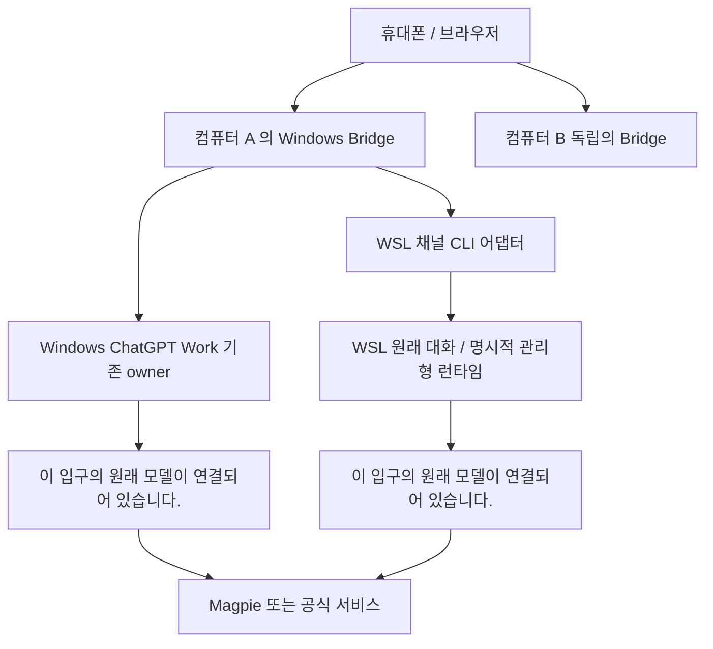

# Windows ChatGPT、WSL CLI 여러 컴퓨터에 액세스할 수 있는 계획

상태: 초기 디자인 제안. 로컬 머신 Windows / WSL 및 Magpie 구현이 수행되었으며 현재 기능과 경계는 다음에서 확인할 수 있습니다. [사용 지침](../wsl-codex.md)그리고[기록 확인](windows-wsl-validation.md)；다른 컴퓨터는 보류 중입니다.。
날짜：2026-10-16。

## 목표 및 확정된 시나리오

사용자는 현재 다음 위치에 있습니다. Windows 사용 ChatGPT 데스크탑 소프트웨어 내에서 Codex/Work，동시에 WSL 단말기 사용 Codex CLI；모델 액세스 권한은 다음에서 제공됩니다. Magpie 관리하다. 향후 다른 컴퓨터도 추가될 예정입니다. Codex。

대상이 동일한 세트에 있습니다. Bridge 컴퓨터와 포털은 인터페이스에서 명확하게 선택되며 각 포털의 원래 세션, 인증, 공급자, 작업 디렉터리 및 실행 소유권이 유지됩니다. 모델 흐름은 원본을 따라 계속됩니다. Codex → Magpie → 업스트림 경로 전송。

이 제안은 두 포털이 공통 구성을 공유하고 병합이 필요하지 않다고 가정하지 않습니다. Windows 및 WSL 의 `.codex`，또한 읽기 기록은 실행 권한을 얻는 것으로 간주되지 않습니다.。

## 현재 코드와 격차

| 이미 구현됨 | 이 시나리오에 미치는 영향 |
| --- | --- |
| `bridge/clients/discovery.py` 클라이언트 유형별로 찾아보세요 Codex 데이터 카탈로그 및 데스크톱 프로그램 | 여러 가지를 완전히 표현할 수 없습니다 Codex 환경 및 운영입구 |
| `bridge/features/sessions/store.py` 필터 `Codex Desktop`、`codex_work_desktop` 데스크톱 소스를 기다리는 중 | 평범한 CLI 세션에는 독립적인 소스 식별 및 목록 전략이 필요하며 단순히 모든 필터링을 취소할 수는 없습니다. |
| `bridge/app/service.py` 로컬 머신으로 Bridge 데스크톱 녹음으로 SSH host 대화 정리 | 기존 환경에서 기본이어야 함 host 보충적인 입구 신원; 토종의 `hostId` 프로토콜의 의미 |
| `bridge/clients/codex/remote.py` ～에서 App 메타데이터 획득 SSH 프로젝트, 전송은 여전히 ​​데스크톱에 따라 다릅니다. IPC owner | 이것은 데스크톱 관리를 위한 원격 작업 공간이며 다른 컴퓨터나 동일하지 않습니다. WSL 내에서 독립적으로 실행 CLI |
| `bridge/features/accounts/accounts.py` 기본 구성에 대해 인증 및 기본 공급자 전환 | 실제 공유 범위는 구성에 따라 격리되어야 합니다. Magpie 동일한 필드를 동시에 관리 |
| `bridge/clients/codex/catalog.py` 유효한 공급자 구성을 읽은 후 모델을 쿼리합니다. | 재사용 가능하지만 확인 필요 Magpie 각 환경의 모델 카탈로그, 결합된 액세스 모드 및 자격 증명 소스 |
| 기존 네트워크 연결 및 모바일 포털 관리 | 여러 컴퓨터는 중앙 서비스를 먼저 도입하지 않고 먼저 독립 게이트웨이 연결을 재사용합니다. |

위의 내용은 이 소스 코드 읽기를 기반으로 합니다. 실제 설치된 버전과 사용자의 개인 구성은 아직 확인되지 않았습니다.、WSL 네트워크 모드 또는 실행 중인 세션。

## 제안된 ID 및 라우팅 모델

네 가지 개념을 구별하라：

| 개념 | 예 | 신원 규칙 |
| --- | --- | --- |
| 컴퓨터/게이트웨이 | Office 데스크탑 및 노트북 | 페어링 바인딩을 위한 안정적인 ID; 주소, 표시 이름 및 임시 포트는 ID가 아닙니다. |
| 실행 환경 | Windows 사용자 환경、WSL Ubuntu 사용자 환경, 독립적 SSH 환경 | 문서 운영 체제, 사용자, 배포 또는 호스트 바인딩 경로는 항상 해당 환경에서 해석됩니다. |
| Codex 입구 | Windows ChatGPT Work、WSL CLI、향후 독립신규 추가 CLI 설정 | 고집 `endpointId`，검증된 런타임, 구성 디렉터리 및 지원 기능을 바인딩합니다. |
| 모델 액세스 | 공식적인、Magpie、Bridge 관리 API | 독립하다 Codex 문; 포털은 실제 구성에 따라 다른 액세스를 사용할 수 있습니다. |

버전 번호와 항목 레지스트리를 늘리도록 구성합니다. 이전 단일 포털 구성은 기본 기본 데스크탑 포털로 명시적으로 마이그레이션되어 기존 페어링, 기록 및 기본 선택 사항을 유지합니다.。

인앱 세션 참조는 기본을 유지하면서 컴퓨터와 포털 범위를 늘립니다. `hostId + conversationId + ownerClientId`。HTTP 요청은 등록된 포털에만 제출되어야 합니다. ID，서버는 실제 경로를 분석하고 프로그램을 실행하며 휴대폰에서 전달된 호스트, 배포판, 구성 디렉터리 또는 실행 파일을 허용하지 않습니다.。

동일한 기본 세션이 여러 보기에서 발견될 수 있습니다. 실제 세션으로 저장/실행 소유권은 통합 바인딩을 설정하여 두 실행기가 서로 다른 입구 표시로 인해 동시에 동일한 스레드를 제어할 수 있도록 합니다. 컴퓨터 복사 또는 구성 복제 후에는 장치 ID를 다시 바인딩해야 하며 동일한 스레드를 기반으로 할 수 없습니다. UUID 세션 병합。

초안, 첨부 파일, 프로젝트 키, 디렉터리 캐시, 알림 커서, 작업 확인 및 보류 중인 확인이 모두 항목 범위에 추가됩니다. 모델과 계정 캐시는 구성 버전과 계정 캐시를 더욱 차별화합니다. provider；인증이 변경되면 이전 캐시를 무효화합니다. 동일한 기본 세션을 중복 제거하라는 알림。

## 권장 배포 방법

첫 번째 단계에서는 한 대의 컴퓨터가 예약됩니다. Windows 관리되는 게이트웨이 Windows 입학 및 등록 WSL 입구。WSL 사용자가 추가 공용 네트워크 서비스를 배포하도록 요구하지 않으려면 제한된 하위 프로세스 채널을 먼저 사용하십시오. 후속 조치를 취하는 경우 CLI 영구 연결은 상주 커넥터를 사용한 다음 수명 주기와 기본 인증을 독립적으로 설계해야 합니다.。

다른 컴퓨터는 각각 자체 게이트웨이를 실행하며 전화기는 여러 쌍의 연결을 저장하고 이들 사이를 전환합니다. 안정적인 스위칭을 우선시하십시오. 후속 기능으로 컴퓨터 전체의 목록을 병합하고, 장치별로 별도로 데이터에 액세스하고 승인하며, 하나의 게이트웨이를 사용하여 휴대폰에 액세스할 수 없습니다. Cookie 다른 게이트웨이로 이동。

기존 데스크탑 SSH 프로젝트는 기본으로 유지됩니다. host 및 owner，독립 게이트웨이로 자동 등록되지 않습니다. 기록 공유 릴레이 문서에는 보관된 기능이 포함되어 있습니다. 이 계획에서는 전제 조건으로 이 항목의 복원을 요구하지 않습니다.。

## WSL 액세스 및 CLI 실행 경계

### WSL 통로

- Windows 플랫폼 계층은 릴리스 상태, 프로세스 및 기본 채널을 담당합니다. 공유사업은 아직이다 features，Codex 데이터와 프로토콜은 여전히 ​​존재합니다. clients。
- 기본값은 릴리스 상태만 열거하는 것입니다. 폴링, 나열 또는 알림으로 인해 중지된 작업을 시작하지 마십시오. WSL 디스트로。
- 사용자가 명시적으로 추가됨/연결되면 선택한 배포판 및 사용자 환경 내에서 확인 Codex 버전, 구성 디렉터리 및 프로그램 경로. 각 릴리스, 사용자 및 사용자 정의를 독립적으로 유지 `CODEX_HOME`。
- 않을 것이다 `C:\...`、`/home/...` 또는 UNC 경로는 직접 혼합됩니다. 파일, 터미널, 업로드 및 다운로드는 여전히 대상 환경 검증 작업 공간의 경계에 있습니다.。
- 제한된 명령은 매개변수 배열과 고정 프로토콜을 사용합니다. 휴대폰은 아무것도 제공하지 않습니다. shell 명령, 로그 및 진단은 자격 증명을 출력하지 않습니다.。
- WSL 중지, 최대 절전 모드 또는 다시 시작 후에는 이전 연결이 무효화됩니다. 읽기 전용 연결은 본인 확인 후 복원되며 쓰기 결과는 알 수 없으므로 재생되지 않습니다.。

### 세 종류 CLI 기능은 별도로 제공됩니다.

| 대화 형식 | 행동 계획 |
| --- | --- |
| 기존 공통 CLI 세션 기록 | 역사와 출처는 독립적으로 표시될 수 있습니다. 데스크탑이 필요하지 않습니다 owner |
| 터미널에서 실행 중 CLI 대화 | 먼저 설치 버전에 원래 실행 프로그램에 바인딩된 지원 채널이 있는지 확인하세요. 검증 전에는 보기 전용으로 표시되어 전송, 승인, 중지가 금지됩니다. |
| 사용자가 명시적으로 선택 Bridge 관리하다 CLI 대화 | 새로운 제한을 추가할 수 있습니다 app-server 동일한 런타임에서 지속적인 상태, 전달 및 승인을 제공하는 어댑터. 데스크톱 딥링크 활성화 없음 |

공식적인 app-server 제공된 문서 `thread/read`、`thread/resume`、`turn/start` 인터페이스는 있지만 이를 기반으로 한 증거는 없습니다.“새로운 것을 시작하세요 app-server 어떤 달리기에도 부착 가능 TUI”。따라서 새 프로세스를 시작하여 동일한 프로세스를 복원할 수 없습니다. UUID，원래 터미널 세션을 인수하겠다는 주장。

와카하라 CLI 안정적인 공유 제어 채널이 없으면 완전한 전화 제어를 위해서는 명시적으로 관리되는 실행 방법이 필요합니다. 기존 스레드를 계속하기 전에 원래 실행기가 해제되었고 원래 세션 설정이 정확하게 복원될 수 있는지 확인해야 합니다. 확인할 수 없으면 읽기 전용으로 유지하세요.。Bridge 자체 임대는 참여 조정만 가능 Bridge 과정에 참여하지 않은 일반 사람들이 이를 증명할 수는 없습니다. CLI 중지됨。

첫 번째 단계에서는 구조화된 승인을 구현하기 위해 화면 텍스트나 터미널 키 입력 시뮬레이션을 사용하지 않습니다. 지원되지 않음 Goal、계획 모드, 권한 옵션 등의 기능은 입력 기능 표에서 명시적으로 비활성화되어 있으며, 위장되지 않은 데스크탑 기능도 이미 동등하게 사용 가능합니다.。

## Magpie 상생전략

### 구성 관리 권한

각 실제 구성 디렉터리에 대해 관리 모드를 명시적으로 선택하는 것이 좋습니다.：

- **외부 관리（이 시나리오에서는 기본값））**：Magpie 공급자, 인증 관련 액세스 구성 및 모델 카탈로그 관리；Bridge 유효한 액세스 읽기 및 제어 가능 세션 읽기。
- **Bridge 관리하다**：기존 계정 전환을 유지하고, 실행하기 전에 실제로 디렉터리의 영향을 받는 모든 항목에 따라 작업, 프로세스 및 구성을 확인합니다.。

관리 모드는 보안 인증의 소스가 아닙니다. 로 표시되어 있어도 Bridge 관리를 수행하려면 여전히 구성이 완료되었는지 확인해야 합니다. Magpie 또는 사용자 수정; 동일한 디렉터리 또는 별칭 경로는 공유 쓰기 범위로 인식되어야 하며 endpointId 잠그다。

외부 관리 모드에서는 자동으로 가져오지 않습니다. `bridge_api`，청소 안함 Magpie provider，교체도 안 함 `auth.json`、`openai_base_url` 또는 모델 디렉토리 참조. 원본인 경우 모델 선택 owner 현재 세션에 명시적으로 적용할 수 있는 세션 수준 설정을 지원합니다. 그렇지 않으면 프롬프트는 다음과 같습니다. Magpie 실제 버전에 따라 재시작이 필요한지 수정하여 문의해 보세요.。

외부 관리에서 다음으로 전환 Bridge 관리는 독립적인 작업이며 영향을 받는 구성 및 항목을 표시하고 모든 공유 구성 사용자를 확인해야 합니다. 동시 수정 사항이 발견되면 종료합니다. 오류 복구를 이전 스냅샷으로 덮어쓰면 안 됩니다. Magpie 새로 작성된 내용。

### 모델 및 상태 식별

- 동시에 확인하세요 `[model_providers.magpie]` 및 `openai_base_url` 및 기타 유효한 구성 경로를 기반으로 할 뿐만 아니라 `model_provider == magpie` 판사。
- 예약하다 Magpie 모델 ID、라우팅 그룹 ID 모델 디렉토리 의미론을 사용합니다. 기본 런타임 디렉터리 인터페이스가 해당 모델을 올바르게 제공할 수 있는지 확인하는 데 우선순위를 두고 변경을 강제로 수행하지 마세요. Bridge 평범한 API 가져오기 프로세스。
- 모델 쿼리는 해당 항목이 위치한 환경에서 실행됩니다.；Windows Bridge 환경 변수는 나타내지 않습니다. WSL CLI 획득 가능한 자격 증명。
- 구성 파일은 구성 상태만 나타내며 실행 중임을 확인하는 데 사용할 수 없습니다. CLI 핫 업데이트되었습니다. 구성된 액세스와 원본 액세스를 구별합니다. owner 보고된 현재 설정과 실제 확인 가능한 연결 상태 비교。
- 라우팅 그룹의 실제 백엔드는 다를 수 있습니다. 신뢰할 수 있는 응답 메타데이터가 없는 경우에만 요청된 모델을 표시합니다./라우팅 그룹은 최종 업스트림 계정이나 모델을 추측하지 않으며 공식 계정 할당량을 표시하지 않습니다.。
- Magpie 연결을 끊거나 오류를 반환할 때 명확한 이유 표시；Bridge 공식 웹사이트로 자동 전환하지 말고, 스스로 모델을 변경하지 말고, 알 수 없는 결과가 있는 요청을 재생하지 마세요.。

### Windows 및 WSL 회로망

먼저 진단하세요 Magpie 실제 운영 위치, 주소 및 WSL NAT/미러 네트워크. 각각에서 Windows 및 WSL 구성된 주소를 확인하고 양쪽을 가정하지 마십시오. `127.0.0.1` 똑같은 서비스인데。

읽기 전용 진단은 유효한 구성, 연결 및 모델 디렉터리를 확인하고 모델 작업을 보내지 않습니다. 환경 간 비루프백 액세스가 관련된 경우 프로젝트의 원본 HTTPS、자격 증명 및 리디렉션 규칙 존재하는 경우 Magpie 구성이 요구 사항을 충족하지 않으며 특정 이유를 사용자가 조정해야 합니다. 검증이 완화되지 않거나 호환성을 위해 모니터링이 자동으로 열립니다.。

첫 번째 버전 호환성 대상은 다음과 같습니다.“기존의 Magpie 구성이 계속해서 정상적으로 작동합니다.”。휴대전화에서 직접 조작 Magpie 관리 인터페이스, 업스트림 키 동기화 및 라우팅 그룹 수정은 필수 조건이 아닙니다.。

## 단계적 구현

| 단계 | 주요 배송 | 완성기준 |
| --- | --- | --- |
| 0：현장 읽기 전용 검증 | Windows ChatGPT 버전 및 기본 액세스가 이미 실행 중입니다. WSL 가운데 CLI 원천/owner、Magpie 구성 모드 및 네트워크 진단 | 자격 증명 없이 기능 목록을 가져옵니다. 확인하다 CLI 채널 타당성을 제어하고 모델 작업을 시작하지 않음 |
| 1：입국 신원 및 격리 | 포털 레지스트리, 레거시 구성 마이그레이션, 라우팅 및 캐싱/초안/영수증 격리 | 기존 데스크톱 운영을 유지합니다. 같은 이름과 같은 스레드를 가진 다른 항목 UUID 교차 쓰기가 없습니다. 공유 기본 세션은 제어를 복제하지 않습니다 |
| 2：WSL 읽기 전용 + Magpie 공존하다 | WSL 플랫폼 채널、CLI 기록 정책, 외부 관리 모드, 환경별 읽기 액세스/모델 | Windows 및 WSL 세션은 동시에 표시됩니다. 구성 및 기록 원본 파일은 변경되지 않습니다. 중지된 배포는 백그라운드에서 깨어나지 않습니다. |
| 3：CLI 작업 완료 | 단계별로 0 결과는 신뢰할 수 있는 소스에 액세스됩니다. owner 채널 또는 명시적으로 호스팅된 전달 CLI 모델 | 동일한 실행기 내에서 이벤트 전송, 스트리밍, 승인 및 중지 원래 터미널 점유를 확인할 수 있습니다. 조건을 충족하지 않는 세션은 여전히 ​​읽기 전용입니다. |
| 4：다른 컴퓨터 | 여러 연결을 재사용하고 장치 ID, 오프라인 및 취소된 상태를 완료합니다. 나중에 집계 목록을 만들어 보세요. | 두 대의 컴퓨터를 별도로 페어링하고 전환할 수 있습니다. 오프라인일 때 실수로 다른 컴퓨터로 전송하지 마십시오. 장치 자격 증명이 혼합되지 않습니다. |

단계 0 의 CLI 결론은 무대다 3 디자인 임계 값. 단계 1、2、4 아이덴티티 디자인은 의존하지 않습니다. CLI 바로 인수할 수는 있지만 무대는 2 읽기 전용 전달은 전체 내용으로 설명할 수 없습니다. CLI 제어 요구 사항 완료。

## 모듈 배치 지점

- `bridge/features/endpoints/`（추가 권장 사항）: 포털 등록, 마이그레이션, 기능 및 액세스 범위 저장되지 않음 OS 부르다。
- `bridge/clients/codex/`：테이크아웃 desktop 및 CLI 프로토콜 적응, 메시지 재사용, 기록 및 디렉터리 정규화 임의 노출을 방지하기 위해 제한된 작업의 화이트리스트를 유지합니다. RPC。
- `bridge/platforms/windows/`：WSL 기본 검색 및 채널 필수의 Linux 네이티브 로직 넣어 Linux/POSIX，플랫폼은 수입 업무를 역전시키지 않습니다.。
- `bridge/app/service.py`、`bridge/api/httpd.py`：서버에 등록된 출입문에 따라 배포하고 계속해서 인증을 진행합니다.、CSRF、owner 검증 및 알 수 없는 결과 보호。
- `bridge/features/accounts/`：구성 관리 모드, 공유 구성 소비자 검사, 드리프트 감지 및 복구 보호。
- `web/features/clients/`、`web/features/chat/`、데스크탑 구성 페이지: 컴퓨터/항목 선택 및 능력 팁. 화면 너비나 호스트에 따라 비즈니스 상태가 복사되지 않습니다.。
- 휴대폰의 기본 측면은 다중 연결 저장 또는 탐색에 필요할 때만 연결됩니다. 새 리소스는 기존 목록과 동기화되며 원격 소스 모듈은 독립적이고 실행 가능한 상태로 유지됩니다.。

## 검증 및 승인

1. **격리 및 마이그레이션**：이전 구성 업그레이드, 주소 중복 및 장치 복제, 동일한 스레드 UUID、공유 구성 별칭, 포털 전환의 느린 응답 및 초안, 알림 중복 제거。
2. **Magpie 공존하다**：다양한 유효한 구성 모드, 로컬 모델 디렉터리 및 라우팅 그룹, 외부 구성 변경, 디렉터리 쿼리 실패、Magpie 오프라인; 구성 확인/auth/역사는 이루어지지 않았다 Bridge 예상치 못한 쓰기。
3. **WSL**：다중 릴리스, 다중 사용자, 사용자 정의 디렉토리, 경로 경계, 공백 및 비- ASCII 길, 멈춰라/다시 시작/최대 절전 모드, 네트워크 모드 차이; 릴리스 시작을 위한 폴링 방지。
4. **실행 및 실패**：평범한 CLI 점유하다, 원본 owner 사라졌고, 승인 대기 중이며, 전송 후 연결이 끊겼고, 게이트웨이가 다시 시작되었습니다. 알려지지 않은 모든 결과는 기록으로 보관되며 자동으로 재전송되지 않습니다.。
5. **안전**：미등록 포털, 포털 간 위조 세션/승인, 오류 owner、어떤 경로/프로그램, 자격 증명 유출, 컴퓨터 간 Cookie 오용, 계속 거부。
6. **작동 범위**：일치하는 백엔드를 먼저 수행하십시오./Node Fixture를 합성하고 승인에 따라 진행합니다. Windows ChatGPT、WSL CLI、현실 Magpie 두 번째 컴퓨터와의 공동 디버깅. 브라우저는 실제로 확인을 위해 단일 열을 렌더링합니다. 소스 코드, 시뮬레이션, 실제 작동 및 패키징 결과는 별도로 기록됩니다.。

이 섹션은 초기 계획 중 상태를 기록합니다. 후속 구현 및 테스트는 [Windows / WSL 기록 확인](windows-wsl-validation.md)대상。

## 참조하다

- [프로젝트 개발 탐색](README.md)、[작동 메커니즘](../../ARCHITECTURE.md)、[계정 전환](../account-switching.md)、[검증입력](../../tests/README.md)。
- [OpenAI 공식적인 app-server 문서](https://learn.chatgpt.com/docs/app-server)：기록 읽기, 스레드 복원 및 라운드 실행을 위한 인터페이스 의미 체계。
- [Magpie 중국어 설명](https://github.com/yetone/magpie/blob/main/README.zh-CN.md)：게이트웨이, 모델 라우팅 및 WSL 지원 지침。
- [Magpie 구성 참조](https://github.com/yetone/magpie/blob/main/docs/reference.md)：Codex provider、모델 디렉토리 `openai_base_url` 액세스 방법을 기다리는 중。

외부 문서 액세스 날짜는 다음과 같습니다. 2026-10-16；구현 시 사용자가 실제로 설치한 버전과의 비교가 필요하며, 현재 업스트림 문서는 로컬 머신의 검증된 동작으로 볼 수 없습니다.。
